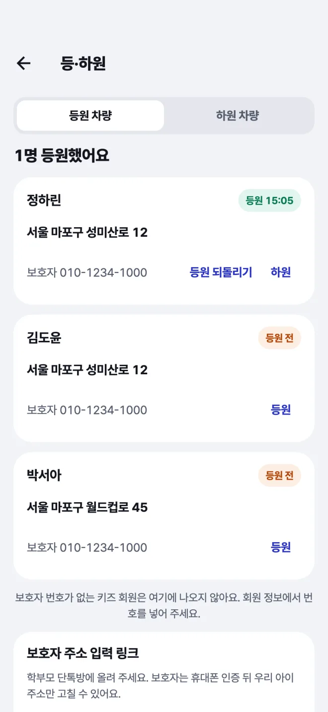

# 키즈 등·하원

아이가 오면 **등원**, 집에 가면 **하원**을 기록하고 보호자에게 알림톡을 보내요. 보호자 연락처가 있는 회원이 키즈 회원이에요.

## 등원과 하원

**☰** 메뉴의 **등하원**을 열어요. 웹은 출석 화면의 등하원 탭이에요.

1. 아이를 태우거나 아이가 오면 **등원**을 눌러요. 출석이 기록되고 보호자에게 알림이 가요.
2. 데려다줄 때 **하원**을 눌러요.
3. 잘못 눌렀으면 되돌리기를 눌러요.

<figure></figure>

키오스크나 직접 출석으로 와도 등원 알림이 가고, 같은 날 두 번 와도 한 번만 가요. 알림은 [자동 알림톡](../contracts/auto-messages.md)에서 꺼요. 하원 차량 탭은 같은 주소끼리 묶어 보여 줘요.


등원을 되돌리면 출석이 취소되고 횟수권은 1회가 돌아와요. 이미 보낸 알림톡은 취소되지 않아요.


## 픽업 주소

카드의 주소 줄을 눌러 등원 주소, 하원 주소, 메모를 고쳐요. 하원 주소를 비우면 등원 주소로 데려다줘요.

보호자가 직접 넣게 하려면 화면 아래 **보호자 주소 입력 링크**를 **복사**해 학부모 단톡방에 올려요. 보호자는 로그인 없이 휴대폰 인증만 하고 자기 아이 주소를 넣어요. 주소는 암호화해 보관하고 차량 운행에만 써요.

* **새로 만들기**를 누르면 예전 링크는 열리지 않아요.
* 보호자에게 등록된 아이가 없다고 나오면 회원 상세의 보호자 연락처를 확인해요.
