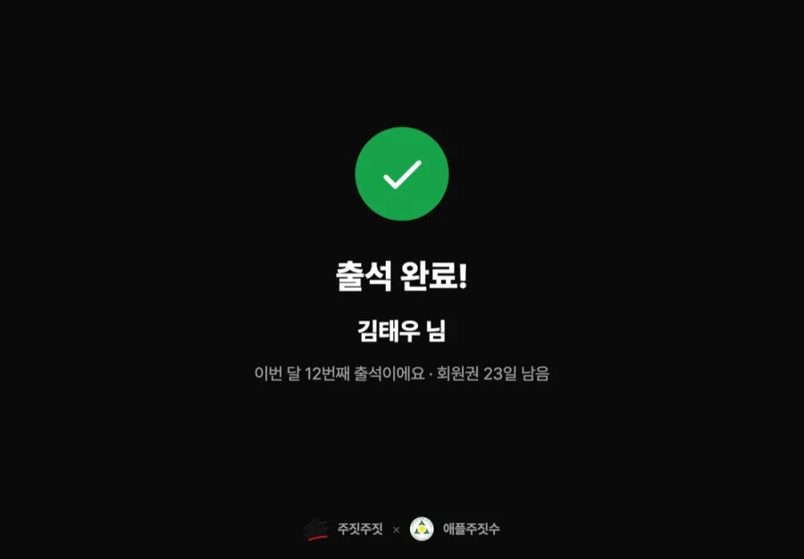
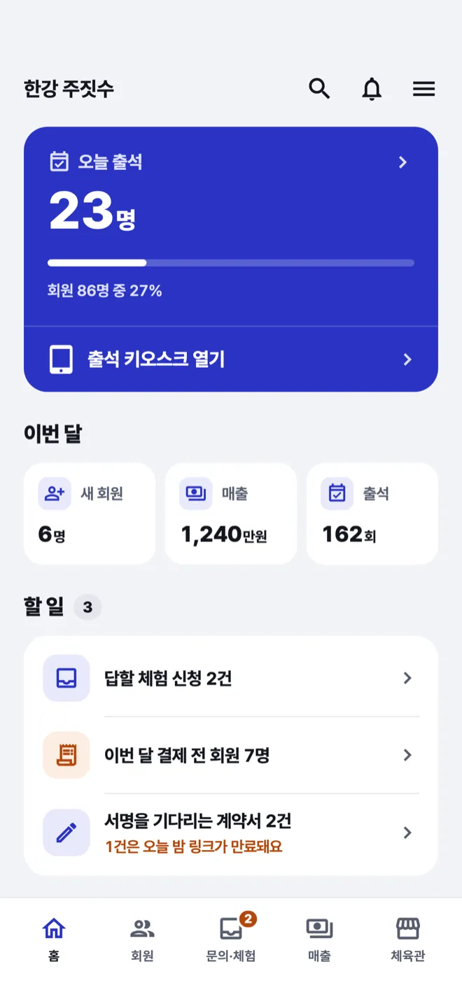
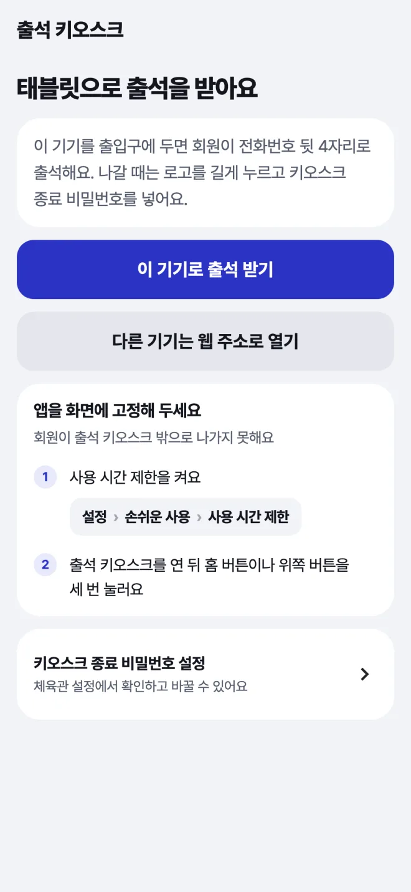

# 출석 키오스크

출입구에 둔 태블릿이나 휴대폰에서 회원이 전화번호 뒷 4자리를 눌러 출석해요. 따로 기기를 살 필요는 없어요.

<figure></figure> <figure></figure>

출석하면 횟수권은 1회 줄고, 키즈 회원은 보호자에게 [등원 알림톡](kids.md)이 가요. 벨트가 없는 주짓수 회원에게는 [벨트](../disciplines/bjj-belts.md)를 물어요. 잘못 찍은 출석은 [출석 기록](records.md)에서 고쳐요.

## 키오스크 켜기

1. 홈에서 **출석 키오스크 열기**를 눌러요.
2. **이 기기로 출석 받기**를 눌러요.
3. 기기를 출입구에 세워 둬요.

다른 태블릿이나 PC는 **다른 기기는 웹 주소로 열기**로 주소를 복사해 브라우저에서 열고 로그인해요.

<figure></figure> <figure></figure>

## 나가지 못하게 하기

키오스크는 로고를 길게 누르고 **키오스크 종료 비밀번호**(숫자 4자리)를 넣어야 닫혀요. 비밀번호는 [체육관 설정](../billing/gym-settings.md)에서 바꿔요.

iPad와 iPhone은 **설정 > 손쉬운 사용 > 사용법 유도 접근**을 켜고, 키오스크에서 홈 버튼이나 위쪽 버튼을 세 번 누르면 화면이 고정돼요.


화면 자동 잠금은 끄고 충전기에 꽂아 두세요.

