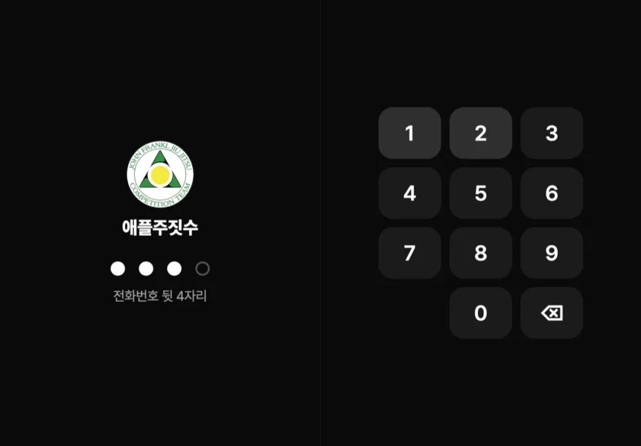
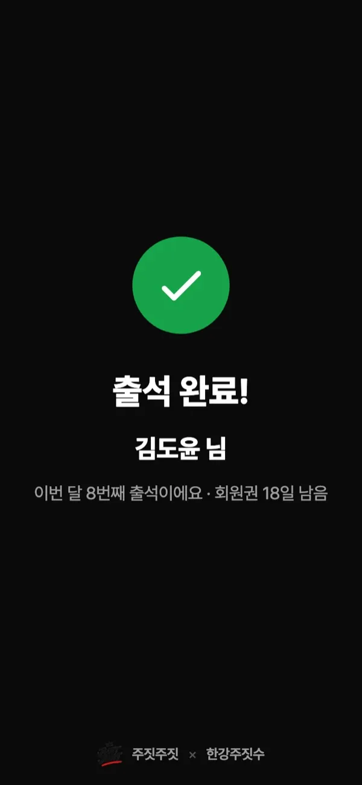

# 출석 키오스크

출석 키오스크는 체육관 출입구에 두는 출석 화면이에요. 회원이 전화번호 뒷 4자리를 누르면 출석이 기록돼요. 태블릿·PC·휴대폰 어디서든 켤 수 있고, 따로 기기를 살 필요는 없어요.

## 회원이 출석하는 과정

1. 회원이 키오스크에서 **전화번호 뒷 4자리**를 눌러요.
2. 같은 번호의 회원이 여럿이면 「본인을 선택해 주세요」가 나와요.
3. 「출석 완료!」와 함께 이번 달 출석 횟수, 남은 회원권이 보여요.

> **예시** 김태우 회원이 5678을 누르면 「출석 완료! 김태우 님 · 이번 달 12번째 출석이에요 · 회원권 23일 남음」이 떠요. 오늘 이미 출석했다면 「이미 출석했어요」가 나와요.

<figure><figcaption>
전화번호 뒷 4자리를 눌러요
</figcaption></figure> <figure><figcaption>
출석 완료
</figcaption></figure>

실제 체육관 「애플주짓수」의 출석 키오스크(태블릿)예요.

## 출석하면 함께 처리되는 것

| 회원 | 출석하면 |
|---|---|
| 횟수권 | 1회 차감돼요 |
| 기간권 | 출석 기록만 남아요 |
| 키즈 회원 | 보호자에게 등원 알림톡이 가요 → [키즈 등·하원](kids.md) |
| 벨트가 없는 주짓수 회원 | 벨트를 물어봐요. 체육관 설정에서 끌 수 있어요 → [주짓수 벨트와 그랄](../disciplines/bjj-belts.md) |

쌓인 출석은 승급식 후보 찾기, 오래 안 온 회원 안내의 기준이 돼요.

## 키오스크 켜기

### 매니저 앱이 깔린 기기에서

1. 홈에서 **출석 키오스크 열기**를 눌러요. **☰ 메뉴의 출석 키오스크**로도 들어가요.
2. **이 기기로 출석 받기**를 눌러요.
3. 기기를 출입구에 세워 둬요.

<figure><figcaption>
매니저 앱 홈의 「출석 키오스크 열기」
</figcaption></figure> <figure><figcaption>
휴대폰으로 연 키오스크
</figcaption></figure>

### 다른 태블릿이나 PC에서

1. 키오스크 안내 화면에서 **다른 기기는 웹 주소로 열기**를 눌러 주소를 복사해요.
2. 쓸 기기의 브라우저에서 그 주소를 열고 주짓주짓 매니저에 로그인해요.
3. 브라우저를 전체 화면으로 두면 깔끔하게 보여요.

웹에서는 홈의 **출석 키오스크 열기**(PC 화면)나 **체육관 설정 → 출석 키오스크 열기**로도 열어요.

<figure><figcaption>
키오스크 안내 화면
</figcaption></figure>

## 회원이 키오스크 밖으로 못 나가게 하기

키오스크를 닫으려면 **키오스크 종료 비밀번호**(숫자 4자리)가 필요해요. 로고를 길게 누르고 비밀번호를 넣으면 나가요. 비밀번호는 체육관 설정에서 확인하고 바꿔요. → [체육관 설정](../billing/gym-settings.md)

iPad나 iPhone이라면 앱을 화면에 고정해 두세요. 홈 화면으로 나가는 것도 막을 수 있어요.

1. 기기의 **설정 → 손쉬운 사용 → 사용 시간 제한**을 켜요.
2. 출석 키오스크를 연 뒤 홈 버튼이나 위쪽 버튼을 세 번 눌러요.


화면 자동 잠금은 끄고, 충전기에 꽂아 두세요. 회원이 들어오면서 바로 누를 수 있는 높이가 좋아요.


## 잘못 찍었거나 못 찍었을 때

출석은 출석 기록 화면에서 고쳐요.

* **취소**: 목록에서 출석을 골라 **출석 취소**를 눌러요. 횟수권이면 1회를 다시 채워요.
* **직접 넣기**: **직접 출석 넣기**로 넣어요. 30일 안의 날짜만 넣을 수 있어요.

→ [출석 기록과 직접 출석](records.md)

## 관련 페이지

* [출석 기록과 직접 출석](records.md) — 날짜별 기록, 시간대별 출석
* [키즈 등·하원](kids.md) — 등원·하원 알림톡
* [주짓수 벨트와 그랄](../disciplines/bjj-belts.md) — 출석할 때 벨트 고르기
* [체육관 설정](../billing/gym-settings.md) — 키오스크 종료 비밀번호
