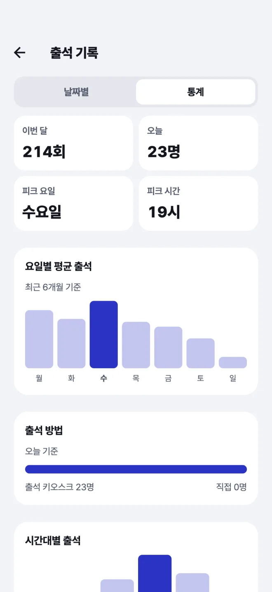

# 출석 기록과 직접 출석

출석 기록은 회원이 출석한 날과 시각을 날짜별로 모은 목록이에요. 회원은 보통 [출석 키오스크](kiosk.md)에서 스스로 출석하고, 키오스크를 못 쓴 날만 관장님이 직접 넣어요.

## 출석 기록 보기

1. 출석 기록을 열어요.
   * 매니저 앱: **☰ → 출석 기록**
   * 웹: 홈의 오늘 출석(「오늘 ○명 왔어요」)을 눌러요
2. **날짜별**에서 날짜를 골라요. **‹ ›**로 하루씩 옮기거나, 날짜를 눌러 달력에서 골라요.

목록에는 그날 온 회원이 시간순으로 보여요. 주짓수 체육관은 벨트도 함께 보여요.

> **예시** 11월 16일에 23명이 왔으면 「23명 왔어요」 아래 정하준 13:58, 강서윤 13:52 …처럼 최근 출석부터 보여요.

<figure><figcaption>
매니저 앱 「출석 기록」
</figcaption></figure>

회원 한 명의 출석은 회원 상세의 출석 달력에서 달마다 봐요. → [회원 등록과 회원 상세](../members/README.md#회원-상세)

## 직접 출석 넣기

직접 출석은 키오스크를 못 쓴 회원의 출석을 관장님이 넣는 거예요. 기기가 꺼져 있었거나 회원이 깜빡했을 때 써요.

1. 출석 기록 아래 **직접 출석 넣기**를 눌러요. 웹은 출석 화면의 **직접 출석 체크**예요.
2. 회원 이름이나 번호로 찾아요.
3. **출석 날짜**를 확인해요. 오늘이 기본이고, 지난날로 바꿀 수 있어요.
4. **출석 넣기**를 눌러요.


* 직접 출석은 오늘부터 30일 안의 날짜에만 넣을 수 있어요.
* 지난 날짜는 그날 쓸 수 있던 회원권으로 넣어요. 지금은 회원권이 끝난 회원도 넣을 수 있어요.
* 같은 날 이미 출석한 회원이면 「이미 출석했어요」가 나오고 두 번 기록되지 않아요.
* 키즈 회원이면 보호자에게 등원 알림톡이 가요.


## 출석 취소

잘못 찍힌 출석은 지워요.

1. 출석 기록에서 그 회원을 눌러요.
2. **출석 취소**를 누르고 한 번 더 확인해요.

횟수권으로 한 출석이면 쓴 1회가 다시 채워져요. 자동으로 채워지지 않았다고 나오면 회원 상세의 **횟수 조정**에서 맞춰요.


이미 하원한 키즈 출석을 취소하면 하원 기록도 함께 지워져요.



인터넷이 끊기면 「출석됐는지 확인하지 못했어요」가 나와요. 한 번 더 누르면 같은 출석으로 확인해서 두 번 기록되지 않아요.


## 통계

출석 기록의 **통계**(웹은 출석 화면의 **통계**)에서 출석이 몰리는 때를 봐요.

| 칸 | 보이는 것 |
|---|---|
| 오늘 · 이번 달 | 오늘 출석 인원, 이번 달 출석 횟수 |
| 요일별 평균 출석 | 요일마다 평균 몇 명이 오는지. 피크 요일 |
| 시간대별 출석 | 몇 시에 많이 오는지. 피크 시간 |

> **예시** 화요일 저녁 7시가 피크면 그 시간에 수업을 하나 더 열어 볼 수 있어요. 한가한 요일은 매트 청소·정비하기 좋아요.

<figure><figcaption>
출석 통계
</figcaption></figure>

## 관련 페이지

* [출석 키오스크](kiosk.md) — 회원이 스스로 출석하기
* [키즈 등·하원](kids.md) — 등원·하원 기록과 알림
* [곧 끝나는 회원·오래 안 온 회원](../members/expiring.md) — 출석이 끊긴 회원 찾기
* [시간표](timetable.md) — 수업 시간 정하기
