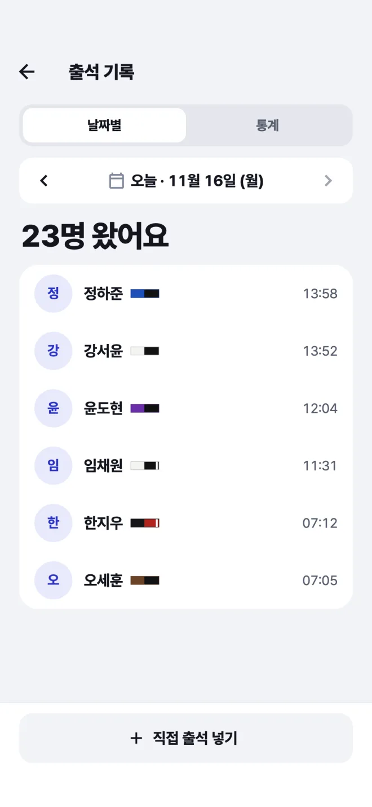

# 출석 기록과 직접 출석

날짜별로 누가 왔는지 보고, 키오스크를 못 쓴 출석을 직접 넣거나 잘못된 출석을 취소해요.

**☰** 메뉴의 **출석 기록**을 열고 **‹ ›**나 달력으로 날짜를 골라요. 웹은 홈의 오늘 출석을 눌러요. 회원 한 명의 출석은 [회원 상세](../members/README.md#회원-상세)의 출석 달력에서 봐요.

<figure></figure>

## 직접 출석 넣기

1. **직접 출석 넣기**를 눌러요.
2. 회원을 찾고 출석 날짜를 확인해요. 30일 전까지 넣을 수 있어요.
3. **출석 넣기**를 눌러요.

지난 날짜는 그날 쓸 수 있던 회원권으로 넣어요. 같은 날 두 번은 기록되지 않고, 키즈 회원이면 보호자에게 등원 알림톡이 가요.

## 출석 취소

출석 기록에서 회원을 누르고 **출석 취소**를 눌러요. 횟수권은 1회가 다시 채워져요. 안 채워졌다고 나오면 회원 상세의 **횟수 조정**에서 맞춰요. 하원한 키즈 출석이면 하원 기록도 지워져요.


인터넷이 끊겨 출석됐는지 확인하지 못했다고 나오면 한 번 더 눌러요. 두 번 기록되지 않아요.


## 통계

**통계**에서 오늘과 이번 달 출석, 요일별 평균, 시간대별 출석을 봐요. 몰리는 시간에 수업을 더 열 때 참고해요.

<figure></figure>
