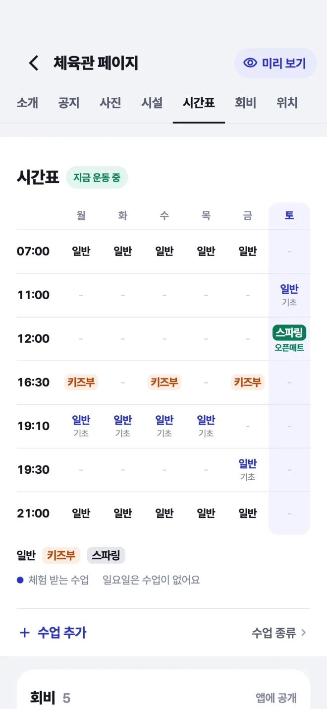
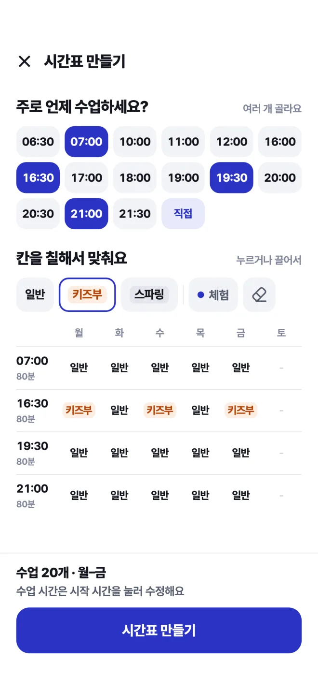
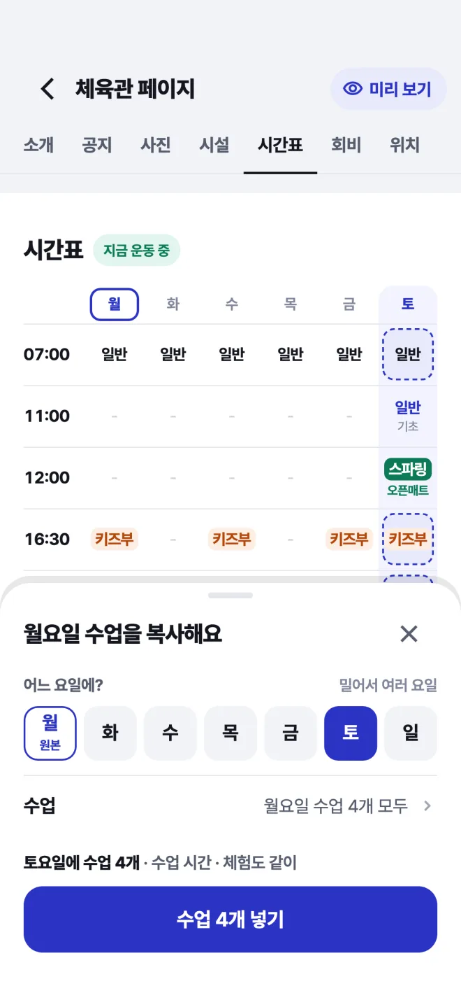
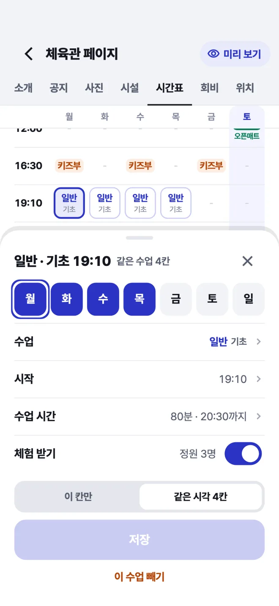

# 시간표

시간표는 줄이 시작 시간, 칸이 요일인 표예요. 주짓주짓 앱 체육관 페이지에 같은 모양으로 보이고, 체험 신청도 이 칸으로 받아요.

**체육관** 탭의 **체육관 페이지**에서 **시간표** 탭을 열어요. 고치면 바로 저장되고, **미리 보기**로 회원이 볼 모습을 확인해요.

<figure></figure>

## 처음 만들기

1. **주로 언제 수업하세요?**에서 시작 시간을 여러 개 골라요. 월요일부터 금요일까지 채워져요.
2. 위쪽 붓(수업 종류, 체험, 지우개)을 고르고 칸을 누르거나 끌어 칠해요.
3. 수업 시간(기본 80분)은 시작 시간을 눌러 바꿔요.
4. **시간표 만들기**를 눌러요.

<figure></figure>

## 넣고 고치기

* 빈 칸을 누르면 수업과 요일을 골라 넣어요. 새 시작 시간은 **수업 추가**로 만들어요.
* 요일을 누르면 **다른 요일에 복사**하거나 그 요일을 비워요.
* 시작 시간을 누르면 **다른 시간에 복사**, **이 줄 빼기**, **시작 시간 수정**을 해요.
* 수업 칸을 누르면 고치거나 **이 수업 빼기**를 해요. 같은 시각 여러 요일이면 **이 칸만** 고칠지 골라요.

바꾸면 바로 적용되고 아래에 **되돌리기**가 잠깐 나와요.

<figure></figure> <figure></figure> <figure></figure>

## 체험과 수업 종류

* 칸에서 **체험 받기**를 켜고 정원을 정하면 그 칸으로 [체험 신청](../new-members/trial-classes.md)을 받아요. 표에는 파란 글씨로 보여요.
* 시작 시간을 옮기면 잡힌 체험도 같이 옮겨지고 회원에게 알려요. 체험이 잡힌 칸을 빼도 예약은 남으니 [문의와 체험 신청](../new-members/inquiries.md)에서 확인해요.
* 수업 종류는 일반, 키즈부, 스파링으로 시작하고 **수업 종류**에서 6개까지 늘려요. 키즈 여부는 수업이 없는 종류만 바꿔요.

<figure></figure>
