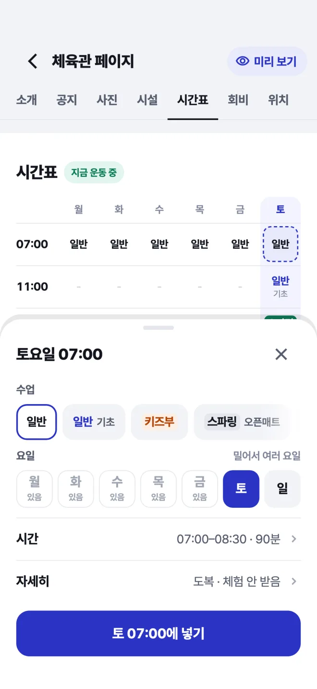
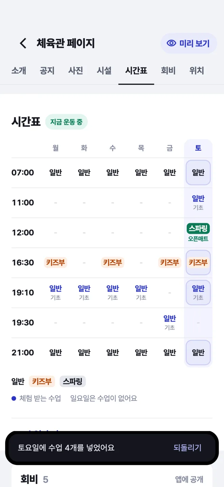
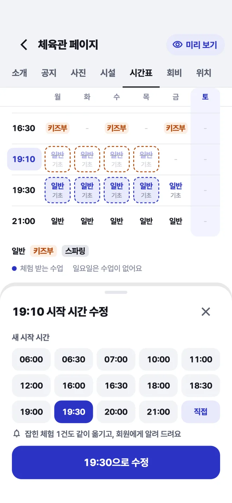

# 시간표

시간표는 요일마다 몇 시에 어떤 수업이 있는지 보여 주는 표예요. 줄은 시작 시간, 칸은 요일이고, 칸 안에는 수업 종류(일반·키즈부·스파링 등)가 들어가요. 만든 시간표는 주짓주짓 앱 체육관 페이지에 같은 모양으로 보이고, 체험 신청도 이 시간표의 칸으로 받아요.

## 시간표 여는 곳

* 매니저 앱: **체육관** 탭 → **체육관 페이지** → **시간표** 탭
* 웹: **체육관 → 체육관 페이지** → **시간표** 탭

고치면 바로 저장돼요. 오른쪽 위 **미리 보기**(웹은 오른쪽 미리 보기)로 회원이 볼 모습을 확인해요.

<figure><figcaption>
시간표. 파란 글씨는 체험 받는 수업이에요.
</figcaption></figure>

## 수업 종류

수업 종류는 칸에 들어가는 이름이에요. 처음에는 **일반 · 키즈부 · 스파링** 세 가지가 있고, 6개까지 늘릴 수 있어요.

1. 시간표 아래 **수업 종류**를 눌러요.
2. **종류 더하기**로 새 종류를 만들거나, 있는 종류의 이름·색을 고쳐요.
3. 키즈 수업이면 **키즈**를 켜요.


* 키즈는 그 종류에 수업이 하나도 없을 때만 바꿀 수 있어요.
* 쓰고 있는 종류를 지우면 그 칸들을 어느 종류로 옮길지 물어요.
* 같은 종류 안에서 「기초」, 「오픈매트」처럼 짧은 이름표를 붙일 수 있어요. 칸에 작게 함께 보여요.


## 처음 시간표 만들기

시간표가 비어 있으면 **시간표 만들기**로 한 번에 만들어요.

> **예시** 평일 07:00, 16:30, 19:30, 21:00에 수업을 하고 월·수·금 16:30만 키즈부예요. 네 시간을 고르면 월~금이 「일반」으로 채워지고, 「키즈부」 붓으로 월·수·금 16:30을 칠해요.

1. **주로 언제 수업하세요?**에서 수업 시작 시간을 여러 개 골라요. 목록에 없으면 **직접**을 눌러요. 고른 시간마다 월~금이 채워져요.
2. **칸을 칠해서 맞춰요** — 위쪽 붓(일반·키즈부·스파링 · ● 체험 · 지우개)을 고르고 칸을 누르거나 끌어서 칠해요.
3. 수업 시간(기본 80분)은 시작 시간을 눌러 바꿔요.
4. **시간표 만들기**를 눌러요.

<figure><figcaption>
시간표 만들기
</figcaption></figure>

## 수업 넣기

빈 칸을 누르면 그 요일·시간에 수업을 넣어요.

1. 표에서 빈 칸(–)을 눌러요.
2. **수업**에서 종류를 골라요.
3. **요일**에서 넣을 요일을 골라요. 칩을 밀면 여러 요일을 한 번에 골라요.
4. **시간**과 **자세히**(도복·노기, 체험 받기)를 확인해요.
5. **○ ○○:○○에 넣기**를 눌러요.

새 시작 시간이 필요하면 표 아래 **수업 추가**를 눌러요.

<figure><figcaption>
빈 칸을 눌러 넣기
</figcaption></figure>

## 복사하기

### 요일 통째로 복사

> **예시** 토요일을 월요일과 똑같이 하고 싶으면 「월」을 눌러 다른 요일에 복사 → 「토」를 골라요. 월요일 수업 4개가 토요일에 들어가요.

1. 표 맨 위 요일(월·화…)을 눌러요.
2. **다른 요일에 복사**를 눌러요.
3. 넣을 요일을 고르고 **수업 ○개 넣기**를 눌러요. 이미 있는 칸은 빼고 넣어요.

요일 메뉴의 **○요일 비우기**는 그 요일 수업을 모두 빼요.

### 시간 줄 복사

시작 시간(07:00 등)을 누르고 **다른 시간에 복사**를 누르면 그 줄 수업을 다른 시작 시간에 똑같이 넣어요.

<figure><figcaption>
요일 복사
</figcaption></figure>

## 고치기와 빼기

수업이 있는 칸을 누르면 그 수업을 고쳐요.

* 같은 시각에 같은 수업이 여러 요일에 있으면 **이 칸만** / **같은 시각 ○칸** 중에 고칠 범위를 골라요.
* 요일 칩을 눌러 끄면 그 요일 칸을 빼요. 저장 버튼에 「저장 · 목요일 1칸 빼기」처럼 바뀌는 내용이 보여요.
* **이 수업 빼기**로 수업을 빼요. 한 줄을 통째로 빼려면 시작 시간을 누르고 **이 줄 빼기**를 눌러요.

<figure><figcaption>
수업 고치기
</figcaption></figure>

### 되돌리기

넣기·복사·고치기·빼기는 확인 창 없이 바로 바뀌고, 아래에 **되돌리기**가 잠깐 나와요. 잘못 눌렀으면 되돌리기를 눌러요.

<figure><figcaption>
바꾼 뒤 나오는 되돌리기
</figcaption></figure>


체험 예약이 잡힌 칸을 빼면 「잡힌 체험 ○건은 그대로 남아요」라고 한 번 더 물어요. 예약은 지워지지 않아요. 문의·체험에서 그 예약을 확인해 주세요. → [문의·체험 신청 답하기](../new-members/inquiries.md)


## 시작 시간 옮기기

수업 시작 시간을 바꾸면 그 줄 수업이 한 번에 옮겨져요.

1. 표 왼쪽 시작 시간(예: 19:10)을 눌러요.
2. **시작 시간 수정**을 눌러요.
3. 새 시작 시간을 고르고 **○○:○○으로 수정**을 눌러요.

잡힌 체험이 있으면 「잡힌 체험 ○건도 같이 옮기고, 회원에게 알려 드려요」가 보여요. 예약도 새 시간으로 옮겨지고, 회원에게 바뀐 시간이 알려져요.

<figure><figcaption>
시작 시간 수정
</figcaption></figure>

## 체험 받는 수업

체험 받는 수업은 주짓주짓 앱에서 체험 신청을 받을 칸이에요. 칸을 누르고 **체험 받기**를 켜고 **정원**을 정해요. 시간표 만들기에서는 **● 체험** 붓으로 칠해요. 체험 받는 수업은 표에 파란 글씨로 보여요.

→ [체험 수업 받기](../new-members/trial-classes.md)

## 관련 페이지

* [체험 수업 받기](../new-members/trial-classes.md) — 체험료, 도복 대여, 신청 마감
* [체육관 페이지와 근처 찾기](../new-members/gym-page.md) — 시간표가 보이는 곳
* [문의·체험 신청 답하기](../new-members/inquiries.md) — 잡힌 체험 확정·거절
* [키즈 등·하원](kids.md) — 키즈부 수업 뒤 하원
