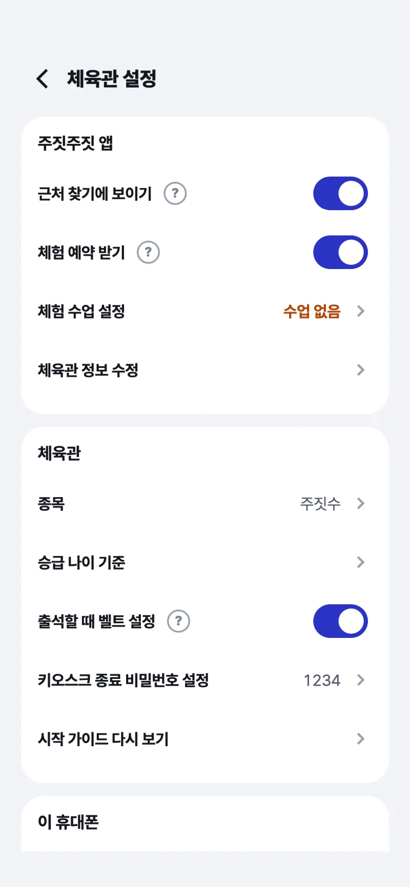

# 체육관 설정

체육관 설정은 체육관 전체에 한 번 정해 두는 값을 모아 둔 곳이에요. 체육관 이름과 주소, 키오스크 종료 비밀번호, 관장 서명, 체험 예약 받기 같은 것이 여기 있어요. 웹은 왼쪽 메뉴 **체육관 설정**, 매니저 앱은 **☰ 메뉴**의 **체육관 설정**·**체육관 정보**·**계약서**로 나뉘어 있어요.

<figure><figcaption>
매니저 앱 「체육관 설정」
</figcaption></figure>

## 한눈에 보기

| 묶음 | 설정 | 하는 일 |
| --- | --- | --- |
| 주짓주짓 앱 | 근처 찾기에 보이기 | 근처 찾기 노출을 켜고 꺼요 → [체육관 페이지와 근처 찾기](../new-members/gym-page.md) |
| | 체험 예약 받기 | 주짓주짓 앱에서 체험 예약을 받을지 정해요 |
| | 체험 수업 설정 | 체험 받을 수업, 체험료, 도복 대여 → [체험 수업 받기](../new-members/trial-classes.md) |
| | 체육관 정보 수정 | 체육관 페이지로 가요 |
| 체육관 | 체육관 정보 | 이름, 전화, 주소, 종목, 로고, 사업자 인증 |
| | 승급 나이 기준 (주짓수) | → [주짓수 승급식](../disciplines/bjj-ceremonies.md) |
| | 급·띠 설정 (태권도) | → [태권도 띠 설정](../disciplines/tkd-ranks.md) |
| | 회원권 관리 | → [회원권 만들기](../members/membership-plans.md) |
| 출석 | 출석할 때 벨트 설정 | 벨트가 없는 회원에게 출석 키오스크에서 물어봐요 → [주짓수 벨트와 그랄](../disciplines/bjj-belts.md) |
| | 키오스크 종료 비밀번호 | 아래 참고 |
| | 출석 키오스크 열기 | → [출석 키오스크](../attendance/kiosk.md) |
| 알림·메시지 | 알림 설정 | 받을 알림, 조용한 시간 |
| | 자동 알림톡 | → [자동 알림톡](../contracts/auto-messages.md) |
| 계약·구독 | 계약서 | 양식, 관장 서명, 서명 완료 목록 |
| | 구독 | → [요금과 구독](subscription.md) |
| | 엑셀로 회원 등록 | → [⑤ 회원 옮기기](../getting-started/import-members.md) |
| 계정 | 내 프로필 | 이름, 사진, 연결된 로그인, 로그아웃, 계정 삭제 |

## 체육관 정보

체육관 이름, 전화번호, 종목, 주소, 로고를 바꿔요. 칸마다 **저장**을 눌러요. 주소는 **주소 찾기**로 검색해요.


예시 · 종목을 「주짓수」에서 「복싱」으로 바꾸면 띠가 없는 종목이라 화면에서 띠를 숨겨요. 띠 기록은 지우지 않아서 다시 바꾸면 그대로 보여요.


사업자 인증 상태(인증 완료·검토 중·인증 전)도 여기서 보고, 인증 전이면 **인증하기**를 눌러요. → [사업자 인증](../new-members/business-verification.md)

## 키오스크 종료 비밀번호

출석 키오스크를 닫을 때 넣는 숫자 4자리예요. 회원이 키오스크 화면을 닫고 다른 화면을 보지 못하게 막아요.

1. **체육관 설정 → 키오스크 종료 비밀번호 설정**으로 가요. 지금 비밀번호가 보여요.
2. 새 숫자 4자리를 넣어요.
3. **변경**을 눌러요. 「비밀번호를 바꿨어요」가 나와요.

키오스크를 닫는 법은 [출석 키오스크](../attendance/kiosk.md)에 있어요.

## 관장 서명

관장 서명은 입관계약서마다 찍히는 서명이에요. 한 번 등록해 두면 모든 계약서에 들어가요.

1. **체육관 설정 → 계약서 → 관장 서명**으로 가요. 매니저 앱은 **☰ → 계약서**예요.
2. **직접 그리기**로 서명하거나 **사진 올리기**로 서명 사진(JPG, PNG, WEBP · 5MB 이하)을 골라요.
3. **서명 저장**을 눌러요. 「관장 서명을 등록했어요」가 보이면 끝이에요.

계약서 양식은 [계약서 양식 고치기](../contracts/templates.md)에 있어요.

## 알림 설정

체험 신청, 계약서 서명, 결제처럼 관장님께 오는 알림을 골라 받아요. **조용한 시간**을 켜고 시작·끝 시간을 정하면 그 시간에는 푸시 알림을 울리지 않아요. 매니저 앱은 **☰ → 알림 설정**, 웹은 **체육관 설정 → 알림 설정**이에요.

## 내 프로필과 계정 삭제

**내 프로필**에서 이름과 사진을 바꾸고, 휴대폰 번호와 연결된 로그인(카카오·네이버·구글·Apple·휴대폰)을 봐요. 로그아웃과 계정 삭제도 여기 있어요. → [① 가입과 로그인](../getting-started/login.md)

## 관련 페이지

* [출석 키오스크](../attendance/kiosk.md)
* [계약서 양식 고치기](../contracts/templates.md)
* [요금과 구독](subscription.md)
