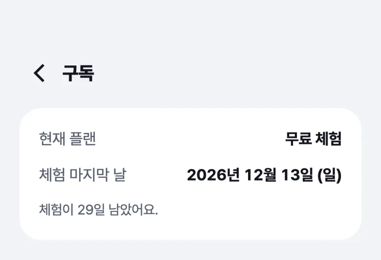

# 요금과 구독

체육관 페이지, 근처 찾기 노출, 체험 신청 받기는 계속 무료예요. 관리 기능은 [관리 시작하기](../getting-started/start-management.md)를 누른 날부터 30일 무료이고, 그 뒤 구독해요.

## 구독 요금

| 구독 | 요금 (VAT 포함) | 참고 |
| --- | --- | --- |
| 월간 | 월 **32,000원** | 매월 자동 결제 |
| 연간 | 연 **320,000원** | 10개월 가격 |

알림톡, 회원 수, 계약서 보내기는 건수 제한 없이 따로 돈이 들지 않아요.

## 이렇게 해요

구독은 웹에서 해요. [사업자 인증](../new-members/business-verification.md)을 마친 체육관만 시작할 수 있어요.

1. 웹에서 **구독**을 열어요.
2. **월간**이나 **연간**을 고르고 **이 플랜으로 시작하기**를 눌러요.
3. 약관에 동의하고 **동의하고 카드 등록**을 눌러요.
4. 토스 결제창에서 카드를 등록하면 결제돼요.

매니저 앱 **☰** 메뉴의 **구독**에서는 상태만 봐요.

<figure><figcaption></figcaption></figure>

## 카드 변경과 해지

웹 **구독**에서 **카드 변경**, **연간으로 전환**, **구독 해지**를 해요. 해지해도 이번 결제 기간 마지막 날까지 쓰고, 그 전에는 **구독 다시 시작**으로 이어 써요.

자동 결제가 안 되면 **결제 다시 시도**를 누르거나 카드를 바꿔요.


구독하지 않고 30일이 끝나거나, 안내된 날까지 다시 결제하지 않으면 관리 기능은 볼 수만 있게 잠겨요. 회원과 출석 기록은 지워지지 않아요.

