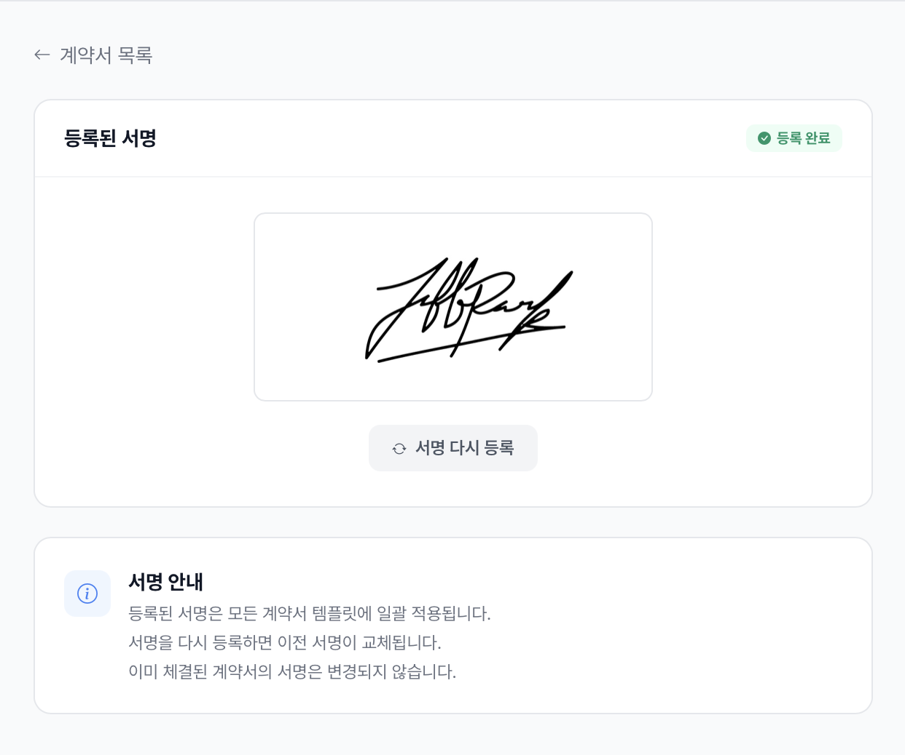

# 전자 계약서

종이 계약서 없이 **모바일 전자 계약서**로 회원을 등록합니다.\
회원은 카카오톡으로 받은 링크를 눌러 휴대폰 브라우저에서 바로 서명합니다. 앱 설치는 필요 없습니다.

---

## 전체 흐름

```
지도자 서명 등록 → 계약서 양식 만들기 → 회원권에 연결 → 계약서 보내기 → 회원 서명 → 결제 확인
```

| 메뉴 (전자 계약서) | 하는 일 | 바로가기 |
|---|---|---|
| **계약서 양식** | 도장 계약서 만들기, 지도자 서명 등록 | 이 페이지 |
| **계약서 보내기** | 회원에게 서명 링크 보내기 | [계약서 보내기](sending.md) |
| **서명 완료된 계약서** | 서명된 계약서 확인, 결제 확인 | [서명 완료된 계약서](signed-management.md) |

---

## 계약서 양식 만들기

**전자 계약서 → 계약서 양식 → 새 계약서 만들기**를 누르면 **종목에 맞는 기본 초안**이 채워집니다.

<div align="left"><figure><figcaption>기본 초안 — 이용약관, 수업 규정, 면책 규정, 개인정보 동의 등</figcaption></figure></div>

### 기본 조항 (공통 · 삭제 불가)

1. 이용약관 및 준수사항
2. 수업 규정
3. 면책 규정
4. 이용자의 권리와 의무
5. 개인정보 수집 및 이용 동의

내용은 도장에 맞게 고칠 수 있습니다.

### 종목별 추가 조항

| 종목 | 처음부터 들어 있는 조항 | 직접 추가하면 좋은 조항 |
|---|---|---|
| **주짓수** | 기본 조항 5개 | 환불 규정, 사진 및 영상 촬영 동의, 특약사항 |
| **태권도** | 기본 조항 5개(태권도 내용) + **보호자 동의, 차량 이용 동의, 수련 중 부상 및 응급조치 동의, 사진 및 영상 촬영 동의** | 환불 규정, 특약사항 |

태권도 초안의 수업 규정에는 승급 심사와 국기원 품·단 심사 내용이 들어 있습니다.

<div align="left"><figure><figcaption>조항을 눌러 도장에 맞게 수정</figcaption></figure></div>

- 조항을 추가·수정·삭제할 수 있습니다 (기본 조항 5개는 삭제할 수 없습니다).
- 드래그로 순서를 바꿀 수 있습니다.

<div align="left"><figure><figcaption>저장한 양식을 회원권에 연결하면 바로 보낼 수 있습니다</figcaption></figure></div>


[회원권](../membership-plans.md)에 연결된 양식은 삭제할 수 없습니다.


## 지도자 서명 등록

계약서 PDF에 들어갈 **지도자 서명**을 미리 등록합니다. 직접 그리거나 서명 이미지를 올릴 수 있습니다.

<div align="left"><figure><figcaption>서명 이미지(PNG, JPG) 올리기</figcaption></figure></div>

<div align="left"><figure><figcaption>드래그로 서명 영역 조정</figcaption></figure></div>

<div align="left"><figure><figcaption>등록한 서명은 모든 계약서에 함께 들어갑니다</figcaption></figure></div>

---

## 상세 기능

- [계약서 보내기](sending.md)
- [회원 서명 과정](signing-flow.md)
- [서명 완료된 계약서](signed-management.md)
