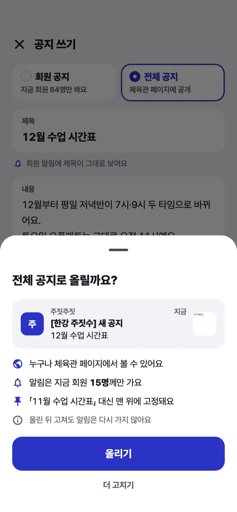
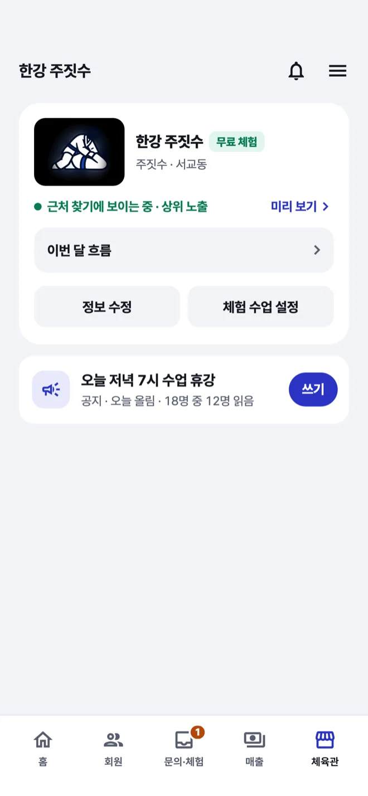

# 공지 (주짓주짓 앱)

공지는 회원이 쓰는 **주짓주짓 앱**에 올리는 체육관 게시글이에요. 휴강, 시간표 변경, 오픈매트 안내처럼 회원에게 알릴 일을 올리면 앱 게시판에 남고, 공지 알림을 켠 회원에게 앱 알림이 가요. 문자나 알림톡 비용은 들지 않아요.

## 회원 공지와 전체 공지

올릴 때 누가 볼지 골라요.

| 종류 | 누가 보나요 | 이럴 때 |
|---|---|---|
| **회원 공지** (기본) | 지금 회원권이 있는 회원만, 앱의 「내 체육관」에서 | 오늘 저녁 7시 수업 휴강 |
| **전체 공지** | 누구나, 주짓주짓 앱의 [체육관 페이지](../new-members/gym-page.md)에서 | 12월 수업 시간표, 토요일 오픈매트 |

앱 알림은 두 종류 모두 **지금 회원 중 공지 알림을 켠 회원**에게만 가요. 회원이 아닌 사람에게는 알림이 가지 않아요.


전체 공지는 체육관 페이지가 보일 때만 공개돼요. 주소가 없거나 체육관 페이지를 숨겨 두었다면, 그동안은 회원만 볼 수 있어요.


## 공지 올리기

**예시**: 12월부터 저녁반 시간이 바뀌어요. 시간표 사진을 넣어 전체 공지로 올리고 맨 위에 고정해요.

1. 매니저 앱 **체육관** 탭의 공지 줄에서 **쓰기**를 눌러요. 웹은 **체육관** → **공지** → **공지 쓰기**예요.
2. **회원 공지**와 **전체 공지** 중에 골라요.
3. 제목과 내용을 넣어요. 제목은 회원 알림에 그대로 보여요(100자까지). 내용은 5,000자까지 써요.
4. 사진이 필요하면 **사진**에서 넣어요. 5장까지 넣을 수 있어요.
5. 늘 맨 위에 둘 공지라면 **맨 위에 고정**을 켜요.
6. **올리기**를 누르고, 확인 창에서 누가 보고 몇 명에게 알림이 가는지 확인한 뒤 한 번 더 **올리기**를 눌러요.

<figure><figcaption>공지 쓰기. 위에서 회원 공지와 전체 공지를 골라요.</figcaption></figure>

<figure><figcaption>올리기 전 확인 창. 회원이 받을 알림 모양과 알림 받을 회원 수가 보여요.</figcaption></figure>


- 사진에 회원 얼굴이 나오면, 주짓주짓 앱에 공개해도 된다는 동의를 받은 뒤 올려 주세요. 사진을 넣을 때 동의 확인을 물어요.
- 올린 뒤 고쳐도 알림은 다시 가지 않아요.


## 맨 위 고정

고정한 공지는 「내 체육관」 공지 맨 위에 늘 보여요. 고정은 체육관마다 **하나**만 돼요. 다른 공지를 고정하면 앞의 고정은 풀려요.

**팁**: 시간표나 커리큘럼 사진을 전체 공지로 올리고 고정해 두면, 처음 오는 분이 체육관을 빨리 파악해요.

## 올린 공지와 읽은 회원 보기

공지 목록 위에는 **앱 쓰는 회원** 수와 **공지 알림 켠 회원** 수가 보여요. 공지마다 「17 / 18명 읽음」처럼 읽은 회원 수가 붙어요. 읽은 수는 주짓주짓 앱을 쓰는 회원을 기준으로 세요.

<figure><figcaption>공지 목록. 앱이 없는 회원 수도 함께 알려 줘요.</figcaption></figure>

공지를 눌러 열면 **고치기**, **지우기**, 고정 바꾸기를 할 수 있어요. 지운 공지는 주짓주짓 앱의 체육관 페이지와 「내 체육관」에서 바로 사라지고, 사진도 함께 지워져 되돌릴 수 없어요.


앱을 쓰지 않는 회원에게는 공지 알림이 가지 않아요. 목록 위의 「앱이 없는 회원 N명」에게는 따로 알려 주세요. 회원이 주짓주짓 앱에서 전화번호로 로그인하면 지난 공지도 보고 알림도 받아요.


## 공지 들어가는 곳

| 어디서 | 들어가는 길 |
|---|---|
| 매니저 앱 | **체육관** 탭의 공지 줄(최근 공지와 읽은 수, **쓰기**) · ☰ → **회원** → **공지** |
| 웹 | 왼쪽 메뉴 **체육관** → **공지** 탭 · 휴대폰 웹은 **전체** → **공지** |

<figure><figcaption>매니저 앱 「체육관」 탭. 최근 공지와 읽은 수가 한 줄로 보여요.</figcaption></figure>


공지 쓰기는 관리 기능이에요. 30일 무료가 끝나고 구독하지 않으면, 올린 공지는 그대로 보이지만 새로 쓰거나 고칠 수 없어요. → [요금과 구독](../billing/subscription.md)


## 관련 페이지

- [체육관 페이지와 근처 찾기](../new-members/gym-page.md) — 전체 공지가 보이는 곳
- [자동 알림톡](auto-messages.md) — 알림톡으로 자동으로 가는 안내
- [시간표](../attendance/timetable.md) — 요일별 수업 시간
- [요금과 구독](../billing/subscription.md) — 30일이 끝난 뒤
