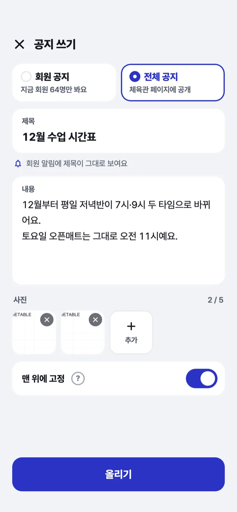
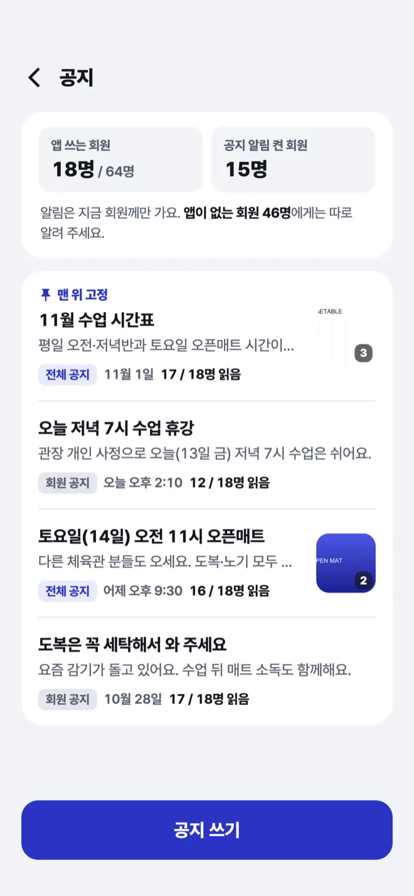

# 공지 (주짓주짓 앱)

회원이 쓰는 주짓주짓 앱에 올리는 체육관 게시글이에요. 공지 알림을 켠 회원에게 앱 알림이 가고, 비용은 들지 않아요.

**이렇게 해요**

1. 매니저 앱 **체육관** 탭의 공지 줄에서 **쓰기**를 눌러요. 웹은 **체육관** 메뉴의 **공지** 탭이에요.
2. **회원 공지**와 **전체 공지** 중에 골라요.
3. 제목(100자까지)과 내용(5,000자까지)을 넣어요. 제목은 회원 알림에 그대로 보여요.
4. 사진은 5장까지 넣어요. 회원 얼굴이 나오면 공개 동의를 받은 뒤 올려 주세요.
5. 늘 맨 위에 둘 공지라면 **맨 위에 고정**을 켜요.
6. **올리기**를 누르고, 확인 창에서 볼 사람과 알림 받을 회원 수를 본 뒤 한 번 더 **올리기**를 눌러요.

<figure></figure>

<figure></figure>

## 회원 공지와 전체 공지

- **회원 공지**(기본): 지금 회원권이 있는 회원만 앱의 **내 체육관**에서 봐요.
- **전체 공지**: 누구나 [체육관 페이지](../new-members/gym-page.md)에서 봐요. 체육관 페이지를 숨겼거나 주소가 없으면 그동안은 회원만 봐요.

앱 알림은 어느 쪽이든 지금 회원 중 공지 알림을 켠 회원에게만 가요.

## 고정과 읽은 수

고정은 체육관마다 하나예요. 다른 공지를 고정하면 앞의 고정은 풀려요.

공지 목록 위에 앱 쓰는 회원 수와 공지 알림 켠 회원 수가, 공지마다 읽은 회원 수가 보여요. 앱이 없는 회원에게는 알림이 가지 않으니 따로 알려 주세요. 회원이 주짓주짓 앱에 전화번호로 로그인하면 지난 공지도 보여요.

<figure></figure>

## 고치기와 지우기

공지를 열어 **고치기**, **지우기**, 고정 바꾸기를 해요. 고쳐도 알림은 다시 가지 않아요. 지운 공지는 사진과 함께 바로 사라지고 되돌릴 수 없어요.


30일 무료가 끝나고 구독하지 않으면 올린 공지는 그대로 보이지만 새로 쓰거나 고칠 수 없어요. [요금과 구독](../billing/subscription.md)

