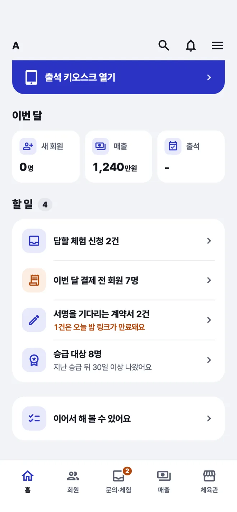

# 입관계약서 보내기

입관계약서는 회원이 휴대폰으로 읽고 서명하는 전자 계약서예요. 따로 보내는 메뉴를 찾을 필요 없이, **회원 등록**과 **재등록** 때 같은 화면에서 함께 받아요. 회원은 카카오 알림톡 링크나 체육관 화면의 QR로 열고, 앱 설치 없이 서명해요.


보내려면 세 가지가 있어야 해요. 없으면 등록 화면에서 바로 만들 수 있어요.

1. [회원권](../members/membership-plans.md)
2. 회원권에 연결한 [계약서 양식](templates.md)
3. [관장 서명](templates.md#관장-서명-등록하기)


## 받는 방법 세 가지

등록·재등록 화면의 **계약서는 어떻게 받을까요?**에서 하나를 골라요.

| 방법 | 이럴 때 | 어떻게 되나요 |
|---|---|---|
| **카카오톡으로 보내기** | 회원이 집에서 읽고 서명할 때 | 회원 휴대폰으로 서명 링크가 알림톡으로 가요 |
| **지금 여기서 서명** | 회원이 체육관에 와 있을 때 | 화면에 QR이 뜨고, 회원이 자기 휴대폰으로 찍어 바로 서명해요 |
| **이번엔 계약서 없이** | 종이 계약서를 이미 받았을 때 | 계약서 없이 등록만 해요. 다음 재등록 때 받을 수 있어요 |


키즈 회원은 계약서가 **보호자 휴대폰**으로 가요. 등록할 때 **키즈 회원이에요**를 켜고 보호자 이름과 휴대폰을 넣어요.


## 새 회원에게 보내기

**예시**: 체험 수업을 마친 김태우 님이 3개월 회원권으로 등록해요. 서명은 집에서 하기로 했어요.

1. **회원** → **회원 등록** → **오늘 처음 온 회원**을 눌러요.
2. 이름과 휴대폰을 넣어요. 계약서는 이 번호로 가요.
3. 회원권과 시작일을 골라요.
4. **카카오톡으로 보내기**를 골라요. 링크는 기본 48시간 열려 있고, **시간 바꾸기**로 6·24·48·72시간 중에 골라요.
5. 결제를 받았으면 결제 수단과 받은 날을 넣고, 아직이면 **아직 안 받았어요**를 골라요.
6. 접수증을 확인하고 등록을 마쳐요.

<figure><figcaption>회원이 받는 알림톡. 「계약서 서명하기」를 누르면 서명 화면이 열려요.</figcaption></figure>


관장 서명이나 양식이 아직 없다면 등록 중에 **관장님 서명만 하면 돼요**가 나와요. 서명하면 기본 계약서를 만들어 그 회원권에 연결해 줘요.


## 재등록할 때 받기

재등록 화면은 지난 계약서와 이번 회원권을 비교해서 알아서 골라 줘요.

| 화면에 보이는 것 | 뜻 |
|---|---|
| **지난 계약서로 진행해요** | 회원권과 가격이 지난 계약서와 같아요. 회원 서명 없이 지난 계약서로 이어 가요. 새로 받고 싶으면 **새로운 계약서 사용하기**를 눌러요 |
| **회원권이나 가격이 달라 새 계약서를 받아요** | 지난 계약서와 조건이 달라 새로 서명을 받아요 |
| **처음 받는 계약서예요** | 이 회원에게 받은 계약서가 없어요 |

<figure><figcaption>웹 재등록 화면. 같은 회원권이면 「지난 계약서로 진행해요」가 나와요.</figcaption></figure>

다니는 회원에게 재등록 없이 계약서만 받고 싶다면 회원 상세 오른쪽 위 **⋯** → **계약서 받기**를 눌러요.

## 보낸 뒤 확인하기

서명을 기다리는 계약서는 홈 **할 일**의 **서명을 기다리는 계약서 N건**에 모여요. 링크가 오늘 끝나는 건은 따로 알려 줘요.

<figure><figcaption>매니저 앱 홈 「할 일」. 서명을 기다리는 계약서가 보여요.</figcaption></figure>

회원 상세의 계약서 줄이나 매니저 앱 ☰ → **계약서** → **진행 중 계약서**에서 이렇게 할 수 있어요.

- **다시 보내기**: 링크를 새로 보내요. 1분 간격으로 5번까지 보낼 수 있어요.
- **링크 복사**: 카카오톡 대화방 등에 직접 붙여 넣어요.
- **링크 취소**: 번호를 잘못 넣었을 때 취소하고 새로 보내요. 취소한 링크로는 서명할 수 없어요.

회원이 서명하면 매니저 알림으로 알려 드려요. 서명한 계약서는 [회원이 서명하는 과정](signing-flow.md#서명이-끝나면)에서 설명한 **서명 완료 계약서**에 모여요.


서명 링크는 정한 시간이 지나면 열리지 않아요. 회원이 「링크 유효 시간이 지났어요」를 봤다면 **다시 보내기**를 눌러 주세요.


## 관련 페이지

- [계약서 양식 고치기](templates.md) — 조항, 환불 규정, 관장 서명
- [회원이 서명하는 과정](signing-flow.md) — 회원이 보는 화면과 서명 완료 계약서
- [회원 등록과 회원 상세](../members/README.md) — 오늘 처음 온 회원 등록
- [재등록](../members/renewal.md) — 다음 회원권과 결제 기록
