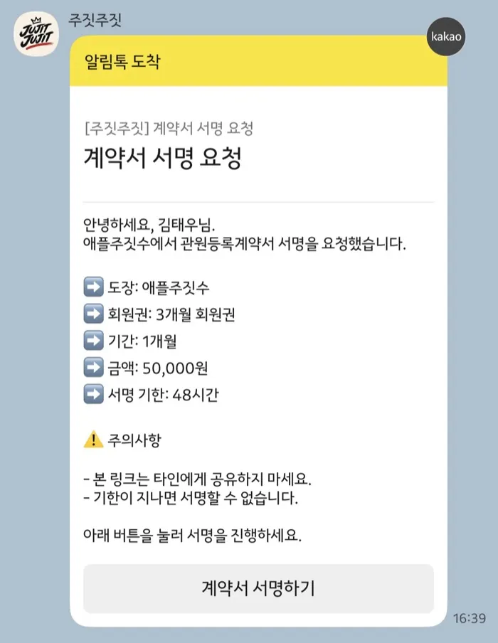
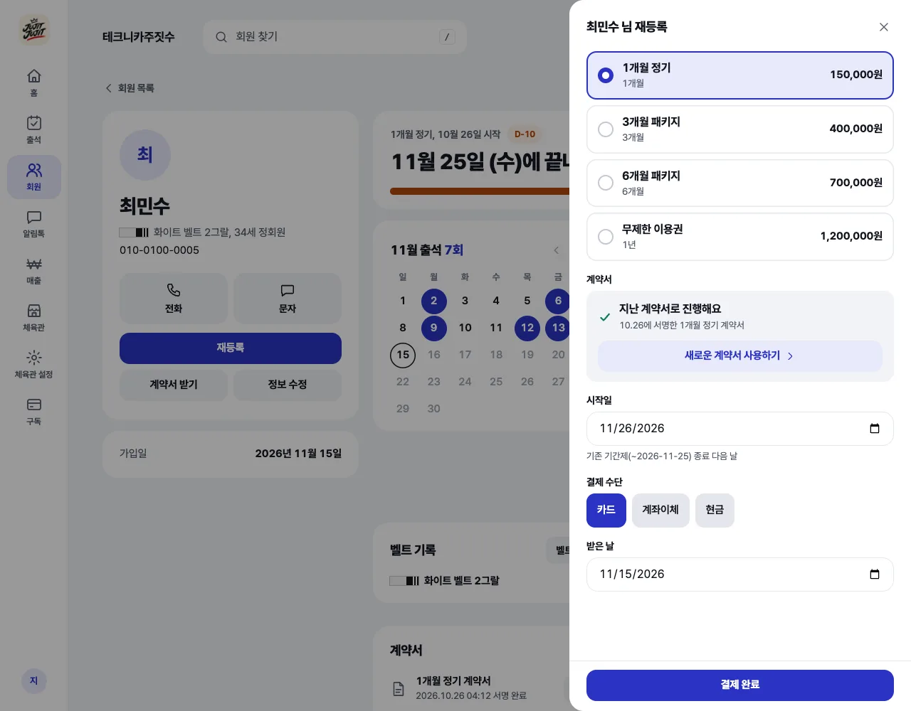

# 입관계약서 보내기

회원이 휴대폰으로 읽고 서명하는 전자 계약서예요. **회원 등록**과 **재등록** 화면에서 함께 받고, 회원은 앱 설치 없이 서명해요.

**이렇게 해요**

1. **회원** 탭에서 **회원 등록**, **오늘 처음 온 회원**을 눌러요.
2. 이름, 휴대폰, 회원권, 시작일을 넣어요. 계약서는 이 번호로 가요.
3. **계약서는 어떻게 받을까요?**에서 받는 방법을 골라요.
4. 결제를 받았으면 결제 수단과 받은 날을 넣고, 아직이면 **아직 안 받았어요**를 골라요.
5. 접수증을 확인하고 등록을 마쳐요.

받는 방법은 세 가지예요.

- **카카오톡으로 보내기**: 서명 링크가 알림톡으로 가요. 링크는 기본 48시간 열려 있고, **시간 바꾸기**로 6, 24, 48, 72시간 중에 골라요.
- **지금 여기서 서명**: 화면에 뜬 QR을 회원이 자기 휴대폰으로 찍어 서명해요.
- **이번엔 계약서 없이**: 종이 계약서를 이미 받았을 때 등록만 해요.

키즈 회원은 **키즈 회원이에요**를 켜고 보호자 이름과 휴대폰을 넣으면 보호자에게 가요.

<figure></figure>


[회원권](../members/membership-plans.md), 거기에 연결한 [계약서 양식](templates.md), [관장 서명](templates.md#관장-서명-등록하기)이 있어야 보낼 수 있어요. 없으면 등록 중에 **관장님 서명만 하면 돼요**가 나오고, 서명하면 기본 계약서를 만들어 회원권에 연결해 줘요.


## 재등록할 때

재등록 화면이 지난 계약서와 비교해 알아서 골라 줘요.

- **지난 계약서로 진행해요**: 회원권과 가격이 같아 회원 서명 없이 이어 가요. 새로 받으려면 **새로운 계약서 사용하기**를 눌러요.
- **회원권이나 가격이 달라 새 계약서를 받아요**: 새로 서명을 받아요.
- **처음 받는 계약서예요**: 이 회원에게 받은 계약서가 없어요.

<figure></figure>

재등록 없이 계약서만 받으려면 회원 상세 오른쪽 위 더보기에서 **계약서 받기**를 눌러요.

## 보낸 뒤 확인하기

서명을 기다리는 계약서는 홈 **할 일**에 모이고, 링크가 오늘 끝나는 건은 따로 알려 줘요. 회원 상세의 계약서 줄이나 매니저 앱 ☰ 의 **진행 중 계약서**에서 이렇게 해요.

- **다시 보내기**: 1분 간격으로 5번까지 보내요. 링크 시간이 지났을 때도 이걸 눌러요.
- **링크 복사**: 카카오톡 대화방 등에 직접 붙여 넣어요.
- **링크 취소**: 번호를 잘못 넣었을 때 취소하고 새로 보내요.

회원이 서명하면 매니저 알림이 오고, 계약서는 [서명 완료 계약서](signing-flow.md#서명이-끝나면)에 모여요.
