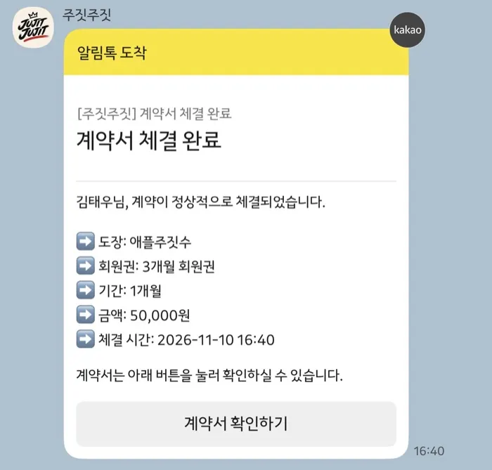
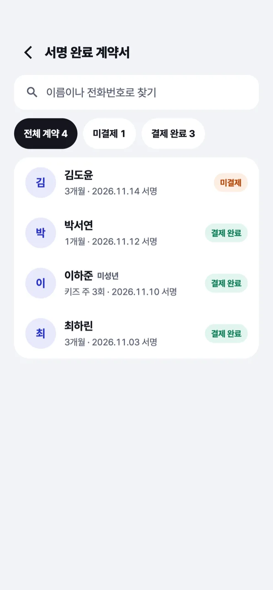

# 회원이 서명하는 과정

회원은 알림톡 링크나 QR로 열어 휴대폰 브라우저에서 서명해요. 회원에게 안내할 때 참고하세요.

**이렇게 해요**

1. **정보**: 실명, 주민등록번호 앞 7자리(생년월일 6자리와 뒷자리 첫째), 휴대폰 번호를 넣어요. 주민등록번호는 암호화해서 저장해요.
2. **확인**: 회원권, 금액, 기간과 조항을 읽고 **상기 내용을 모두 읽었으며 동의합니다**에 체크해요.
3. **서명**: 손가락으로 서명해요. 관장 서명은 미리 찍혀 있어요.
4. **계약이 완료되었습니다**가 보이면 끝이에요.

만 19세 미만이면 1단계에서 보호자 이름과 연락처를 넣고 **법정대리인의 동의를 받았습니다**에 체크해요. 이 보호자 정보는 [키즈 등하원](../attendance/kids.md) 알림에 바로 쓰여요.

## 서명이 끝나면

- 회원에게 **계약서 체결 완료** 알림톡이 가요.
- 관장님께 서명 완료 알림이 가요.
- 계약서가 **서명 완료 계약서**에 **결제 전** 상태로 들어가요.
- 두 서명이 들어간 PDF가 잠시 뒤 만들어져요. 실패하면 자동으로 다시 만들어요.

<figure></figure>

## 서명 완료 계약서

매니저 앱 ☰ 의 **계약서**, **서명 완료 계약서**에서 봐요. 웹은 **체육관 설정**의 **계약서**예요. 이름이나 번호로 찾고 상태로 걸러요.

- **결제 전**: 결제 기록이 없어요. 매니저 앱에서는 미결제로 보여요.
- **결제 완료**: 결제까지 기록했어요.
- **환불됨**: 이 계약으로 시작한 회원권을 환불했어요.

<figure></figure>

결제를 받았으면 **결제 전** 계약서를 열고 **결제 완료**에서 카드, 현금, 계좌이체 중에 골라요. 회원권이 시작되고 [매출](../members/sales.md)에 잡혀요. 등록 때 결제를 기록했다면 서명하자마자 **결제 완료**로 들어가요.

## 회원이 다시 볼 때

- 체결 완료 알림톡의 **계약서 확인하기**를 누르고, 계약 때 넣은 이름과 전화번호를 넣어요.
- [manager.thisisbjj.com/p/contracts](https://manager.thisisbjj.com/p/contracts)에서 계약서의 휴대폰 번호로 인증번호를 받아요. 미성년자 계약은 보호자 번호로도 되고, 인증은 30분 유지돼요.


링크는 정한 시간이 지나면 열리지 않아요. [다시 보내기](sending.md#보낸-뒤-확인하기)로 새로 보내 주세요. 이미 서명한 링크는 완료 화면으로 가서 두 번 서명할 수 없어요.

