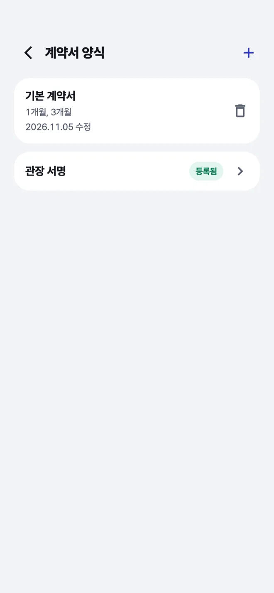
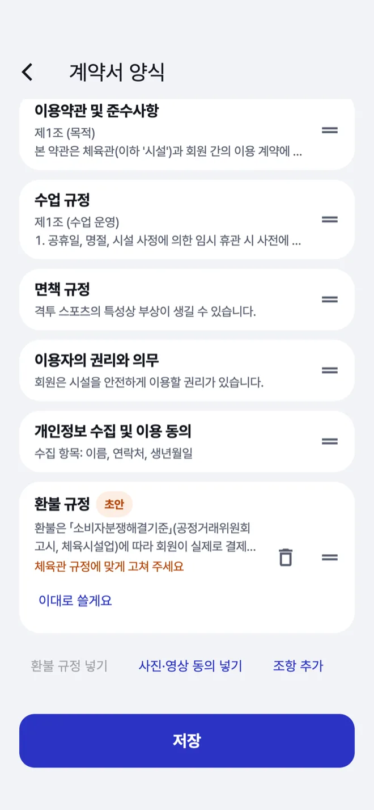

# 계약서 양식 고치기

계약서 양식은 입관계약서에 들어가는 조항 묶음이에요. 양식을 만들어 회원권에 연결하면, 그 회원권으로 등록하는 회원에게 이 양식으로 서명을 받아요. 양식을 새로 만들면 종목에 맞는 기본 조항이 채워져 있어서 체육관에 맞게 고치기만 하면 돼요.

양식은 웹 **체육관 설정** → **계약서**, 매니저 앱 ☰ → **계약서**에서 관리해요. 이 화면에 양식, 관장 서명, 서명 완료 계약서가 함께 있어요.

<figure><figcaption>양식마다 연결된 회원권이 보여요. 아래는 관장 서명 등록 상태예요.</figcaption></figure>

## 처음 들어 있는 조항

**양식 추가**를 누르면 체육관 종목에 맞는 기본 조항이 채워져요.

| 종목 | 처음 들어 있는 조항 |
|---|---|
| **주짓수** | 이용약관 및 준수사항, 수업 규정, 면책 규정, 이용자의 권리와 의무, 개인정보 수집 및 이용 동의 |
| **태권도** | 위 5개(태권도 내용) + 보호자 동의, 차량 이용 동의, 수련 중 부상 및 응급조치 동의, 사진 및 영상 촬영 동의 |
| **유도·그 외** | 주짓수 5개 조항을 종목에 맞는 말로 바꾼 것(도복 또는 운동복, 띠·급 승급) |
| **MMA·복싱·무에타이·킥복싱·레슬링** | 위와 같고 승급 조항은 빠져요 |

**예시**: 「도복(기) 또는 래쉬가드·쇼츠를 착용해야 하며」 같은 문장을 체육관 규칙에 맞게 「노기 수업은 래쉬가드 필수」로 바꿀 수 있어요.

## 조항 고치기

1. 양식을 눌러 열어요.
2. 조항을 눌러 제목과 내용을 고치고 **적용**을 눌러요.
3. 순서는 조항 오른쪽 손잡이(≡)를 끌어 바꿔요. 웹에서는 **위로** · **아래로**를 눌러요.
4. 필요 없는 조항은 **조항 지우기**(휴지통)로 지워요. 이용약관부터 개인정보 동의까지 기본 5개 조항에는 휴지통이 없어서, 지우지 않고 내용을 고쳐 써요.
5. 새 조항은 **조항 추가**로 넣어요.
6. 다 고쳤으면 **저장**을 눌러요.

<figure><figcaption>양식 편집. 맨 아래에 「환불 규정 넣기」 「사진·영상 동의 넣기」 「조항 추가」가 있어요.</figcaption></figure>

## 환불 규정과 사진·영상 동의 넣기

자주 쓰는 조항은 버튼 하나로 넣어요.

- **환불 규정 넣기**: 「소비자분쟁해결기준」(체육시설업)에 따른 환불 계산을 적은 초안이 들어가요. 회원 사정으로 해지할 때와 체육관 사정으로 해지할 때를 나눠 적었어요.
- **사진·영상 동의 넣기**: 수업 사진과 영상 촬영 동의 조항이 들어가요.

환불 규정에는 **초안** 표시와 「체육관 규정에 맞게 고쳐 주세요」가 붙어요. 내용을 고치면 표시가 사라지고, 그대로 쓸 거라면 **이대로 쓸게요**를 눌러요.


환불 규정 초안은 기준을 옮긴 예시예요. 체육관에서 실제로 안내하는 환불 방식과 맞는지 꼭 확인하고 고쳐 주세요.


## 회원권에 연결하기

양식은 회원권에 연결해야 쓸 수 있어요.

1. **회원권 관리**에서 회원권을 열어요.
2. **연결할 계약서**에서 양식을 골라요.
3. 저장해요. 회원권 목록에 「계약서 연결됨」이 붙어요.

**예시**: 「기본 계약서」는 성인 1개월·3개월에, 보호자 동의가 들어간 「키즈 계약서」는 키즈 회원권에 연결해요.


- 양식을 고쳐도 **이미 서명한 계약서는 바뀌지 않아요.** 회원이 서명한 그때의 내용이 그대로 남아요.
- 회원권에 연결된 양식은 지울 수 없어요. 회원권에서 다른 양식으로 바꾼 뒤 지워 주세요.


## 관장 서명 등록하기

관장 서명은 모든 입관계약서에 찍혀요. 서명이 없으면 계약서를 보낼 수 없어요.

1. **계약서** 화면에서 **관장 서명**을 눌러요.
2. **직접 그리기**로 손가락이나 마우스로 서명하거나, **사진 올리기**로 서명 사진을 올려요. 사진은 JPG·PNG·WEBP, 5MB 이하예요.
3. **서명 저장**을 눌러요. 바꾸고 싶으면 **새 서명으로 바꾸기**를 눌러요.

## 관련 페이지

- [입관계약서 보내기](sending.md) — 등록·재등록 때 보내기
- [회원이 서명하는 과정](signing-flow.md) — 회원이 보는 화면
- [회원권 만들기](../members/membership-plans.md) — 계약서 연결
- [체육관 설정](../billing/gym-settings.md) — 계약서 메뉴가 있는 곳
