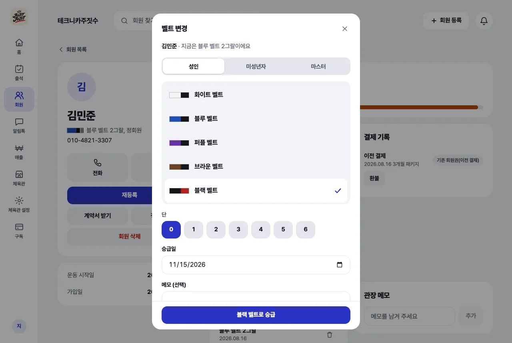

# 주짓수 벨트와 그랄

주짓수 체육관은 IBJJF 벨트와 그랄(0~4)로 회원 벨트를 기록해요. 블랙 벨트부터는 그랄 대신 단을 쓰고, 벨트 목록은 바꿀 수 없어요.

- **키즈**: 그레이, 옐로, 오렌지, 그린 순이에요. 색마다 화이트가 섞인 벨트, 단색 벨트, 블랙이 섞인 벨트로 나뉘고 각각 0~4그랄이에요.
- **성인**: 화이트, 블루, 퍼플, 브라운 벨트. 각각 0~4그랄이에요.
- **블랙**: 무단(0단), 1~6단
- **마스터**: 레드 블랙 벨트(7단), 레드 화이트 벨트(8단), 레드 벨트(9단)

## 한 명씩 벨트 바꾸기

1. 회원 상세 오른쪽 위 점 세 개 버튼을 누르고 **벨트 변경**을 골라요.
2. **성인**, **미성년자**, **마스터** 중 구분을 고르고 벨트를 골라요.
3. 그랄을 골라요. 블랙 벨트는 단을 골라요.
4. 승급일과 메모를 넣고 **블랙 벨트로 승급**처럼 고른 벨트 이름이 붙은 버튼을 눌러요.

<figure></figure>

바꾼 내용은 회원 상세 **승급 이력**에 쌓이고, 잘못 넣은 줄은 휴지통으로 지워요. 여러 명은 [승급식](bjj-ceremonies.md)으로 한 번에 올려요.


블랙 벨트의 단은 출석일로 정하지 않아서 승급식이 대상으로 추천하지 않아요. 필요하면 승급식에 직접 넣어요.


## 출석할 때 벨트 고르기

**체육관 설정**의 **출석할 때 벨트 설정**이 켜져 있으면(처음부터 켜짐), 벨트가 없는 회원이 [출석 키오스크](../attendance/kiosk.md)에서 출석할 때 한 번만 주니어나 시니어, 벨트 색, 그랄을 골라요. 이미 벨트가 있으면 묻지 않아요. 틀리게 골랐다면 회원 상세에서 고쳐 주세요.

## 회원 목록에서 보기

회원 목록 조건에서 **벨트**로 좁히고, **벨트 순**으로 정렬해요. 이름 옆에 벨트 색과 그랄이 보여요.
