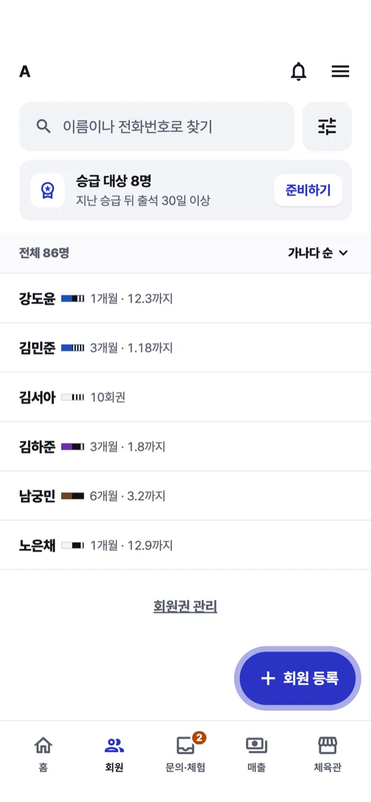
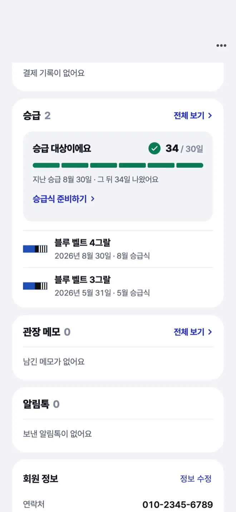
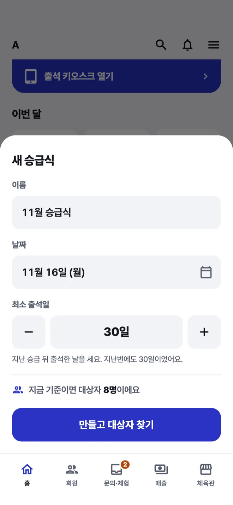
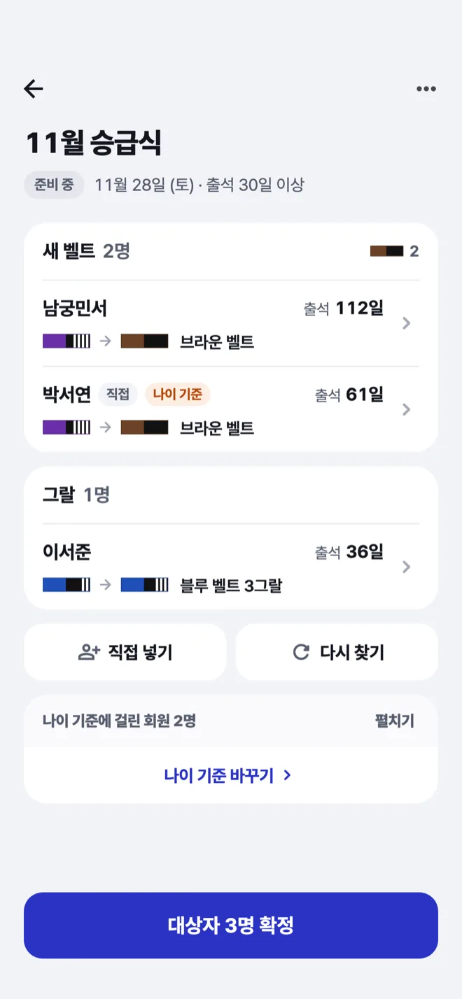
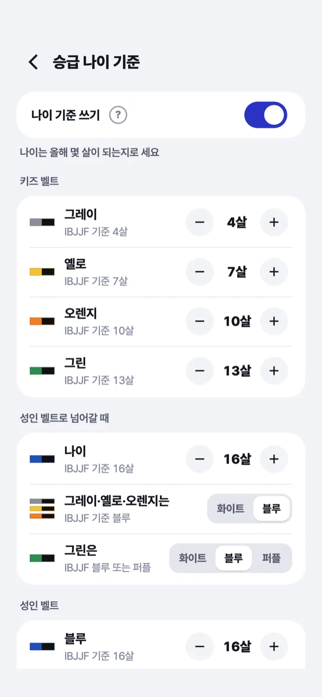

# 주짓수 승급식 (IBJJF 나이)

승급식은 여러 회원의 벨트를 한 번에 올리는 기능이에요. 최소 출석일과 나이 기준으로 대상자를 찾아 주고, 관장님이 빼거나 더한 뒤 **승급 실행**을 누르면 대상자의 벨트가 한꺼번에 바뀌어요. 나이 기준은 IBJJF 졸업 규정이 기본이고, 체육관에 맞게 고칠 수 있어요.


주짓수 체육관의 승급식이에요. 태권도는 [태권도 승급식](tkd-ceremonies.md)을 보세요. 한 명만 바꿀 때는 [주짓수 벨트와 그랄](bjj-belts.md#한-명씩-벨트-바꾸기)에서 해요.


## 승급식 들어가는 길

승급 대상이 생기면 세 곳에서 알려 줘요.

| 어디서 | 보이는 것 |
|---|---|
| **홈 할 일** | 「승급 대상 8명 · 지난 승급 뒤 30일 이상 나왔어요」. 진행 중인 승급식이나 승급식 날도 알려 줘요 |
| **회원 탭** | 찾기 칸 아래 한 줄 「승급 대상 8명」과 **준비하기** |
| **회원 상세 「승급」 칸** | 이 회원의 출석일 막대(예: 34 / 30일), 지난 승급일, **승급식 준비하기** |

<figure><figcaption>매니저 앱 회원 탭. 찾기 칸 아래에 승급 대상이 한 줄로 보여요.</figcaption></figure>

<figure><figcaption>회원 상세 「승급」 칸. 지난 승급 뒤 출석일과 기준을 막대로 보여 줘요.</figcaption></figure>

승급식 목록은 매니저 앱 ☰ → **회원** → **승급식**에 있어요. 웹은 위 세 곳에서 들어가고, 휴대폰 웹은 **전체** → **승급식**으로도 가요. 끝난 승급식도 목록에 남아요.

## 승급식 진행하기

**예시**: 11월 28일(토)에 승급식을 해요. 지난 승급 뒤 30일 이상 나온 회원을 대상으로 해요.

1. **새 승급식**을 열고 이름, 날짜, 최소 출석일을 넣어요. 최소 출석일은 지난 승급 뒤 출석한 날을 세고, 지난 승급식 기준이 미리 채워져요. 아래에 「지금 기준이면 대상자 8명이에요」가 바로 보여요.
2. **만들고 대상자 찾기**를 눌러요. 조건에 맞는 회원이 현재 벨트 → 올릴 벨트, 출석일과 함께 나와요.
3. 대상자를 고쳐요.
   - 올릴 벨트를 바꾸려면 회원을 눌러 **바꾸기**
   - 이번에 뺄 회원은 **제외**, 다시 넣으려면 **되돌리기**
   - 출석일은 모자라도 올릴 회원은 **직접 넣기**로 이름을 찾아 넣어요
   - 조건을 바꿨다면 **다시 찾기**. 직접 넣거나 뺀 회원은 그대로 남아요
4. **확정**을 눌러요. 대상자가 잠기고, 웹에서는 **엑셀로 받기**로 명단을 내려받을 수 있어요. 고칠 게 생기면 **확정 풀기**를 눌러요.
5. 승급식 날 **승급 실행**을 눌러요.

<figure><figcaption>새 승급식. 최소 출석일을 바꾸면 대상자 수가 바로 바뀌어요.</figcaption></figure>

<figure><figcaption>대상자는 「새 벨트」와 「그랄」로 나눠 보여요. 「직접」은 직접 넣은 회원이에요.</figcaption></figure>

**승급 실행**을 누르면 이렇게 돼요.

- 모든 대상자의 벨트가 올릴 벨트로 바뀌어요.
- 회원마다 승급 이력에 승급일과 승급식 이름이 남아요.
- 승급식이 **완료**로 바뀌어요.
- [자동 알림톡](../contracts/auto-messages.md)의 **승급 축하 알림**이 켜져 있으면 승급한 회원에게 축하 알림톡이 가요.


승급 실행은 되돌릴 수 없어요. 실행 전에 대상자와 올릴 벨트를 꼭 확인하세요. 잘못 올린 회원은 회원 상세에서 벨트를 다시 바꿔 주세요.



- 블랙 벨트 이상은 대상자로 찾지 않아요. 단을 올릴 회원은 **직접 넣기**로 넣어요.
- 벨트가 비어 있는 회원은 확정 전에 지금 벨트를 먼저 정해야 해요.


## 나이 기준 (IBJJF)

대상자를 찾을 때 IBJJF 졸업 규정의 최소 나이를 봐요. 나이는 **올해 몇 살이 되는지**로 세요. 생일이 지났는지는 보지 않아서, 올해 그 나이가 되는 회원부터 대상이에요.

| 기준 | IBJJF 기본값 |
|---|---|
| 키즈 벨트 최소 나이 | 그레이 4살 · 옐로 7살 · 오렌지 10살 · 그린 13살 |
| 성인 벨트로 넘어가는 나이 | 16살 |
| 넘어갈 때 받는 벨트 | 그레이·옐로·오렌지는 블루 벨트, 그린은 블루 벨트(퍼플도 고를 수 있어요) |
| 성인 벨트 최소 나이 | 블루 16살 · 퍼플 16살 · 브라운 18살 · 블랙 19살 |

**예시**: 올해 15살이 되는 그린 벨트 4그랄 회원은 성인 벨트로 넘어가는 나이(16살)가 안 돼서 대상자에 들지 않아요. 대신 「나이 기준에 걸린 회원」에 「올해 15살 · 성인 벨트는 16살부터」로 보여요.

나이 기준 때문에 빠진 회원은 승급식 화면 아래 **나이 기준에 걸린 회원 N명**에 따로 모여요. 펼쳐서 **넣기**를 누르면 대상자에 넣을 수 있고, 그 회원에게는 「나이 기준」 표시가 붙어요.

<figure><figcaption>「나이 기준에 걸린 회원」을 펼친 모습. 「넣기」로 대상자에 넣어요.</figcaption></figure>

### 체육관에 맞게 바꾸기

1. **체육관 설정** → **승급 나이 기준**을 열어요. 승급식 화면의 **나이 기준 바꾸기**로도 들어가요.
2. 키즈 벨트, 성인 벨트로 넘어갈 때, 성인 벨트 나이를 **−** · **+**로 바꿔요. 줄마다 IBJJF 기준값이 함께 보여요.
3. 나이를 보지 않으려면 **나이 기준 쓰기**를 꺼요.
4. 처음 값으로 돌리려면 맨 아래 **IBJJF 기준으로 되돌리기**를 눌러요. 나이 기준 쓰기도 다시 켜져요.

<figure><figcaption>승급 나이 기준. 바꾼 값 아래에 IBJJF 기준이 함께 보여요.</figcaption></figure>


생년월일이 없는 회원은 나이를 볼 수 없어서 나이 기준 없이 다음 단계를 제안해요. 정확히 하려면 회원 정보에 생년월일을 넣어 주세요.


## 관련 페이지

- [주짓수 벨트와 그랄](bjj-belts.md) — 벨트 체계, 한 명씩 바꾸기
- [자동 알림톡](../contracts/auto-messages.md) — 승급 축하 알림
- [출석 기록과 직접 출석](../attendance/records.md) — 출석일이 쌓이는 곳
- [체육관 설정](../billing/gym-settings.md) — 승급 나이 기준
