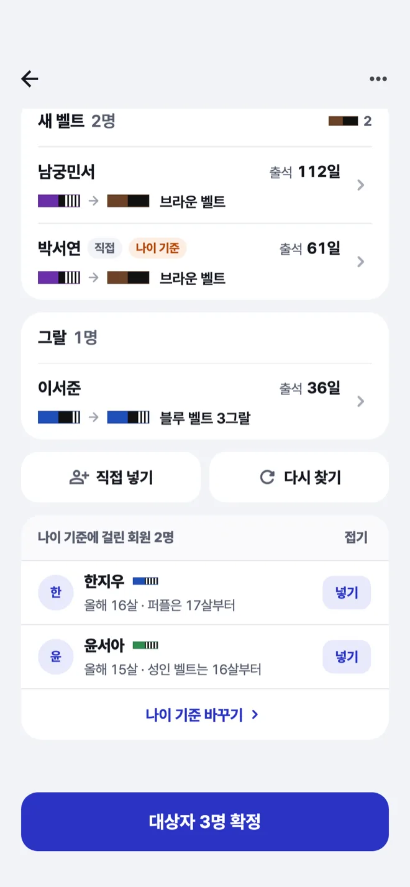

# 주짓수 승급식 (IBJJF 나이)

여러 회원의 벨트를 한 번에 올려요. 최소 출석일과 IBJJF 나이 기준으로 대상자를 찾아 주고, 관장님이 고친 뒤 실행해요.

**이렇게 해요**

1. 홈 **할 일**, 회원 탭의 승급 대상 줄, 회원 상세 **승급** 칸 중 한 곳에서 들어가요. 목록은 매니저 앱 ☰ 의 **회원**, **승급식**에 있어요.
2. **새 승급식**에 이름, 날짜, 최소 출석일을 넣어요. 최소 출석일은 지난 승급 뒤 나온 날이고, 지난 기준이 미리 채워져요.
3. **만들고 대상자 찾기**를 눌러요.
4. 회원을 눌러 올릴 벨트를 **바꾸기**, 뺄 회원은 **제외**, 더할 회원은 **직접 넣기**를 해요. 조건을 바꿨다면 **다시 찾기**를 눌러요. 직접 넣거나 뺀 회원은 그대로 남아요.
5. **확정**을 눌러요. 웹은 **엑셀로 받기**로 명단을 받아요. 고칠 게 생기면 **확정 풀기**를 눌러요.
6. 승급식 날 **승급 실행**을 눌러요.

<figure></figure>

<figure></figure>

실행하면 대상자 벨트가 바뀌고 승급 이력에 승급일과 승급식 이름이 남아요. [승급 축하 알림](../contracts/auto-messages.md)이 켜져 있으면 축하 알림톡도 가요.

블랙 벨트 이상은 대상자로 찾지 않으니 직접 넣어요. 벨트가 비어 있는 회원은 확정 전에 지금 벨트를 먼저 정해요.


승급 실행은 되돌릴 수 없어요. 잘못 올린 회원은 회원 상세에서 벨트를 다시 바꿔 주세요.


## 나이 기준 (IBJJF)

나이는 생일과 관계없이 올해 몇 살이 되는지로 세요.

- **키즈 벨트 최소 나이**: 그레이 4살, 옐로 7살, 오렌지 10살, 그린 13살
- **성인 벨트로 넘어가는 나이**: 16살. 블루 벨트를 받고, 그린은 퍼플도 고를 수 있어요.
- **성인 벨트 최소 나이**: 블루 16살, 퍼플 16살, 브라운 18살, 블랙 19살

나이 때문에 빠진 회원은 화면 아래 **나이 기준에 걸린 회원**에 모이고, **넣기**로 대상자에 넣어요. 생년월일이 없는 회원은 나이를 보지 않고 다음 단계를 제안해요.

<figure></figure>

## 나이 기준 바꾸기

1. **체육관 설정**의 **승급 나이 기준**을 열어요. 승급식 화면의 **나이 기준 바꾸기**로도 가요.
2. 나이를 **−**, **+**로 바꿔요. 줄마다 IBJJF 기준값이 함께 보여요.
3. 나이를 보지 않으려면 **나이 기준 쓰기**를 꺼요. **IBJJF 기준으로 되돌리기**를 누르면 처음 값으로 돌아가고 나이 기준 쓰기도 켜져요.

<figure></figure>

