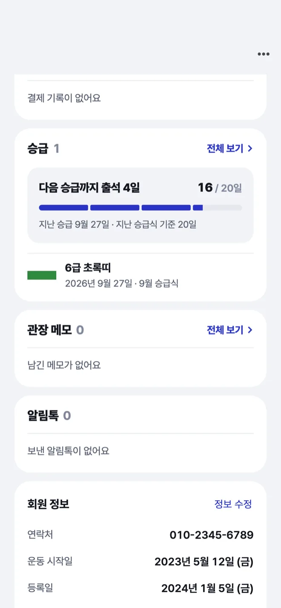

# 태권도 승급식

여러 회원의 띠를 한 번에 올려요. 진행은 [주짓수 승급식](bjj-ceremonies.md)과 같고, 그랄과 IBJJF 나이 기준 대신 만 15세로 품과 단을 가려요.

**이렇게 해요**

1. 홈 **할 일**, 회원 탭의 승급 대상 줄, 회원 상세 **승급** 칸 중 한 곳에서 들어가요. 매니저 앱 ☰ 의 **회원**, **승급식**에도 있어요.
2. **새 승급식**에 이름, 날짜, 최소 출석일을 넣고 **만들고 대상자 찾기**를 눌러요.
3. 대상자의 지금 띠와 목표 띠, 출석일을 확인해요.
4. 목표 띠를 바꾸거나 제외하거나 **직접 넣기**로 더해요. 목표 띠는 [띠 설정](tkd-ranks.md)에 있는 띠 중에서 골라요.
5. **확정**한 뒤 승급식 날 **승급 실행**을 눌러요. 웹은 **엑셀로 받기**로 명단을 받아요.

<figure></figure>

실행하면 띠가 한꺼번에 바뀌고 띠 이력이 남아요. [승급 축하 알림](../contracts/auto-messages.md)이 켜져 있으면 축하 알림톡이 가요.


승급 실행은 되돌릴 수 없어요. 대상자와 목표 띠를 꼭 확인하세요.


## 목표 띠 자동 제안

- **10급부터 2급**: 한 급 위
- **1급**: 만 15세 미만은 1품, 그 이상은 1단
- **품**: 만 15세 미만은 한 품 위, 넘으면 같은 숫자의 단
- **단**: 한 단 위

생년월일이 없는 1급과 품 회원은 목표 띠가 비어 화면 위에 따로 모여요. **띠 정하기**로 모두 골라야 실행할 수 있어요.

국기원 품, 단 심사 결과는 승급식이나 회원 상세에서 기록해 두세요.
