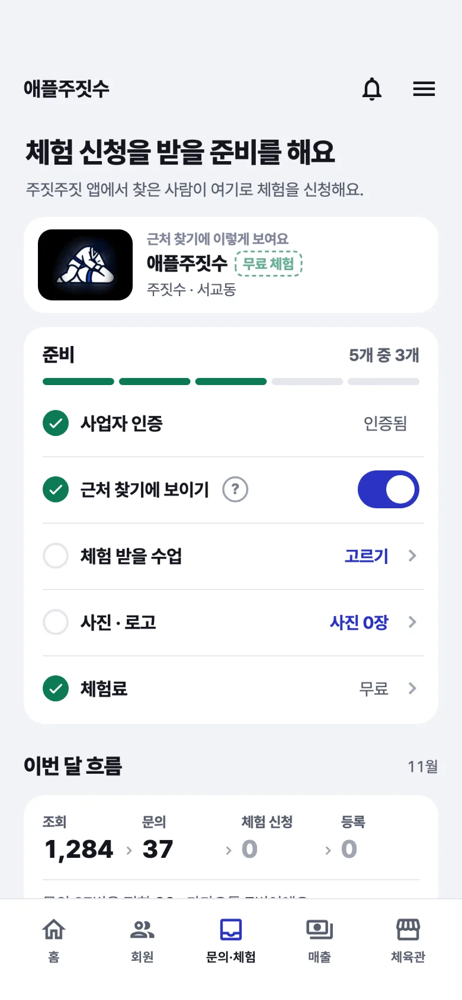

# ③ 체육관 페이지 꾸미기

체육관 페이지는 주짓주짓 앱에서 회원이 보는 우리 체육관 소개 화면이에요. 등록만 해도 근처 찾기에 보이지만, 사진·시간표·회비가 비어 있으면 눌러 본 사람이 체험을 신청하지 않아요. 이 쪽은 처음 채울 때의 순서만 모았어요. 항목마다 자세한 방법은 「새 회원 모으기」에 있어요. 모두 무료예요.

## 채우는 순서

매니저 앱 **문의·체험** 탭 맨 위 「준비」에 같은 순서가 나와요. 끝낸 줄에는 체크가 붙어요.

<figure><figcaption>
매니저 앱 「문의·체험」 탭의 준비 목록. 5개 중 몇 개를 끝냈는지 보여요.
</figcaption></figure>

1. **주소와 연락처** · 주소가 있어야 근처 찾기에 보여요. 문의 버튼에 쓸 전화나 카카오톡 주소도 넣어요. → [체육관 페이지와 근처 찾기](../new-members/gym-page.md)
2. **사진과 로고** · 운동 사진을 올려요. 1번 사진이 근처 찾기 목록 카드가 돼요. → [사진 올리기](../new-members/photos.md)
3. **소개** · 소개 글, 종목, 특징(키즈반·여성반·오픈매트)을 골라요. → [체육관 페이지와 근처 찾기](../new-members/gym-page.md)
4. **시간표** · 요일별 수업을 넣어요. → [시간표](../attendance/timetable.md)
5. **회비** · 기간과 금액을 넣고 앱에 공개할 회비를 켜요. → [체육관 페이지와 근처 찾기](../new-members/gym-page.md)
6. **체험 받을 수업과 체험료** · 시간표에서 체험 받을 칸을 고르고 체험료를 정해요. → [체험 수업 받기](../new-members/trial-classes.md)
7. **사업자 인증** · 인증을 마쳐야 체험 예약이 열려요. → [사업자 인증](../new-members/business-verification.md)


예시 · 주소 「서울 강남구 가로수길 43」, 사진 6장, 시간표 「월·수·금 19:30 일반」, 회비 「1개월 150,000원」, 체험 「무료 · 월·수·금 19:30」. 여기까지 채우면 근처 찾기에서 「무료 체험」 배지와 함께 상위 노출돼요.


## 어디서 고치나요

* 매니저 앱: **체육관** 탭 → **정보 수정**
* 웹: 왼쪽 메뉴 **체육관** → 체육관 페이지

한 번에 다 채우지 않아도 돼요. 항목마다 따로 저장돼요.


「관리 시작하기」를 누르지 않아도 체육관 페이지, 체험 수업 설정, 문의·체험은 계속 무료로 써요.


## 관련 페이지

* [체육관 페이지와 근처 찾기](../new-members/gym-page.md)
* [체험 수업 받기](../new-members/trial-classes.md)
* [④ 관리 시작하기](start-management.md)
