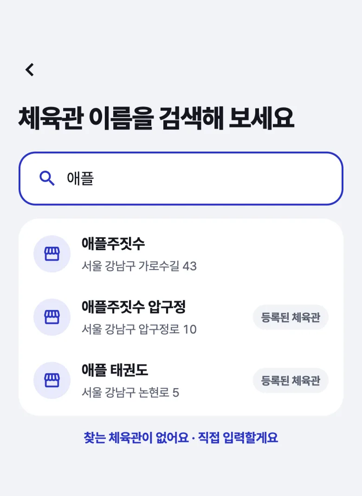

# 체육관 등록

승인을 기다리지 않아요. 등록하면 바로 쓰고, 주소가 있으면 주짓주짓 앱 근처 찾기에도 바로 보여요.

## 이렇게 해요

1. 종목을 골라요. 앱에 없는 종목은 **기타 체육관**으로 등록하고 **체육관 설정**의 **종목**에서 바꿔요.
2. 체육관 이름이나 주소로 검색해 우리 체육관을 골라요.
3. 주소와 전화를 확인하고 **이 체육관으로 시작하기**를 눌러요.

<figure><figcaption></figcaption></figure>

검색에 없으면 **찾는 체육관이 없어요, 직접 입력할게요**를 눌러 이름과 주소를 넣어요.

매니저 앱은 등록 직후 근처 찾기에 보일지, 체험을 무료로 받을지 물어요. 둘 다 나중에 **체육관 설정**에서 바꿔요.

## 이미 등록된 체육관

* **제 체육관이에요**가 보이면 눌러서 사업자 정보를 넣어요. 운영팀이 확인하고 보통 영업일 하루 안에 넘겨 드려요.
* 다른 관장님이 쓰고 있으면 고를 수 없어요. [카카오톡 채널](https://pf.kakao.com/_NnxmZX)로 문의해 주세요.


체육관은 한 계정에 하나예요. 지점이 여러 곳이면 카카오톡 채널로 문의해 주세요.


다음은 [체육관 페이지 꾸미기](gym-page-setup.md)예요.
