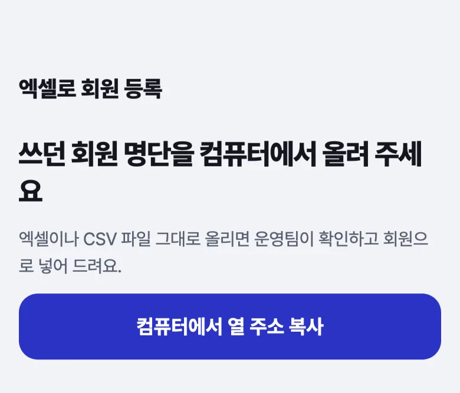

# ⑤ 회원 옮기기

회원 옮기기는 다른 프로그램이나 엑셀로 관리하던 회원 명단을 주짓주짓 매니저로 한 번에 넣는 일이에요. 쓰던 프로그램에서 내려받은 엑셀이나 CSV 파일을 **양식 그대로** 올리면, 운영팀이 확인하고 회원으로 넣어 드려요. 칸 이름이나 순서를 맞추지 않아도 돼요.


회원 옮기기는 [④ 관리 시작하기](start-management.md)를 누른 뒤에 쓸 수 있어요.


## 진행 순서

1. 웹 **체육관 설정 → 엑셀로 회원 등록**으로 가요. 회원이 없을 때 홈과 회원 목록에 보이는 **엑셀 파일 올리기**로도 가요.
2. **파일 고르기**를 눌러 명단 파일을 골라요.
3. **데이터 이전 약관 보기**를 읽고 **약관에 동의해요**에 체크해요.
4. **엑셀로 회원 등록**을 눌러요. 「파일을 받았어요. 운영팀이 확인하고 회원으로 넣어 드릴게요.」가 나오면 접수가 끝나요.
5. 운영팀이 등록을 마치면 회원 목록에서 확인해요.

| 항목 | 내용 |
| --- | --- |
| 파일 형식 | 엑셀(xlsx, xls) 또는 CSV |
| 파일 크기 | 5MB 이하 |
| 있어야 하는 정보 | 회원 이름, 전화번호, 회원권 시작한 날·끝나는 날처럼 등록에 필요한 정보 |


예시 · 쓰던 프로그램에서 내려받은 「회원명단.xlsx」에 이름, 전화번호, 회원권, 시작일, 종료일 칸이 있으면 그대로 올리면 돼요. 칸 이름이 「연락처」든 「휴대폰」이든 상관없어요.


## 매니저 앱에서는

파일 올리기는 컴퓨터에서 해요. 매니저 앱 **☰ → 엑셀로 회원 등록**에서 **컴퓨터에서 열 주소 복사**를 누르고, 그 주소를 컴퓨터 브라우저에서 열어요.

<figure><figcaption>
매니저 앱에서는 컴퓨터에서 열 주소를 복사해요.
</figcaption></figure>

## 올린 파일 상태

| 상태 | 뜻 |
| --- | --- |
| **접수 완료** | 운영팀이 확인하고 있어요. 이 동안에는 새 파일을 올릴 수 없어요 |
| **완료** | 등록이 끝났어요. 회원 목록에서 확인하세요 |
| **반려** | 등록에 필요한 정보가 빠졌어요. 화면에 나온 사유를 보고 파일을 고쳐 다시 올려 주세요 |

<figure><figcaption>
올린 파일과 상태. 반려되면 사유가 함께 보여요.
</figcaption></figure>


처리되지 못한 파일은 **3주**가 지나면 지워져요. 그때는 파일을 다시 올려 주세요. 등록 뒤 **72시간 안에는** 운영팀에 문의해 되돌릴 수 있고, 그 뒤에는 회원별로 직접 고쳐야 해요.


## 몇 명뿐이라면

회원이 몇 명뿐이라면 **회원 등록 → 이미 다니던 회원**으로 직접 넣는 편이 빨라요. 시작한 날만 고르면 끝나는 날은 알아서 계산돼요. → [이미 다니던 회원 넣기](../members/existing-members.md)

## 옮긴 뒤 할 일

* 주짓수 체육관: 벨트는 출석할 때 회원이 직접 고르게 하면 편해요. → [주짓수 벨트와 그랄](../disciplines/bjj-belts.md)
* 태권도 체육관: 회원 상세나 승급식에서 띠를 정해 주세요. → [태권도 승급식](../disciplines/tkd-ceremonies.md)
* 키즈 회원은 회원 상세에 **보호자 연락처**를 넣어야 등·하원 알림이 가요. → [키즈 등·하원](../attendance/kids.md)

## 관련 페이지

* [이미 다니던 회원 넣기](../members/existing-members.md)
* [회원 등록과 회원 상세](../members/README.md)
* [출석 키오스크](../attendance/kiosk.md)
