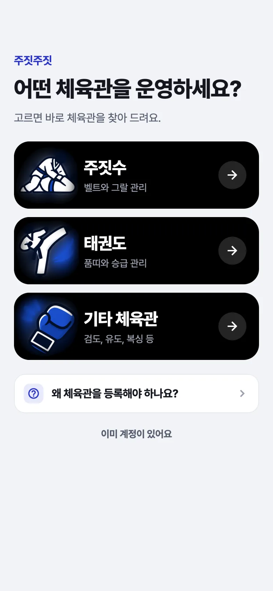

# 가입과 로그인

처음 로그인하면 그대로 가입돼요. 따로 가입 양식은 없어요.

## 이렇게 해요

1. **휴대폰 번호로 시작하기**를 눌러요.
2. 번호를 넣고 **인증번호 받기**를 눌러요.
3. 받은 6자리 번호를 넣고 **확인하고 시작하기**를 눌러요.

인증번호는 3분 동안 유효하고, 번호당 하루 5번까지 받아요. 매니저 앱에서 1분 안에 오지 않으면 **알림톡으로 받기**를 눌러요.

## 카카오, 네이버, 구글, Apple

버튼을 누르고, 처음이면 휴대폰 인증을 한 번 더 해요. Apple은 iPhone 앱에만 있어요. 어떤 방법으로 들어와도 같은 번호면 계정은 하나예요.

## 매니저 앱에서 처음 시작할 때

종목을 고르고 체육관을 찾은 뒤 로그인해요. 계정이 있으면 **이미 계정이 있어요**를 눌러요.

<figure><figcaption></figcaption></figure>

## 로그아웃과 계정 삭제

웹은 **체육관 설정**의 **내 프로필**, 앱은 **☰** 메뉴 맨 아래에 있어요. 삭제한 계정의 개인정보는 3달 보관한 뒤 지우고, 원하면 바로 지워요.


구독 중이면 계정을 지우기 전에 구독부터 정리해 주세요. 결제와 계약 기록은 법령에 따라 정해진 기간 동안 남아요.

