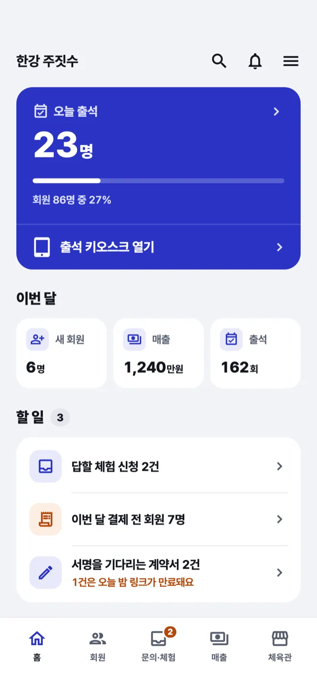

# 주짓주짓 매니저 한눈에

주짓주짓 매니저는 체육관 홍보와 체육관 관리를 함께 하는 서비스예요. 웹과 iPhone 앱에서 같은 체육관을 써요.

| 구분 | 하는 일 | 요금 |
| --- | --- | --- |
| 체육관 홍보 | 체육관 페이지, 근처 찾기 노출, 체험 신청 받기 | 계속 무료 |
| 체육관 관리 | 회원, 출석 키오스크, 입관계약서, 승급식, 매출, 알림톡 | **관리 시작하기**부터 30일 무료, 그 뒤 [구독](../billing/subscription.md) |

## 종목

주짓수, MMA, 복싱, 무에타이, 킥복싱, 태권도, 유도, 레슬링, 그 외 종목을 등록해요. 종목에 맞춰 띠와 계약서 초안이 바뀌어요.

* [주짓수 벨트와 그랄](../disciplines/bjj-belts.md)
* [태권도 띠 설정](../disciplines/tkd-ranks.md)
* [띠 없는 종목](../disciplines/no-belt.md)

## 매니저 앱 화면

관리를 시작하면 **홈**에서 오늘 출석, 이번 달 숫자, 할 일을 봐요.

<figure><figcaption></figcaption></figure>

* **홈**: 오늘 출석, 출석 키오스크 열기, 할 일
* **회원**: 회원 찾기와 등록, 재등록
* **문의·체험**: 체험 신청 확정과 거절
* **매출**: 매출, 결제 내역
* **체육관**: 체육관 페이지, 공지, 체험 수업 설정

회원권, 계약서, 구독 같은 나머지는 **☰** 메뉴에 있어요. 웹 메뉴는 [웹과 iPhone 앱](web-and-app.md)에 있어요.
