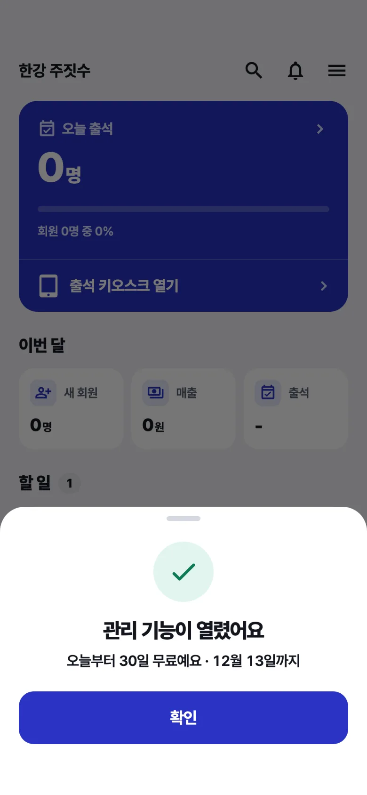

# ④ 관리 시작하기

「관리 시작하기」는 주짓주짓 매니저의 체육관 관리 기능을 여는 버튼이에요. 체육관을 등록하기만 하면 체육관 페이지와 체험 신청만 쓸 수 있고, 이 버튼을 누르면 회원·회원권, 출석 키오스크, 입관계약서, 승급식, 매출·알림톡이 열려요. 누른 날부터 **30일 무료**이고 카드는 등록하지 않아요.

## 시작하기 전과 뒤

| | 시작하기 전 | 시작한 뒤 |
| --- | --- | --- |
| 체육관 페이지, 근처 찾기 노출 | 쓸 수 있어요 | 쓸 수 있어요 |
| 체험 수업 설정, 문의·체험 | 쓸 수 있어요 | 쓸 수 있어요 |
| 회원, 출석, 계약서, 승급식, 매출, 알림톡 | 「관리 시작하기」 안내가 나와요 | 쓸 수 있어요 |


예시 · 11월 14일에 「관리 시작하기」를 누르면 12월 13일까지 30일 무료예요. 체육관을 10월에 등록했어도 30일은 누른 날부터 세요.


## 시작하는 법

### 매니저 앱

1. 아래 탭에서 **홈**, **회원**, **매출** 중 하나를 눌러요. 시작 전에는 매니저 소개 화면이 나와요.
2. **매니저로 내 체육관 관리 시작하기**를 눌러요.
3. 「관리 기능이 열렸어요 · 오늘부터 30일 무료예요」가 나오면 **확인**을 눌러요. 홈으로 가요.

<figure><figcaption>
관리를 시작하기 전 회원 탭. 체육관 페이지에 빈 칸이 있으면 위에 「채우기」 안내가 함께 나와요.
</figcaption></figure>

<figure><figcaption>
누르면 무료 기간이 언제까지인지 바로 알려 줘요.
</figcaption></figure>

### 웹

1. [manager.thisisbjj.com](https://manager.thisisbjj.com)에서 **홈**이나 **회원**처럼 관리 화면을 열어요.
2. 「주짓주짓 매니저로 내 체육관 관리 시작하기」 아래 **관리 시작하기**를 눌러요.
3. 「오늘부터 30일 무료예요 · ○월 ○일까지」가 보이면 끝이에요.


두 번 눌러도 한 번만 시작돼요. 앱과 웹 중 한 곳에서만 누르면 돼요.


## 시작 가이드 

관리를 시작했는데 회원이 아직 없으면 홈에 「N가지만 하면 출석을 받을 수 있어요」가 나와요. 세 단계를 차례대로 하면 돼요.

| 순서 | 할 일 | 자세히 |
| --- | --- | --- |
| 1 | **회원권** · 1개월, 3개월, 10회권처럼 체육관에서 파는 회원권을 넣어요 | [회원권 만들기](../members/membership-plans.md) |
| 2 | **회원** · 쓰던 명단을 올리거나 한 명씩 넣어요 | [⑤ 회원 옮기기](import-members.md) · [이미 다니던 회원 넣기](../members/existing-members.md) |
| 3 | **첫 출석** · 태블릿에 키오스크를 띄우면 회원이 번호만 눌러요 | [출석 키오스크](../attendance/kiosk.md) |

* 지금 할 단계가 펼쳐져 있고, 끝난 단계에는 체크가 붙어요.
* 명단 파일을 올렸다면 운영팀이 확인하는 동안 「운영팀이 확인하고 있어요」로 보여요.
* 매니저 앱에서 시작 가이드를 닫았다면 **☰ → 체육관 설정 → 시작 가이드 다시 보기**로 다시 열어요.

## 30일이 끝나면

무료 기간이 끝나기 전에 매니저 앱 홈에 「무료 이용 기간이 곧 끝나요」가 보여요. 남은 날은 웹 **구독** 화면에서도 볼 수 있어요. 구독하지 않으면 관리 기능은 **볼 수만 있게** 잠겨요. 넣어 둔 회원과 출석 기록은 그대로 남아요. 체육관 페이지와 체험 신청은 계속 무료예요.

→ [요금과 구독](../billing/subscription.md)

## 관련 페이지

* [⑤ 회원 옮기기](import-members.md)
* [출석 키오스크](../attendance/kiosk.md)
* [요금과 구독](../billing/subscription.md)
