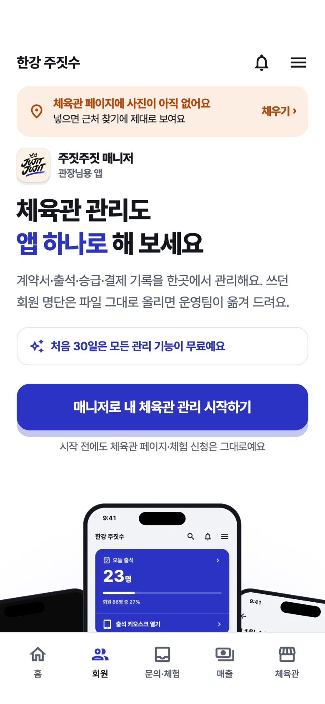

# 관리 시작하기

누르면 회원, 출석 키오스크, 입관계약서, 승급식, 매출, 알림톡이 열려요. 체육관을 등록한 날이 아니라 누른 날부터 30일 무료이고, 카드는 등록하지 않아요.

## 이렇게 해요

1. 매니저 앱에서 **홈**, **회원**, **매출** 탭 중 하나를 눌러요.
2. **매니저로 내 체육관 관리 시작하기**를 눌러요.
3. 무료 기간 안내가 나오면 **확인**을 눌러요.

<figure><figcaption></figcaption></figure>

웹은 관리 화면의 **관리 시작하기**를 눌러요. 앱과 웹 중 한 곳에서만 누르면 돼요.

## 시작 가이드 

회원이 없으면 홈에 세 단계가 나와요.

1. [회원권 만들기](../members/membership-plans.md)
2. [회원 옮기기](import-members.md)나 [이미 다니던 회원 넣기](../members/existing-members.md)
3. [출석 키오스크](../attendance/kiosk.md)로 첫 출석 받기

닫은 가이드는 **☰** 메뉴의 **체육관 설정**에서 **시작 가이드 다시 보기**로 열어요.

## 30일이 끝나면

구독하지 않으면 관리 기능은 볼 수만 있게 잠겨요. 회원과 출석 기록은 그대로 남고, 체육관 페이지와 체험 신청은 계속 무료예요. [요금과 구독](../billing/subscription.md)
