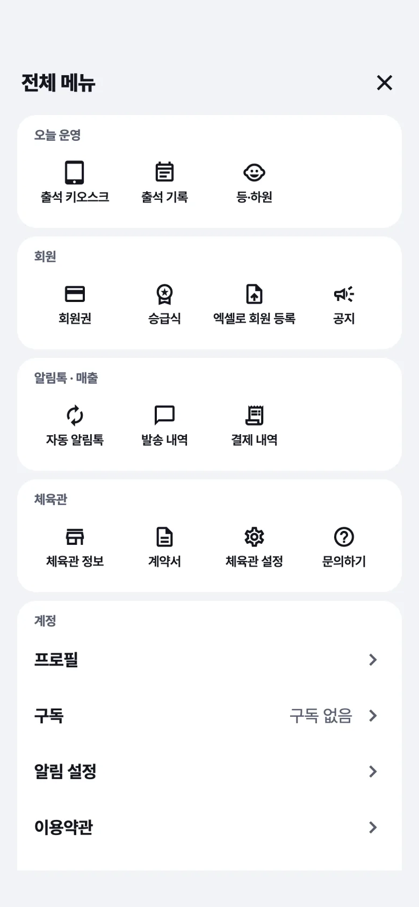
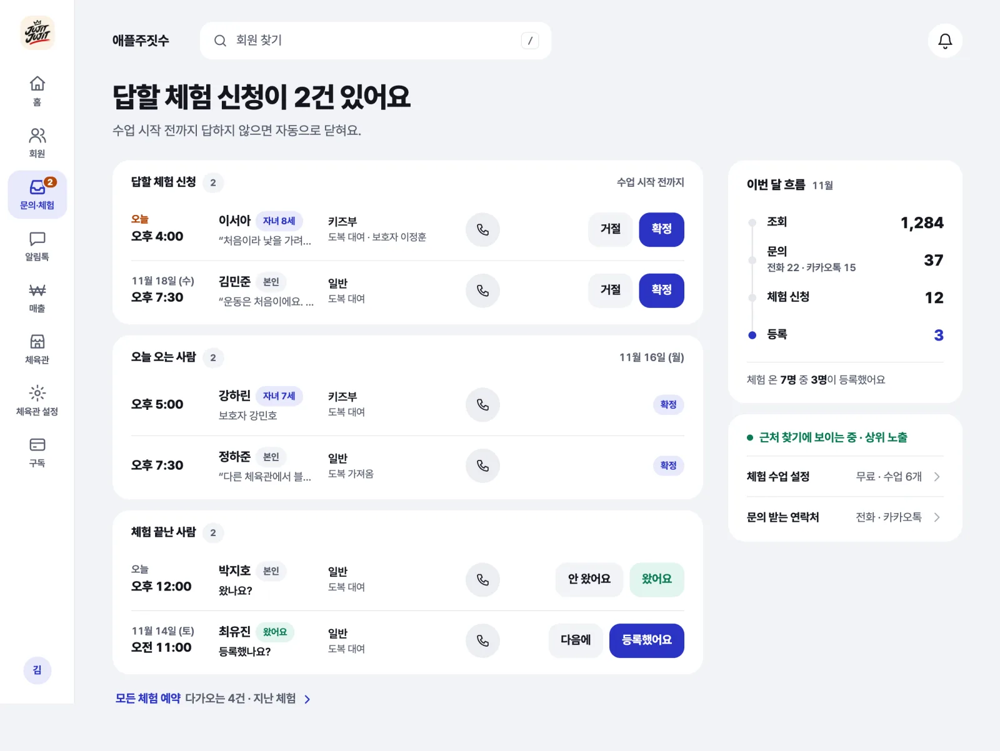

# 웹과 iPhone 앱

주짓주짓 매니저는 두 곳에서 써요. **웹**은 PC나 휴대폰 브라우저로 [manager.thisisbjj.com](https://manager.thisisbjj.com)에 들어가 쓰고, **iPhone 앱**은 앱스토어의 [주짓주짓 매니저](https://apps.apple.com/kr/app/id6759941989)를 설치해 써요. 같은 계정으로 로그인하면 같은 체육관이 보이고, 한쪽에서 고친 내용은 다른 쪽에도 바로 반영돼요.


예시 · 체육관에서는 앱으로 체험 신청을 확정하고, 저녁에 PC 웹에서 결제 내역을 엑셀로 내려받아요.


## 매니저 앱 화면

아래 탭 다섯 개와 오른쪽 위 **☰ 메뉴**로 움직여요.

| 탭 | 하는 일 |
| --- | --- |
| 홈 | 오늘 출석, 출석 키오스크 열기, 이번 달 숫자, 할 일 |
| 회원 | 회원 찾기·등록, 재등록, 결제 기록 |
| 문의·체험 | 답할 체험 신청, 오늘 오는 사람, 이번 달 흐름 |
| 매출 | 이번 달 매출, 결제 내역 |
| 체육관 | 체육관 페이지, 공지, 체험 수업 설정 |

**☰ 메뉴**에는 출석 키오스크·출석 기록·등·하원, 회원권·승급식·엑셀로 회원 등록·공지, 자동 알림톡·발송 내역·결제 내역, 체육관 정보·계약서·체육관 설정·문의하기가 있어요. 맨 아래에 프로필, 구독, 알림 설정, 로그아웃이 있어요.

<figure><figcaption>
매니저 앱 ☰ 전체 메뉴
</figcaption></figure>

## 웹 화면

PC에서는 왼쪽 메뉴로 움직여요. 휴대폰 브라우저에서는 아래 탭(홈 · 회원 · 문의·체험 · 매출 · 전체)으로 바뀌어요.

| 왼쪽 메뉴 | 하는 일 |
| --- | --- |
| 홈 | 오늘 할 일, 이번 달 매출, 오늘 출석, 출석 기록, 등·하원 |
| 회원 | 회원 목록, 회원권, 승급식, 엑셀로 회원 등록 |
| 문의·체험 | 체험 신청 확정·거절, 이번 달 흐름 |
| 알림톡 | 보낸 기록, 자동 알림톡 |
| 매출 | 매출, 결제 내역 |
| 체육관 | 체육관 페이지, 공지, 체험 수업 설정 |
| 체육관 설정 | 체육관 정보, 회원권, 계약서, 키오스크 비밀번호, 알림 설정 → [체육관 설정](../billing/gym-settings.md) |
| 구독 | 구독 시작·카드 변경·해지 → [요금과 구독](../billing/subscription.md) |

<figure><figcaption>
PC 웹 「문의·체험」. 왼쪽 메뉴가 늘 보여요.
</figcaption></figure>

## 웹에서만 하는 일

| 일 | 이유와 방법 |
| --- | --- |
| 구독 결제, 카드 변경, 해지 | iPhone 앱에서는 결제하지 않아요. 앱 **구독**에서는 상태만 봐요 → [요금과 구독](../billing/subscription.md) |
| 회원 명단 파일 올리기 | 앱에서는 컴퓨터에서 열 주소를 복사해 줘요 → [⑤ 회원 옮기기](import-members.md) |
| 엑셀로 내려받기 | 결제 내역, 승급식 명단을 엑셀 파일로 받아요 |
| 체육관 페이지 실시간 미리 보기 | 고치는 대로 오른쪽에 주짓주짓 앱 모습이 보여요 → [체육관 페이지와 근처 찾기](../new-members/gym-page.md) |

## 출석 키오스크는 어디서나

출석 키오스크는 태블릿·PC·휴대폰 어디서든 켤 수 있어요. 매니저 앱이 깔린 기기는 앱에서 바로 열고, 다른 기기는 웹 주소로 열어요. → [출석 키오스크](../attendance/kiosk.md)

## 알림

체험 신청, 계약서 서명, 결제 같은 일이 생기면 알려 드려요. 앱은 휴대폰 푸시로, 웹은 오른쪽 위 종 모양에서 봐요. 받을 알림과 조용한 시간(이 시간에는 푸시를 울리지 않아요)은 **알림 설정**에서 정해요.

## 관련 페이지

* [① 가입과 로그인](login.md)
* [주짓주짓 매니저 한눈에](overview.md)
* [체육관 설정](../billing/gym-settings.md)
