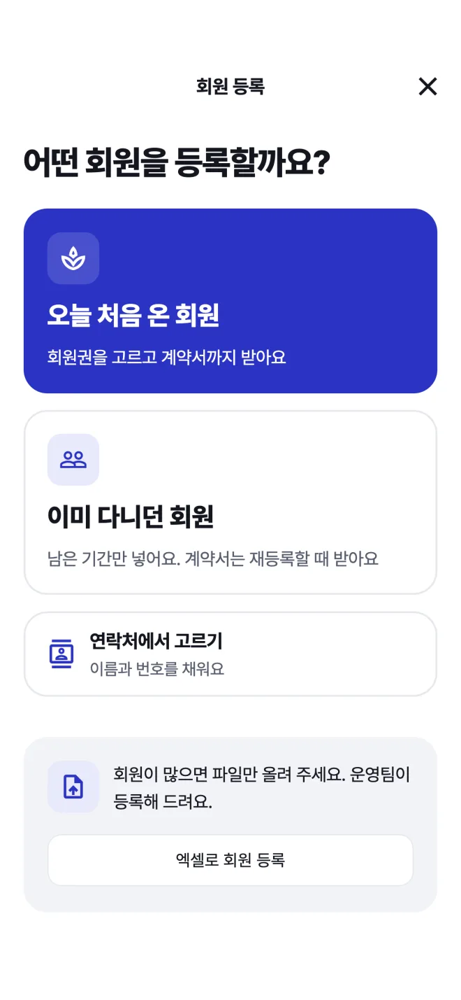
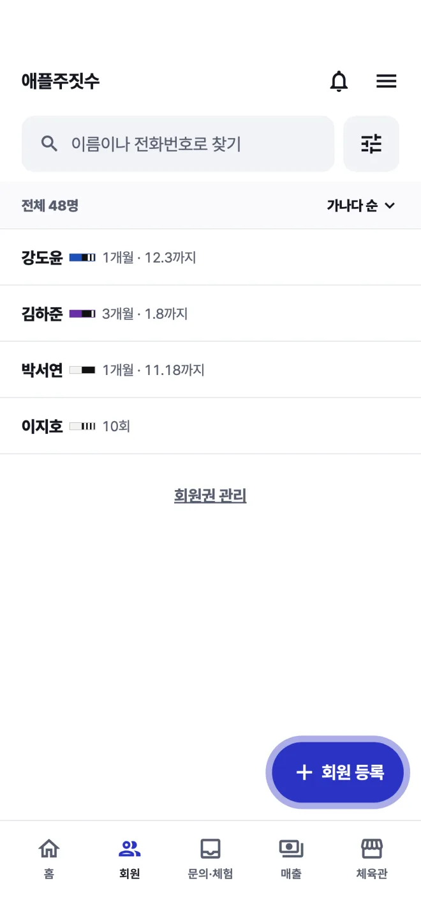
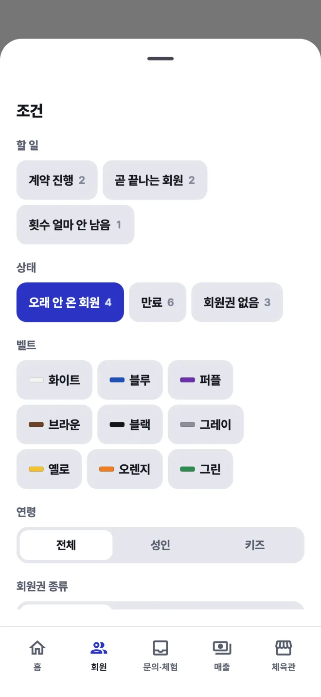

# 회원 등록과 회원 상세

회원은 이름과 휴대폰 번호로 등록하고, 회원권을 붙여 기간과 출석을 관리해요. [관리 시작하기](../getting-started/start-management.md)를 누른 뒤에 열려요.

## 회원 등록

원래 다니던 회원은 [이미 다니던 회원 넣기](existing-members.md)로, 많으면 [명단 파일](../getting-started/import-members.md)로 옮겨요. 오늘 처음 온 회원은 이렇게 등록해요.

1. 회원 탭의 **회원 등록**에서 **오늘 처음 온 회원**을 골라요.
2. 이름과 휴대폰 번호를 넣어요. 미성년자면 **키즈 회원이에요**를 켜고 보호자 이름과 휴대폰을 넣어요.
3. 회원권과 시작일을 골라요.
4. 계약서를 받을 방법을 골라요. **카카오톡으로 보내기**, **지금 여기서 서명**, **이번엔 계약서 없이** 중 하나예요.
5. 결제 수단과 받은 날을 고르거나 **아직 안 받았어요**를 눌러요.
6. 내용을 확인하고 등록해요.

<figure></figure>


결제는 쓰던 방식대로 받고 매니저에는 기록만 남겨요. 키즈 회원은 계약서가 보호자 번호로 가고, 출석하면 보호자에게 등원 알림톡이 가요.


## 회원 목록

이름이나 전화번호로 찾고, 찾기 칸 옆 조건 버튼으로 좁혀요.

* 할 일: 계약 진행, 곧 끝나는 회원, 횟수 얼마 안 남음
* 상태: 오래 안 온 회원, 만료, 회원권 없음
* 벨트, 연령, 회원권 종류

조건마다 기준은 [곧 끝나는 회원](expiring.md)에 있어요. 정렬은 가나다, 만료일, 최근 출석, 나이, 벨트 순으로 바꾸고, 한 번 더 누르면 방향이 바뀌어요.

<figure></figure> <figure></figure>

## 회원 상세

회원을 누르면 회원권, 출석 달력, 결제 기록, 승급 이력, 관장 메모, 보낸 알림톡, 회원 정보가 한 화면에 보여요. 관장 메모는 회원에게 보이지 않아요.

* 맨 위 회원권 카드에서 **재등록**과 **계약서 보기**를 해요.
* 결제 기록의 회원권을 누르면 **결제 기록**, **기록 취소**, **환불**, **횟수 고치기**를 해요. 서명을 기다리는 계약서는 다시 보내거나 링크를 취소해요. [결제 기록](payments.md)
* **정보 수정**으로 회원 정보를 고쳐요. 회원이 계약서에 직접 서명했다면 이름, 번호, 생년월일은 고칠 수 없어요.
* 오른쪽 위 메뉴의 **회원 삭제**는 정보와 메모를 지우고 되돌릴 수 없어요.

<figure></figure> <figure></figure>

