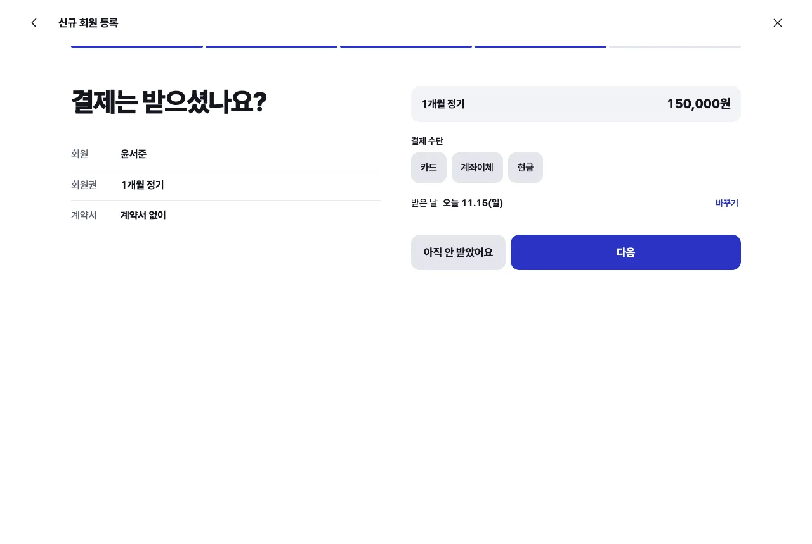
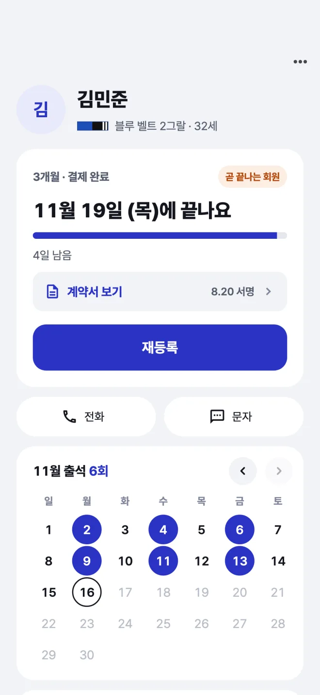
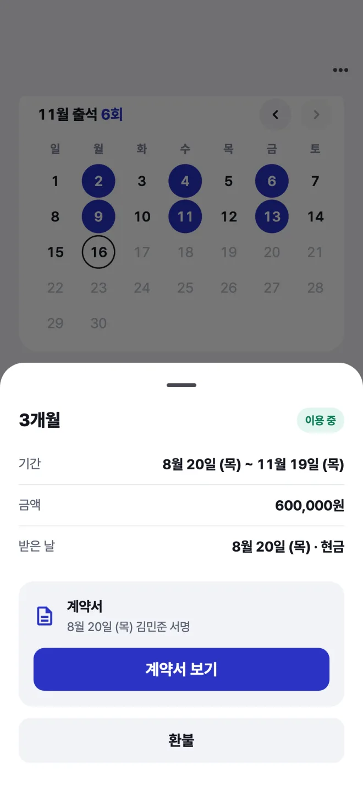

# 회원 등록과 회원 상세

회원은 체육관에 다니는 사람 한 명이에요. 이름과 휴대폰 번호로 등록하고, 회원권을 붙여 남은 기간과 출석을 관리해요. 등록한 회원은 회원 목록에 모이고, 누르면 회원 상세가 열려요.


회원 관리는 「관리 시작하기」를 누른 뒤에 열려요. → [관리 시작하기](../getting-started/start-management.md)


## 회원 등록

회원 등록은 두 갈래예요. 오늘 처음 온 사람은 「오늘 처음 온 회원」, 원래 다니던 사람을 옮길 때는 「이미 다니던 회원」을 골라요.

| 고르기 | 언제 | 넣는 것 |
|---|---|---|
| **오늘 처음 온 회원** | 새로 등록하는 사람 | 회원권, 계약서, 결제 |
| **이미 다니던 회원** | 쓰던 회원권이 남아 있는 사람 | 쓰던 회원권과 남은 기간(횟수)만. 계약서는 재등록할 때 받아요 → [이미 다니던 회원 넣기](existing-members.md) |

회원이 많으면 쓰던 명단 파일만 올려 주세요. 운영팀이 등록해 드려요. → [회원 옮기기](../getting-started/import-members.md)

<figure><figcaption>
매니저 앱 「회원 등록」 입구
</figcaption></figure>

### 오늘 처음 온 회원 등록하기

> **예시** 김민준 님이 오늘 1개월 회원권으로 등록하고 카드로 150,000원을 냈어요. 이름과 번호를 넣고, 「1개월」을 고르고, 계약서는 카카오톡으로 보내고, 결제는 「카드」로 기록해요.

1. 매니저 앱은 회원 탭의 **회원 등록**, 웹은 위쪽의 **회원 등록**을 눌러요.
2. **오늘 처음 온 회원**을 골라요.
3. **누가 왔어요?** — 이름과 휴대폰 번호를 넣어요. 앱에서는 **연락처에서 고르기**로 채울 수도 있어요.
4. **어떤 회원권으로 시작해요?** — 회원권과 시작일을 골라요.
5. **계약서는 어떻게 받을까요?** — 아래 셋 중에서 골라요.
   * **카카오톡으로 보내기**: 회원 번호로 서명 링크가 가요. 링크가 열려 있는 시간은 **시간 바꾸기**로 정해요.
   * **지금 여기서 서명**: 회원 휴대폰 카메라로 QR을 찍어 바로 서명해요.
   * **이번엔 계약서 없이**: 계약서는 재등록할 때 받아요.
6. **결제는 받으셨나요?** — 받았다면 결제 수단(카드 · 계좌이체 · 현금)과 받은 날을 골라요. 아직이면 **아직 안 받았어요**를 눌러요.
7. **이대로 등록할까요?** — 내용을 확인하고 등록해요. 고칠 줄을 누르면 그 단계로 돌아가요.

<figure><figcaption>
웹 「신규 회원 등록」 4단계. 결제 수단과 받은 날을 고르거나 「아직 안 받았어요」를 눌러요.
</figcaption></figure>


* 회원권이 하나도 없으면 3단계에서 **회원권부터 하나 만들어요**가 나와요. 이름·가격·기간만 넣고 바로 만들 수 있어요. → [회원권 만들기](membership-plans.md)
* 결제는 체육관에서 쓰던 방식대로 받고, 주짓주짓 매니저에는 기록만 남겨요. → [결제 기록과 이번 달 결제 전](payments.md)
* 같은 번호로 등록된 회원이 있으면 「같은 번호로 ○○ 님이 있어요」가 보여요. 가족이면 따로 등록해요.


### 미성년자 등록하기

1. 1단계에서 **키즈 회원이에요**를 켜요.
2. **보호자 이름**과 **보호자 휴대폰**을 넣어요.
3. 계약서는 보호자 번호로 가요.

보호자 번호가 있는 회원은 [키즈 등·하원](../attendance/kids.md)에 나오고, 출석하면 보호자에게 등원 알림톡이 가요.

## 회원 목록

회원 목록은 등록한 회원을 모두 보는 곳이에요. 매니저 앱은 **회원** 탭, 웹은 왼쪽 메뉴의 **회원**이에요.

### 찾기

이름이나 전화번호로 찾아요. 찾는 회원이 없으면 그 자리에서 **○○ 님 새로 등록**을 눌러 등록해요.

### 조건으로 좁히기

> **예시** 2주 넘게 안 온 회원에게 먼저 연락하고 싶으면 조건에서 「오래 안 온 회원」을 골라요.

1. 찾기 칸 옆의 조건 버튼을 눌러요.
2. 조건을 고르고 **○명 보기**를 눌러요.

| 묶음 | 조건 |
|---|---|
| 할 일 | 계약 진행, 곧 끝나는 회원, 횟수 얼마 안 남음 |
| 상태 | 오래 안 온 회원, 만료, 회원권 없음 |
| 벨트 | 벨트 색 (주짓수 체육관) |
| 연령 | 전체 · 성인 · 키즈 |
| 회원권 종류 | 기간권 · 횟수권 |

할 일·상태 조건은 하나만 골라요. 칩 옆 숫자는 그 조건에 맞는 회원 수예요. 조건마다 기준은 [곧 끝나는 회원·오래 안 온 회원](expiring.md)에 있어요.

정렬은 가나다 순, 만료일 순, 최근 출석 순, 나이 순, 벨트 순으로 바꿔요. 한 번 더 누르면 방향이 바뀌어요(예: 곧 끝나는 회원부터 ↔ 늦게 끝나는 회원부터).

<figure><figcaption>
회원 탭
</figcaption></figure> <figure><figcaption>
조건으로 좁히기
</figcaption></figure>

## 회원 상세

회원 상세는 회원 한 명의 모든 기록을 한 화면에 모은 곳이에요. 회원 목록에서 회원을 누르면 열려요.

| 칸 | 보이는 것 |
|---|---|
| 회원권 | 회원권 이름, 결제 상태, 끝나는 날과 남은 기간(횟수권은 남은 횟수), **계약서 보기**, **재등록** |
| 전화 · 문자 | 회원(키즈는 보호자)에게 바로 전화나 문자 |
| 출석 달력 | 달마다 출석한 날과 횟수. 화살표로 지난달을 봐요 |
| 결제 기록 | 회원권마다 기간, 결제 수단, 금액, 이용 중·끝남·환불 |
| 승급 이력 | 벨트·띠가 바뀐 날과 승급식 |
| 관장 메모 | 회원에게는 보이지 않는 메모. 부상 이력, 특이 사항 |
| 알림톡 | 이 회원에게 보낸 알림톡과 보낸 시각 |
| 회원 정보 | 연락처, 생년월일, 운동 시작일, 등록일, 건강 주의사항, 보호자 |

<figure><figcaption>
회원 상세. 맨 위 회원권 카드에서 재등록해요.
</figcaption></figure>

### 회원권 한 장 보기

결제 기록에서 회원권을 누르면 기간, 금액, 받은 날·결제 수단과 계약서가 열려요. 여기서 아래 일을 해요.

* **결제 기록**: 결제 전인 회원권에 받은 결제를 기록해요.
* **기록 취소**: 잘못 넣은 결제 기록을 지워요.
* **환불**: 환불 금액과 사유를 기록해요.
* **횟수 고치기**: 횟수권의 남은 횟수를 맞춰요.
* 서명을 기다리는 계약서는 **다시 보내기 · 링크 복사 · 링크 취소**를 해요.

→ [결제 기록과 이번 달 결제 전](payments.md)

<figure><figcaption>
회원권을 누르면 열리는 화면
</figcaption></figure>

### 회원 정보 고치기

1. 회원 정보의 **정보 수정**을 눌러요.
2. 고칠 칸을 고치고 **저장**을 눌러요.


회원이 계약서에 직접 서명했다면 이름·번호·생년월일은 고칠 수 없어요. 서명한 정보이기 때문이에요.


### 회원 삭제

회원 상세 오른쪽 위 **⋯**에서 **회원 삭제**를 눌러요.


회원 정보와 메모가 지워지고 되돌릴 수 없어요.


## 관련 페이지

* [이미 다니던 회원 넣기](existing-members.md) — 남은 기간만 넣어 옮기기
* [재등록](renewal.md) — 회원권이 끝나 갈 때
* [결제 기록과 이번 달 결제 전](payments.md) — 결제 기록, 기록 취소, 환불
* [입관계약서 보내기](../contracts/sending.md) — 계약서를 보내고 확인하기
* [주짓수 벨트와 그랄](../disciplines/bjj-belts.md) — 회원 벨트 바꾸기
