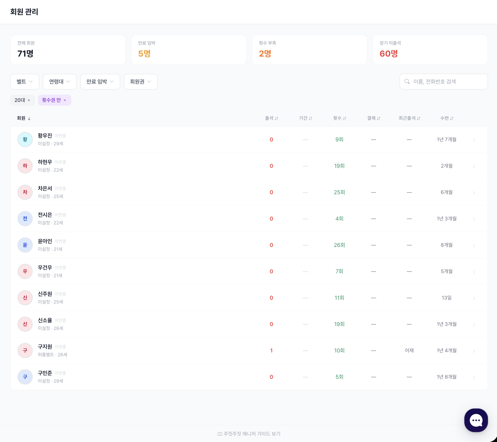

# 회원 관리

도장의 모든 회원을 조회하고 관리합니다.\
**회원 → 회원 관리** 메뉴에서 확인합니다.

---

## 회원은 어떻게 등록되나요?

| 방법 | 언제 | 바로가기 |
|---|---|---|
| **계약서 보내기** | 새 회원 한 명씩 | 회원이 서명하면 회원 목록에 자동으로 들어옵니다. → [계약서 보내기](../contracts/sending.md) |
| **회원 데이터 옮기기** | 기존 프로그램의 회원을 한 번에 | 엑셀 파일을 올려 일괄 등록 → [회원 데이터 옮기기](../data-migration.md) |

## 회원 목록

<figure><figcaption>회원 목록</figcaption></figure>

### 검색

이름이나 전화번호로 검색합니다.

### 필터

| 필터 | 선택지 |
|---|---|
| 회원 상태 | 전체 회원 · 만료 임박(7일 / 14일 / 30일 이내) · 만료 회원 · 장기 미출석 · 횟수 부족 |
| 회원권 | 기간제 · 횟수제 |
| 연령대 | 미성년자 · 성인 · 10대~50대+ |
| 벨트 | 유소년 · 성인 · 마스터 벨트 (**주짓수 도장만**) |

### 만료 임박 회원에게 알림톡 보내기

**만료 임박** 필터를 켜면 **"알림톡 발송"** 버튼이 나타납니다.\
선택한 기간 안에 만료되는 회원에게 갱신 안내 알림톡을 보냅니다. 이미 보낸 회원은 자동으로 빠집니다.


휴대폰에서는 목록이 **회원 · 30일 출석 · 남은 기간(횟수)** 세 칸으로 간단하게 보입니다. 기간이 지난 회원권은 **"만료"**로 표시됩니다.


---

## 상세 기능

- [회원 상세](detail.md): 프로필, 보호자 정보, 회원권, 계약서, 출석, 메모
- 승급: [벨트 관리 (주짓수)](../jiujitsu/belts.md) · [띠 설정 (태권도)](../taekwondo/ranks.md)
