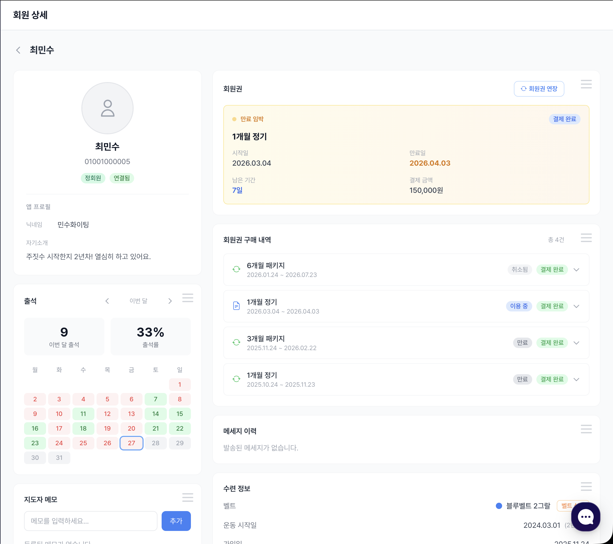

# 회원 상세

회원 목록에서 회원을 누르면 상세 화면으로 이동합니다.\
한 화면에서 회원 정보, 회원권, 승급, 출석, 메모를 관리합니다.

---

<figure><figcaption>회원 상세</figcaption></figure>

## 기본 정보

| 항목 | 설명 |
|---|---|
| 회원명 · 닉네임 | 회원 이름 |
| 연락처 | 휴대폰 번호 (키오스크 출석에 사용) |
| 생년월일 · 나이 | 계약서 서명 때 입력한 정보 |
| 가입일 | 도장에 등록된 날 |

## 보호자 정보

| 항목 | 설명 |
|---|---|
| 보호자 성명 | 미성년 회원의 보호자 |
| 보호자 전화번호 | 등·하원 알림을 받을 번호 |


**보호자 전화번호**를 넣으면 그 회원은 **키즈부 회원**이 되어 [등·하원](../kids/README.md) 화면에 나오고, 출석할 때 보호자에게 등원 알림이 갑니다.\
미성년자가 계약서에 서명하면 보호자 정보가 자동으로 채워집니다.


## 수련 정보

| 항목 | 설명 |
|---|---|
| 현재 벨트 · 띠 | 종목에 맞는 승급 단계 |
| 마지막 승급 | 최근 승급일 |
| 승급 이력 | 지금까지의 승급 기록 |
| 운동 시작일 | 직접 입력 |
| 건강/주의사항 · 부상 내용 | 수업 때 참고할 정보 |

승급은 종목별 페이지를 참고하세요. → [벨트 관리 (주짓수)](../jiujitsu/belts.md) · [승급 심사 (태권도)](../taekwondo/promotion-test.md)

## 회원권

### 현재 회원권

- **기간제**: 시작일, 종료일, 남은 기간
- **횟수제**: 총 횟수, 남은 횟수

### 회원권 구매 내역

이 회원의 회원권 구매·연장·환불 내역을 봅니다.

### 회원권 연장

**"회원권 연장"**을 누르고 회원권을 고르면 **즉시 연장**됩니다. 오프라인 결제를 마친 뒤 진행해 주세요.


회원권 연장은 [회원권 상품](../membership-plans.md)이 1개 이상 있어야 합니다.


### 환불 · 횟수 조정

- **환불**: 사용한 기간·횟수에 따라 사용 비율이 자동 계산됩니다.
- **횟수 조정**: 횟수제 회원권의 남은 횟수를 직접 늘리거나 줄입니다. 조정 사유가 함께 남습니다.

## 계약서

이 회원이 서명한 [계약서](../contracts/README.md) 목록입니다. 결제 확인과 PDF 보기를 여기서도 할 수 있습니다.

## 출석

이번 달 출석 현황을 봅니다. → [출석 통계](../attendance/stats.md)

## 메세지 이력

이 회원에게 보낸 알림톡·문자 내역입니다. → [자동 메시지](../announcements/auto-messages.md)

## 지도자 메모

회원에게는 보이지 않는 **내부 메모**입니다. 부상 이력, 특이 사항 등을 기록하세요.
