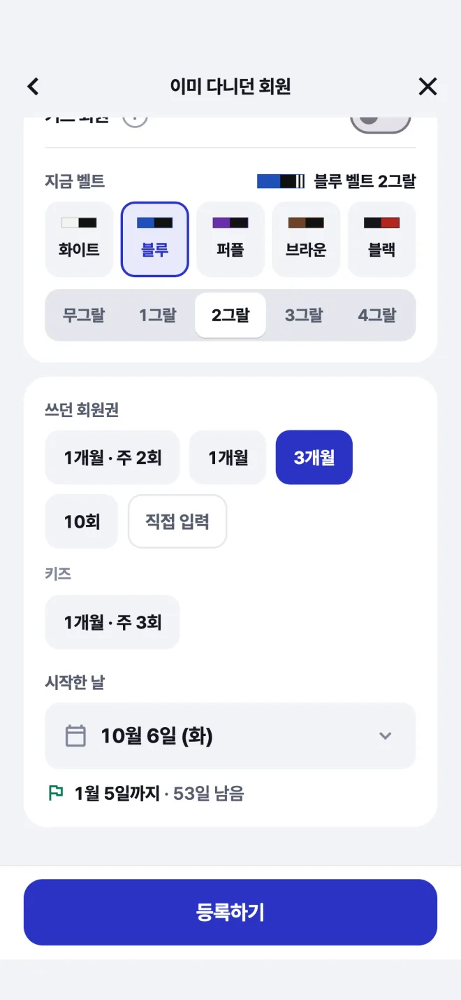
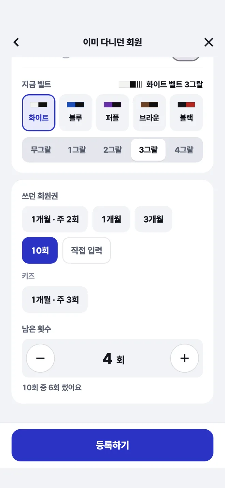

# 이미 다니던 회원 넣기

이미 다니던 회원은 주짓주짓 매니저를 쓰기 전부터 체육관에 다니던 사람이에요. 쓰던 회원권이 아직 남아 있으니 결제와 계약서는 건너뛰고, 회원권과 남은 기간(횟수권은 남은 횟수)만 넣어요. 계약서는 다음 재등록 때 받아요.


회원이 많으면 한 명씩 넣지 말고 쓰던 명단 파일을 올려 주세요. 엑셀이나 CSV 그대로 올리면 운영팀이 등록해 드려요. → [회원 옮기기](../getting-started/import-members.md)


## 기간권 회원 넣기

기간권은 **시작한 날**만 고르면 돼요. 끝나는 날은 회원권 기간으로 자동 계산돼요. 시작한 날도 하루로 세요.

> **예시** 김민준 님이 10월 6일에 3개월권을 시작했어요. 「3개월」을 고르고 시작한 날을 10월 6일로 고르면 「1월 5일까지 · 53일 남음」이 보여요.

1. **회원 등록**을 누르고 **이미 다니던 회원**을 골라요.
2. 이름과 휴대폰 번호를 넣어요. 앱에서는 **연락처**로 채울 수 있어요.
3. 주짓수 체육관이면 **지금 벨트**와 그랄을 골라요.
4. **쓰던 회원권**에서 회원권을 골라요.
5. **시작한 날**을 골라요. 아래에 끝나는 날과 남은 날이 보여요.
6. **등록하기**를 눌러요.

<figure><figcaption>
이름 · 휴대폰 · 지금 벨트
</figcaption></figure> <figure><figcaption>
시작한 날을 고르면 끝나는 날이 계산돼요
</figcaption></figure>


오늘까지 쓸 수 있는 회원권만 넣어요. 이미 끝난 회원권은 넣지 않아요. 달력에는 오늘 기준으로 아직 남아 있는 시작일만 골라져요.


## 횟수권 회원 넣기

횟수권은 **남은 횟수**만 넣어요.

> **예시** 10회권 중 6회를 쓴 회원이면 「10회」를 고르고 남은 횟수를 4회로 맞춰요. 아래에 「10회 중 6회 썼어요」가 보여요.

1. **쓰던 회원권**에서 횟수권을 골라요.
2. **−**, **+**로 남은 횟수를 맞춰요.
3. **등록하기**를 눌러요.

<figure><figcaption>
횟수권은 남은 횟수만 넣어요
</figcaption></figure>

## 목록에 없는 회원권

쓰던 회원권이 회원권 목록에 없으면 **직접 입력**을 눌러요. 회원권 이름, 기간권·횟수권, 길이(또는 횟수)를 넣고 시작한 날(또는 남은 횟수)을 골라요.

## 키즈 회원 넣기

1. **키즈 회원**을 켜요.
2. **보호자 이름**과 **보호자 휴대폰**을 넣어요.
3. 벨트는 키즈 벨트에서 골라요.

키즈 회원 회비는 쓰던 회원권의 **키즈** 묶음에 따로 보여요.

## 같은 번호가 있을 때

* 같은 사람이 이미 있으면 「이미 등록된 회원이에요」가 보이고 새로 만들지 않아요. **그 회원 보기**로 확인해요.
* 같은 번호로 다른 이름이 있으면 **가족인가요?**를 물어요. 가족이면 **가족이에요**를 눌러 따로 등록해요.

## 여러 명 이어서 넣기

등록하면 화면 위에 「○명 등록했어요」가 보이고 바로 다음 회원을 넣을 수 있어요. **방금 등록한 회원**을 누르면 이번에 넣은 회원을 모아 봐요. 다 넣었으면 **완료**를 눌러요.


이미 다니던 회원의 회원권에는 결제 기록이 없어요. 주짓주짓 매니저를 쓰기 전에 받은 돈이라 매출에도 잡히지 않아요. 다음에 재등록하면서 받은 결제부터 기록돼요.


## 관련 페이지

* [회원 등록과 회원 상세](README.md) — 오늘 처음 온 회원 등록
* [회원 옮기기](../getting-started/import-members.md) — 명단 파일로 한 번에
* [재등록](renewal.md) — 남은 기간이 끝나면
* [회원권 만들기](membership-plans.md) — 쓰던 회원권을 미리 만들어 두기
