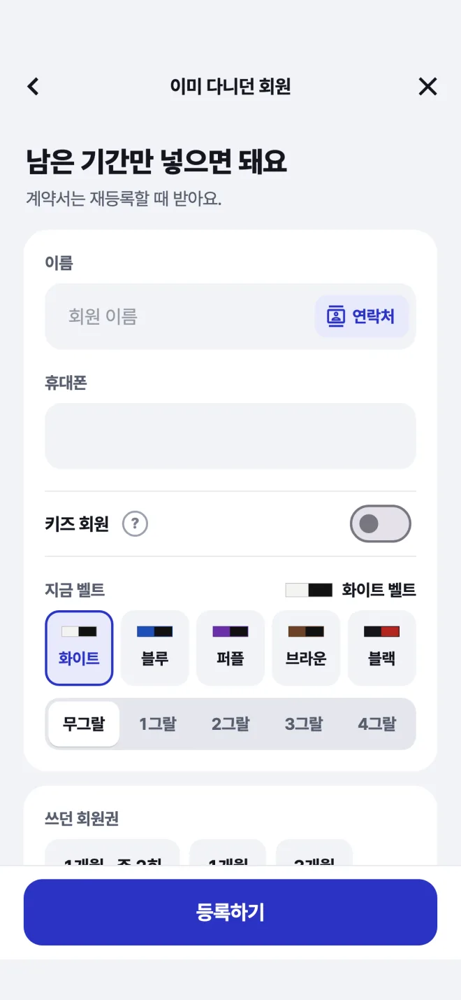

# 이미 다니던 회원 넣기

주짓주짓 매니저를 쓰기 전부터 다니던 회원은 결제와 계약서 없이 쓰던 회원권과 남은 기간(횟수)만 넣어요. 계약서는 다음 재등록 때 받아요. 회원이 많으면 [명단 파일](../getting-started/import-members.md)을 올려 주세요. 운영팀이 등록해 드려요.

**이렇게 해요**

1. **회원 등록**에서 **이미 다니던 회원**을 골라요.
2. 이름과 휴대폰 번호를 넣어요. 주짓수 체육관이면 **지금 벨트**와 그랄도 골라요.
3. **쓰던 회원권**을 골라요. 목록에 없으면 **직접 입력**을 눌러요.
4. 기간권은 **시작한 날**을 고르고, 횟수권은 **−**, **+**로 남은 횟수를 맞춰요.
5. **등록하기**를 누르고 다음 회원을 이어서 넣어요. 다 넣었으면 **완료**를 눌러요.

끝나는 날은 자동으로 계산돼요. 10월 6일에 시작한 3개월권이면 1월 5일까지예요. 이미 끝난 회원권은 넣지 않아요.

키즈 회원은 **키즈 회원**을 켜고 보호자 이름과 휴대폰을 넣어요. 같은 번호에 다른 이름이 있으면 가족인지 물어요.

<figure></figure> <figure></figure> <figure></figure>


매니저를 쓰기 전에 받은 돈이라 결제 기록이 없고 매출에도 잡히지 않아요. 재등록하면서 받은 결제부터 기록돼요.

