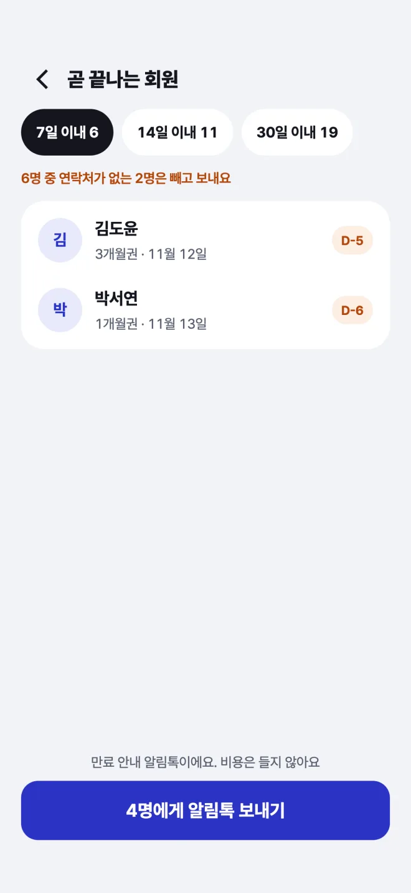

# 곧 끝나는 회원·오래 안 온 회원

그만두기 전에 먼저 연락하면 좋은 회원을 홈과 회원 목록에서 모아 보여 줘요.

| 이름 | 기준 | 보이는 곳 |
|---|---|---|
| 곧 끝나는 회원 | 기간권이 7일 안에 끝나요 | 홈, 매출, 회원 목록 |
| 횟수 얼마 안 남음 | 횟수권이 1~3회 남았어요 | 회원 목록 |
| 오래 안 온 회원 | 14일 넘게 안 왔거나 출석이 없어요 | 회원 목록 |
| 만료 | 회원권이 끝났어요 | 회원 목록 |

회원 목록 조건 버튼에서 고르고 **만료일 순**이나 **최근 출석 순**으로 정렬하면 급한 회원이 위로 와요.

## 알림톡 보내기

1. 홈의 **곧 끝나는 회원**을 눌러요. 웹은 **재등록 안내 보내기**예요.
2. 기간을 골라요.
3. **N명에게 알림톡 보내기**를 눌러요.

비용은 들지 않아요. 연락처가 없거나 같은 안내를 이미 받은 회원은 빼고 보내요.

<figure></figure>


[자동 알림톡](../contracts/auto-messages.md)을 켜면 매일 아침 알아서 보내요. 곧 끝나는 회원과 만료 당일 안내는 처음부터 켜져 있고, 오래 안 온 회원 안내는 꺼져 있어요.

