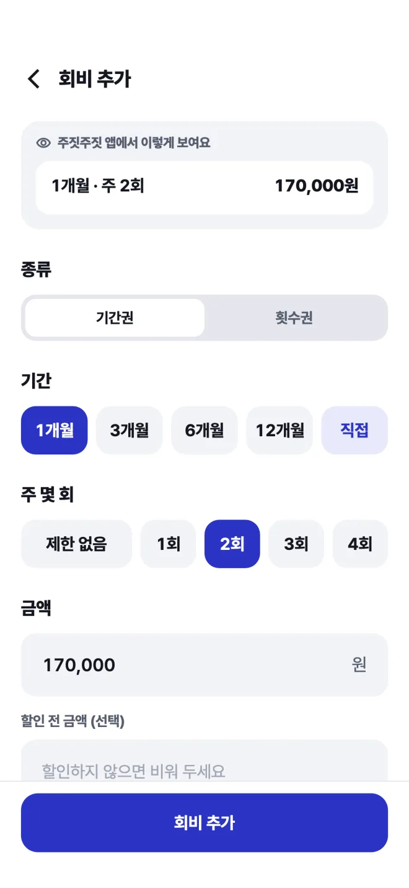
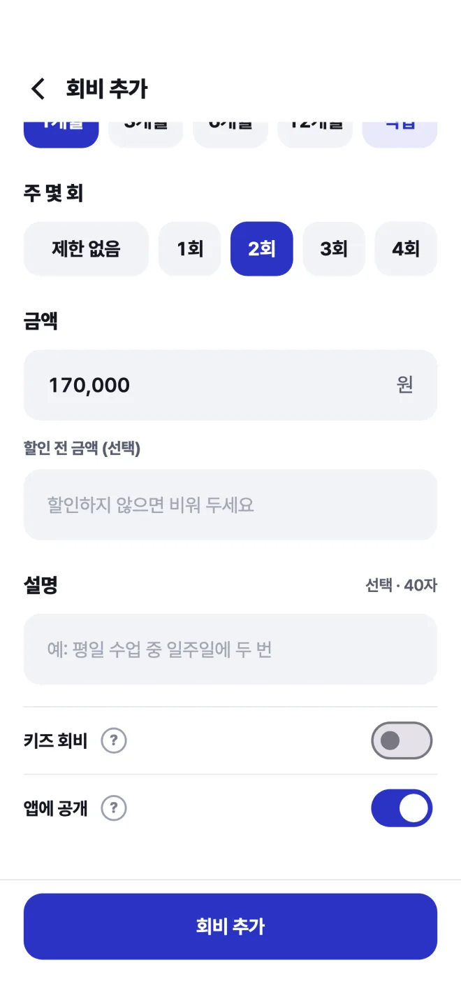
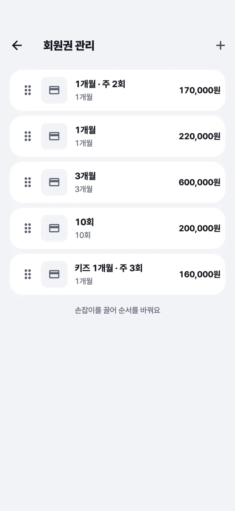

# 회원권 만들기

회원권은 체육관에서 파는 이용권이에요. 회원을 등록하거나 재등록할 때 회원권을 고르면 기간과 금액이 함께 들어가요. 만든 회원권은 주짓주짓 앱 체육관 페이지의 **회비**에도 보여요.

## 기간권과 횟수권

| 종류 | 쓰는 법 | 예시 |
|---|---|---|
| **기간권** | 시작일부터 정한 기간 동안 다녀요. 출석은 기록만 남아요 | 1개월 · 3개월 · 12개월 |
| **횟수권** | 정한 횟수만큼 다녀요. 출석할 때마다 1회씩 줄어요 | 10회 · 20회 |

종류는 만든 뒤 바꿀 수 없어요.

## 회원권 만들기

> **예시** 평일 수업 중 일주일에 두 번 오는 한 달 회비가 170,000원이에요. 「기간권 · 1개월 · 주 2회 · 170,000원」으로 만들면 주짓주짓 앱에 「1개월 · 주 2회 170,000원」으로 보여요.

1. 회원권 화면을 열어요.
   * 매니저 앱: **☰ → 회원권**, 또는 회원 탭 맨 아래 **회원권 관리**
   * 웹: **회원 → 회원권 관리**, 또는 **체육관 설정 → 회원권 관리**
2. **+**(웹은 **회원권 만들기**)를 눌러요.
3. 아래 칸을 채우고 저장해요.

| 칸 | 넣는 것 |
|---|---|
| 종류 | 기간권 또는 횟수권 |
| 기간 | 1개월 · 3개월 · 6개월 · 12개월, 또는 **직접**(일 수) |
| 횟수 | 횟수권일 때 횟수 |
| 주 몇 회 | 제한 없음 · 1~4회. 기간권만 |
| 금액 | 판매 금액 |
| 할인 전 금액 | 할인할 때만. 금액보다 커야 해요 |
| 설명 | 선택. 주짓주짓 앱에서 회비 이름 아래 보여요 |
| 키즈 회비 | 켜면 주짓주짓 앱에서 「키즈」 묶음에 따로 보여요 |
| 앱에 공개 | 끄면 주짓주짓 앱에 이 회비가 안 보여요. 회원 등록에는 그대로 써요 |

매니저 앱은 맨 위 **주짓주짓 앱에서 이렇게 보여요**에 회원이 볼 모습이 바로 바뀌어요. 이름은 따로 묻지 않고 칸으로 지어요(예: 「1개월 · 주 2회」, 「키즈 1개월」).

<figure><figcaption>
회비 추가 — 맨 위가 주짓주짓 앱 미리 보기
</figcaption></figure> <figure><figcaption>
설명 · 키즈 회비 · 앱에 공개
</figcaption></figure>


**주 몇 회**는 회원에게 보여 주기만 해요. 주 2회 회원이 세 번째로 와도 출석은 막지 않아요.


## 이름 · 계약서 · 사진 고치기

회원권을 누르고 **회원권에서 더 고치기**를 누르면 아래를 고쳐요.

* **회원권 이름**: 매니저 안에서 부르는 이름이에요. 회원 등록과 계약서에 쓰여요. 주짓주짓 앱에는 칸으로 지은 이름(「1개월 · 주 2회」)이 보여요.
* **연결할 계약서**: 이 회원권으로 등록·재등록할 때 자동으로 붙을 계약서 양식이에요. → [계약서 양식 고치기](../contracts/templates.md)
* **사진**: 회원권 사진(선택)이에요.

## 비슷한 회원권 복사하기

이미 만든 회원권과 비슷하면 **복사**를 눌러요. 원본 내용이 채워져 있어 바꿀 것만 고치면 돼요.

## 순서 바꾸기 · 지우기

* 매니저 앱은 손잡이(⠿)를 끌어 순서를 바꿔요. 웹은 **위로 · 아래로**로 옮기고 **순서 저장**을 눌러요.
* 회원권을 열고 **지우기**를 누르면 목록에서 빠져요. 이 회원권을 쓰던 회원의 기록은 그대로 남아요.

<figure><figcaption>
매니저 앱 「회원권 관리」
</figcaption></figure>


서명을 기다리는 계약서 링크가 걸린 회원권은 지울 수 없어요. 링크를 취소하거나 서명이 끝난 뒤에 지워요.


## 관련 페이지

* [회원 등록과 회원 상세](README.md) — 회원권으로 회원 등록하기
* [재등록](renewal.md) — 같은 회원권으로 다시 등록하기
* [체육관 페이지와 근처 찾기](../new-members/gym-page.md) — 회비가 보이는 곳
* [입관계약서 보내기](../contracts/sending.md) — 회원권에 붙는 계약서
