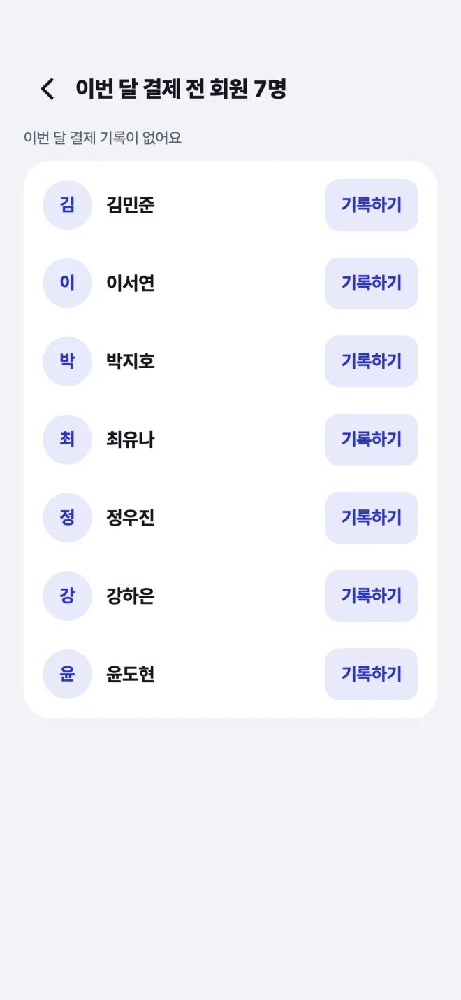

# 결제 기록과 이번 달 결제 전

결제 기록은 체육관에서 받은 회비를 주짓주짓 매니저에 적어 두는 일이에요. 돈은 쓰던 카드 단말기·계좌이체·현금으로 받고, 매니저에는 받은 날·금액·결제 수단만 남겨요. 기록한 결제가 [매출](sales.md)에 모여요.

## 결제 수단

| 결제 수단 | 언제 |
|---|---|
| **카드** | 카드 단말기로 받았을 때 |
| **계좌이체** | 체육관 계좌로 받았을 때 |
| **현금** | 현금으로 받았을 때 |

예전에 카카오페이·네이버페이로 기록한 결제는 **기타**로 보여요.

## 결제를 기록하는 곳

| 언제 | 어디서 |
|---|---|
| 새 회원 등록 | 등록 4단계 **결제는 받으셨나요?** → [회원 등록](README.md) |
| 재등록 | 재등록 화면의 **결제 완료** → [재등록](renewal.md) |
| 등록 때 아직 안 받았던 결제 | 회원 상세 맨 위 「결제 전」 카드의 **결제 기록** |
| 서명이 끝난 계약서 | 계약서의 결제 기록 → [입관계약서 보내기](../contracts/sending.md) |

### 나중에 받은 결제 기록하기

> **예시** 박서연 님을 등록하면서 「아직 안 받았어요」를 눌렀고, 사흘 뒤 계좌이체로 회비를 받았어요.

1. 회원 상세를 열어요. 맨 위에 「결제 전」 카드가 보여요.
2. **결제 기록**을 눌러요.
3. 결제 수단을 고르고, **받은 날**을 실제로 받은 날로 바꿔요.
4. **결제 완료**를 눌러요.

## 받은 날과 매출 달

* 받은 날은 오늘이 기본이고, 오늘부터 90일 전까지 고를 수 있어요.
* 매출은 받은 날이 있는 달에 잡혀요. 받은 날이 이번 달이 아니면 「10월 매출에 잡혀요」처럼 알려 줘요.

## 잘못 기록했을 때

### 결제 수단만 틀렸어요

1. **매출 → 결제 내역**에서 그 결제를 눌러요.
2. **결제 수단 바꾸기**에서 맞는 수단을 골라 저장해요.

결제를 다시 하는 게 아니라 기록만 고쳐요.

### 기록 자체가 잘못됐어요

1. 회원 상세의 결제 기록에서 그 회원권을 눌러요.
2. **기록 취소**를 누르고 취소 사유를 넣어요.

결제 기록이 지워지고 매출에서도 빠져요. 되돌릴 수 없어요.

## 환불

환불은 회원에게 돈을 돌려준 일을 기록하는 거예요. 돈은 체육관에서 직접 돌려주고, 매니저에는 금액과 사유를 남겨요.

1. 회원 상세의 결제 기록에서 환불할 회원권을 눌러요.
2. **환불**을 눌러요.
3. 이용 기간·출석·쓴 횟수와 **권장 환불 금액**을 확인해요.
4. **돌려줄 금액**과 **환불 사유**(선택)를 넣고 환불을 기록해요.


* 환불하면 그 회원권은 바로 끝나고, 되돌릴 수 없어요.
* 돌려줄 금액이 권장 환불 금액보다 적으면 「법정 기준보다 적어요」가 보여요.
* [이미 다니던 회원](existing-members.md)으로 넣은 회원권은 결제 기록이 없어 금액 없이 **0원으로 정리**만 해요.


## 이번 달 결제 전

이번 달 결제 전 회원은 **회비를 낼 때가 됐는데 이번 달 결제 기록이 없는 회원**이에요. 홈의 할 일과 매출 화면에 「이번 달 결제 전 ○명」으로 보여요.

아래를 모두 만족하면 이번 달 결제 전이에요.

1. 이번 달에 기록한 결제가 없어요.
2. 아직 쓸 수 있는 횟수권이 없어요.
3. 회원권이 지난달 1일부터 이번 달 말일 사이에 끝나요(끝났어요).

> **예시** 11월에 6개월권이 남은 회원은 세지 않아요. 아직 낼 때가 아니기 때문이에요. 11월 19일에 1개월권이 끝나고 재등록하지 않은 회원은 이번 달 결제 전이에요. 9월에 끝나고 그 뒤로 안 온 회원은 그만둔 회원으로 보고 세지 않아요.

### 이번 달 결제 전 회원 챙기기

1. 홈의 **이번 달 결제 전 회원 ○명**(또는 매출 화면의 **이번 달 결제 전 ○명**)을 눌러요.
2. 회원 옆 **기록하기**를 누르면 재등록 화면이 열려요.
3. 받은 결제를 기록하며 재등록해요. → [재등록](renewal.md)

<figure><figcaption>
이번 달 결제 전 회원
</figcaption></figure>

## 관련 페이지

* [매출](sales.md) — 기록한 결제가 모이는 곳
* [재등록](renewal.md) — 결제와 함께 다음 회원권 붙이기
* [회원 등록과 회원 상세](README.md) — 회원권마다 결제 기록 보기
