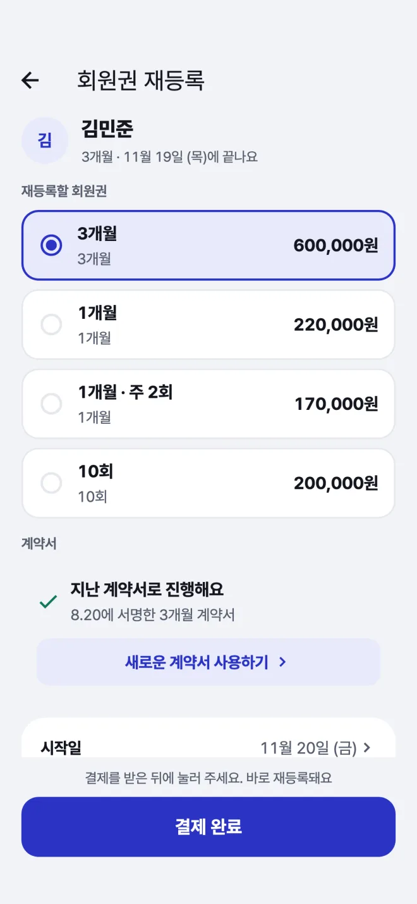
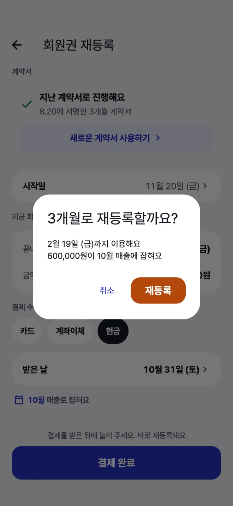

# 재등록

재등록은 지금 회원과 다음 회원권을 다시 계약하는 일이에요. 새 회원권은 지금 회원권이 끝난 다음 날부터 이어져요. 결제를 받은 뒤 누르면 결제 기록과 계약서까지 한 번에 처리돼요.


재등록하려면 회원권이 하나 이상 있어야 해요. → [회원권 만들기](membership-plans.md)


## 재등록하기

> **예시** 김민준 님의 3개월권이 11월 19일에 끝나요. 오늘 현금으로 600,000원을 받고 같은 3개월권으로 재등록하면 11월 20일부터 2월 19일까지 이어져요.

1. 회원 상세 맨 위 회원권 카드의 **재등록**을 눌러요.
2. **재등록할 회원권**을 골라요.
3. **계약서**를 확인해요. 아래 「계약서는 어떻게 되나요?」를 보세요.
4. **시작일**을 확인해요. 지금 회원권이 끝난 다음 날로 채워져 있어요.
5. **결제 수단**(카드 · 계좌이체 · 현금)과 **받은 날**을 골라요.
6. **결제 완료**를 누르고, 「○○로 재등록할까요?」에서 이용 기간과 매출에 잡히는 달을 확인한 뒤 **재등록**을 눌러요.

<figure><figcaption>
회원권 재등록
</figcaption></figure> <figure><figcaption>
누르기 전에 기간과 매출 달을 한 번 더 보여 줘요
</figcaption></figure>


결제는 받은 뒤에 눌러 주세요. 누르면 바로 재등록돼요. 아직 돈을 받지 않았으면 받은 뒤에 재등록해요.


## 시작일

지금 쓰는 기간권이 남아 있으면 끝난 다음 날부터 시작해요. 그보다 앞당길 수는 없어요. 지금 회원권이 이미 끝났으면 오늘부터 시작해요. 다른 날로 바꾸려면 **시작일**을 눌러요.

횟수권은 시작일 없이 바로 쓸 수 있어요.

## 받은 날과 매출

받은 날은 오늘이 기본이에요. 지난날에 받았으면 **받은 날**을 눌러 바꿔요. 오늘부터 90일 전까지 고를 수 있어요.

매출은 받은 날이 있는 달에 잡혀요. 10월 31일에 받은 돈을 11월에 기록해도 10월 매출이에요. 받은 날이 이번 달이 아니면 「10월 매출로 잡혀요」처럼 알려 줘요.

## 계약서는 어떻게 되나요?

| 경우 | 계약서 |
|---|---|
| 지난번과 회원권·가격이 같아요 | **지난 계약서로 진행해요**. 새로 서명받지 않아요. 새로 받으려면 **새로운 계약서 사용하기** |
| 회원권이나 가격이 달라요 | 새 계약서를 받아요. **카카오톡으로 보내기** · **지금 여기서 서명** · **이번엔 계약서 없이** 중에서 골라요 |
| 계약서 양식이나 관장 서명이 없어요 | 계약서 없이 재등록해요 |

새 계약서를 고르면 버튼이 **결제 완료하고 카톡 보내기** 또는 **결제 완료하고 서명 받기**로 바뀌어요. → [입관계약서 보내기](../contracts/sending.md)

## 곧 끝나는 회원에게 먼저 알리기

재등록할 때가 된 회원에게 알림톡으로 먼저 알릴 수 있어요. 한 명씩 보내지 않아도 매일 자동으로 가게 할 수도 있어요.

* 한 번에 보내기: [곧 끝나는 회원·오래 안 온 회원](expiring.md)
* 자동으로 보내기: [자동 알림톡](../contracts/auto-messages.md)

## 관련 페이지

* [회원 등록과 회원 상세](README.md) — 회원권 카드와 결제 기록
* [결제 기록과 이번 달 결제 전](payments.md) — 결제를 나중에 기록하거나 고칠 때
* [매출](sales.md) — 재등록한 금액이 잡히는 곳
