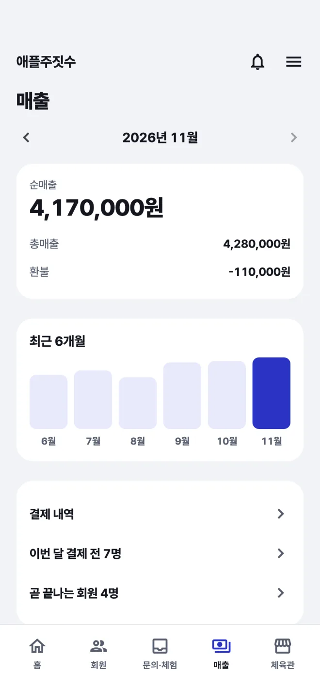
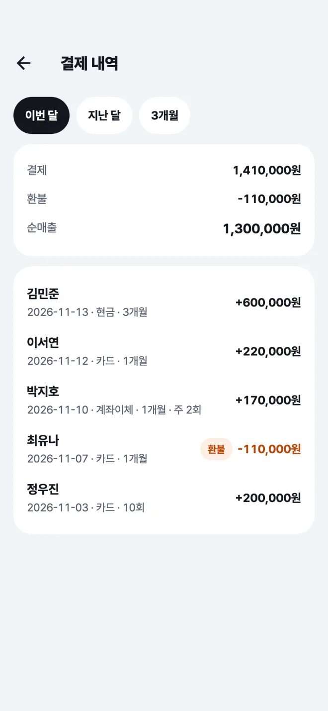

# 매출

매출은 기록한 결제와 환불을 달마다 모아 보여 주는 곳이에요. 순매출은 그 달 결제 금액에서 환불 금액을 뺀 돈이에요. 매니저 앱은 **매출** 탭, 웹은 왼쪽 메뉴의 **매출**이에요.


매출에는 주짓주짓 매니저에 기록한 결제만 잡혀요. 결제는 회원 등록·재등록 때나 회원 상세에서 기록해요. → [결제 기록과 이번 달 결제 전](payments.md)


## 매출 화면

> **예시** 11월에 21건 4,280,000원을 받고 1건 110,000원을 환불했어요. 매출 화면에는 순매출 4,170,000원, 총매출 4,280,000원, 환불 −110,000원이 보여요.

| 칸 | 보이는 것 |
|---|---|
| 순매출 | 그 달 결제 금액 − 환불 금액. 환불이 있으면 총매출과 환불을 나눠 보여 줘요 |
| 최근 6개월 | 달마다 순매출 막대. 보고 있는 달이 진하게 보여요 |
| 결제 내역 | 결제·환불 기록 전체 |
| 이번 달 결제 전 ○명 | 회비를 낼 때가 됐는데 이번 달 결제 기록이 없는 회원. 있을 때만 보여요 |
| 곧 끝나는 회원 ○명 | 7일 안에 회원권이 끝나는 회원. 있을 때만 보여요 |

위쪽 **‹ ›**로 지난달을 봐요. 다음 달로는 이번 달까지만 가요.

<figure><figcaption>
매니저 앱 매출 탭
</figcaption></figure>

## 결제 내역

결제 내역은 결제와 환불 기록을 날짜순으로 모은 목록이에요. 위쪽에 결제·환불·순매출 합계가 보여요.

1. 매출 화면에서 **결제 내역**을 눌러요. 매니저 앱은 **☰ → 결제 내역**으로도 들어가요.
2. 기간을 골라요. **이번 달 · 지난 달 · 3개월**, 웹은 시작일과 종료일을 직접 정할 수도 있어요.
3. 웹은 **전체 · 결제 · 환불**로 종류를 좁혀요.

<figure><figcaption>
결제 내역
</figcaption></figure>

### 엑셀로 받기

웹 결제 내역의 **엑셀로 받기**를 누르면 지금 조회한 결제 내역을 엑셀(XLSX)로 내려받아요. 세무·회계 자료로 쓰면 돼요.


엑셀 내려받기는 웹에서만 돼요. iPhone 앱에서는 PC나 휴대폰 브라우저로 [manager.thisisbjj.com](https://manager.thisisbjj.com)에 들어가 받아요.


## 결제 상세

결제 내역에서 한 건을 누르면 그 결제를 한 화면에서 봐요.

| 칸 | 내용 |
|---|---|
| 결제 정보 | 회원, 회원권, 금액, 결제 수단, 결제일 |
| 이용 정보 | 기간, 남은 기간 또는 쓴 횟수, 출석, 이용률 |
| 환불 정보 | 환불 금액, 환불일, 사유, 처리자 (환불한 경우만) |

* **결제 수단 바꾸기**: 카드·계좌이체·현금 중 잘못 기록한 수단을 고쳐요. 기록만 바뀌어요.
* **계약서 보기**: 이 결제에 붙은 계약서를 열어요.
* **회원 보기**: 회원 상세로 가요.

## 관련 페이지

* [결제 기록과 이번 달 결제 전](payments.md) — 결제 기록, 기록 취소, 환불
* [재등록](renewal.md) — 재등록한 결제가 잡히는 달
* [곧 끝나는 회원·오래 안 온 회원](expiring.md) — 매출 화면의 곧 끝나는 회원
