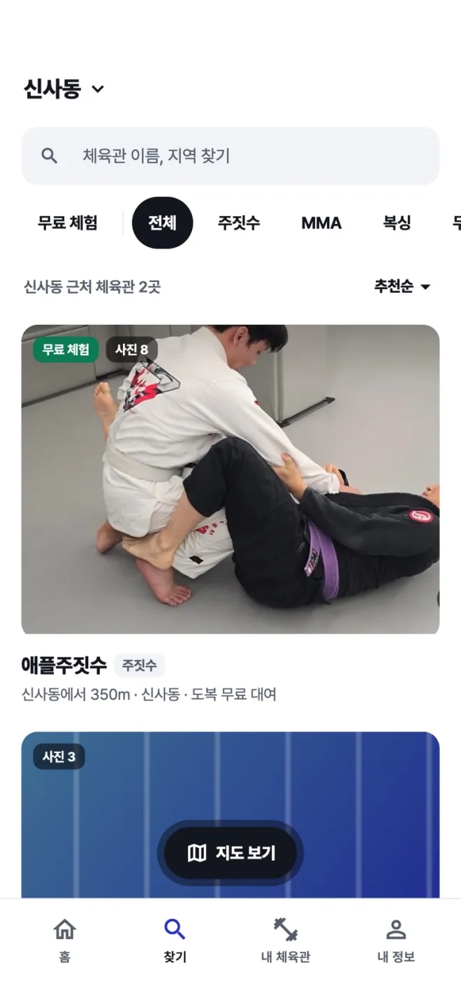
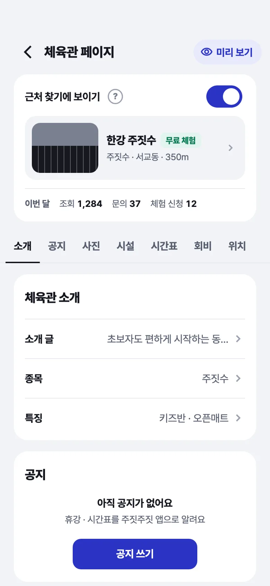

# 체육관 페이지와 근처 찾기

주소를 넣으면 주짓주짓 앱 근처 찾기에 보이고, 누르면 체육관 페이지가 열려요. 둘 다 무료예요.

<figure><figcaption></figcaption></figure>

## 근처 찾기에 보이기

처음부터 켜져 있어요. 매니저 앱 **체육관** 탭의 **정보 수정** 맨 위 스위치로 끄고 켜요. 끄면 찾기와 지도에서 바로 빠지고 새 체험 신청도 받지 않아요. 이미 잡힌 예약은 그대로예요.

무료 체험을 받는 체육관은 상위 노출되고 **무료 체험** 배지가 붙어요. 운동 사진이 있으면 더 잘 보여요.

## 이렇게 채워요

1. 매니저 앱 **체육관** 탭에서 **정보 수정**을 눌러요. 웹은 **체육관** 메뉴의 **체육관 페이지**예요.
2. 소개, 공지, 사진, 시설, 시간표, 회비, 위치를 차례로 채워요. 항목마다 따로 저장돼요.
3. **미리 보기**로 회원에게 보이는 모습을 확인해요. 웹은 오른쪽에 바로 보여요.

<figure><figcaption></figcaption></figure>

* 소개 글은 2,000자까지 쓰고, 키즈반, 여성반, 오픈매트 같은 특징을 골라요.
* 회비는 **앱에 공개**를 켠 것만 가격이 보여요. [회원권 만들기](../members/membership-plans.md)
* 사진은 [사진 올리기](photos.md), 시간표는 [시간표](../attendance/timetable.md)를 보세요.

## 문의 받는 방법

**위치**의 **연락처**에서 전화번호나 카카오톡 채널, 오픈채팅 주소를 넣고 보이기 스위치를 켜요. 둘 다 켜면 **먼저 보일 문의 방법**을 골라요.


체험 예약은 [사업자 인증](business-verification.md)을 마친 체육관만 받아요. 인증 전에도 근처 찾기에는 보여요.

