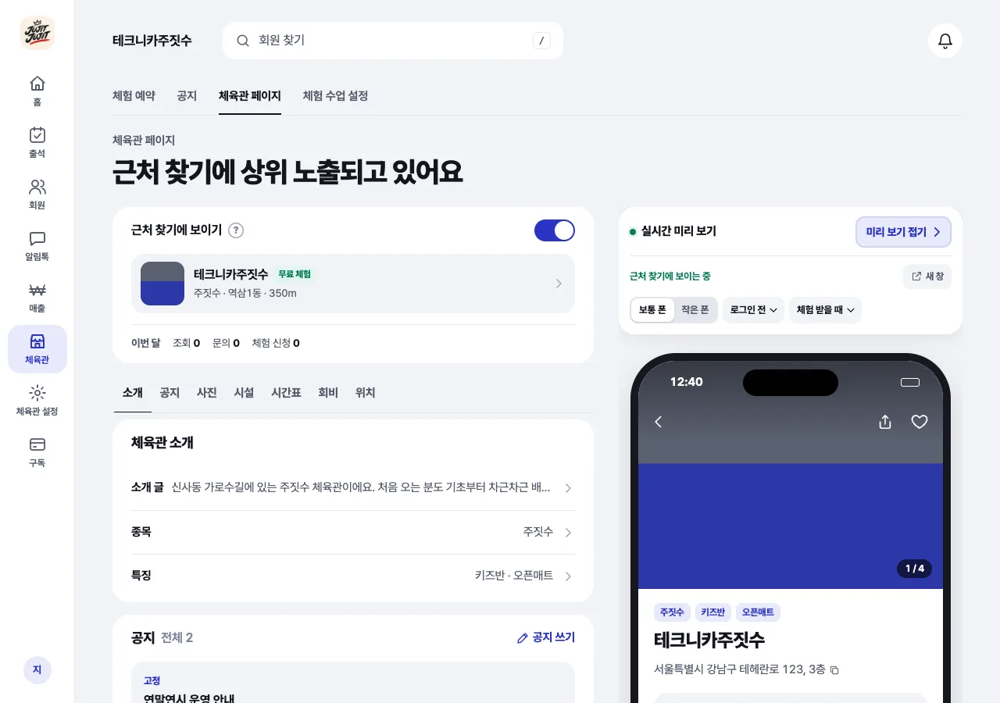
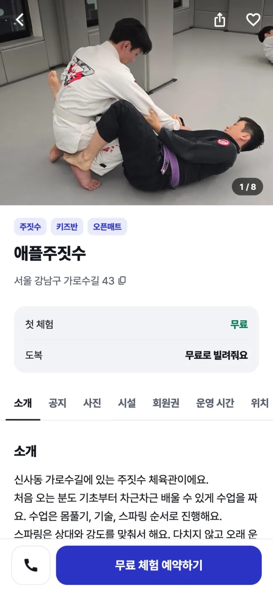

# 체육관 페이지와 근처 찾기

체육관 페이지는 주짓주짓 앱에서 회원이 보는 우리 체육관 소개 화면이에요. 근처 찾기는 주짓주짓 앱에서 내 주변 체육관을 보여 주는 목록이고요. 체육관을 등록하고 주소를 넣으면 근처 찾기에 보이고, 누르면 체육관 페이지가 열려요. 둘 다 무료예요.

## 근처 찾기에 보이기

체육관을 등록하면 **근처 찾기에 보이기**가 처음부터 켜져 있어요. 주소가 있어야 보이고, 주소가 없으면 「주소를 넣어야 보여요」라고 나와요.


예시 · 신사동에서 근처 체육관을 찾으면 「애플주짓수 · 신사동에서 350m · 도복 무료 대여」처럼 거리와 함께 보여요.


<figure><figcaption>
주짓주짓 앱 「찾기」 화면. 1번 사진이 목록 카드가 돼요.
</figcaption></figure>

### 켜고 끄는 법

1. 매니저 앱은 **체육관** 탭 → **정보 수정**, 웹은 **체육관 → 체육관 페이지**로 가요. **체육관 설정**의 「주짓주짓 앱」 묶음에도 같은 스위치가 있어요.
2. 맨 위 **근처 찾기에 보이기** 스위치를 켜거나 꺼요. 누르는 즉시 저장돼요.
3. 끄면 주짓주짓 앱의 찾기·지도에서 바로 빠져요. 웹에서는 「이제 근처 찾기에 안 보여요」 옆 **되돌리기**로 바로 되돌릴 수 있어요.


숨긴 동안에는 새 체험 신청을 받지 않아요. 이미 잡힌 체험 예약은 그대로예요.


## 상위 노출

근처 찾기는 기본으로 추천순이에요. **무료 체험**을 받는 체육관은 상위 노출돼요. 카드에 「무료 체험」 배지도 붙어요. 운동 사진을 올리면 더 잘 보여요.


체험 예약은 사업자 인증을 마친 체육관만 받아요. 인증 전에도 근처 찾기에는 보여요. → [사업자 인증](business-verification.md)


## 체육관 페이지 채우기

체육관 페이지는 항목마다 따로 저장돼요. 한 번에 다 채우지 않아도 돼요. 웹에서는 고치는 대로 오른쪽 **미리 보기**에 주짓주짓 앱 모습이 바로 보여요. 매니저 앱은 **체육관** 탭의 **미리 보기**로 봐요.

| 항목 | 넣는 것 | 예시 |
| --- | --- | --- |
| 소개 | 소개 글(2,000자까지), 종목(여러 개), 특징(키즈반·여성반·오픈매트) | 「처음 오는 분도 기초부터 차근차근 배울 수 있게 수업을 짜요.」 |
| 공지 | 주짓주짓 앱 게시판에 올리는 글. 맨 위에 고정할 수 있어요 | 연말연시 운영 안내 |
| 사진 | 운동 사진. 대표는 3장까지 | 스파링, 기술 수업 |
| 시설 | 시설 사진과 이름표, 소개 이미지 | 매트 존, 샤워실 |
| 시간표 | 요일별 수업. 체험 받는 칸을 함께 정해요 | 월·수·금 19:30 일반 |
| 회비 | 기간과 금액. 회비마다 앱에 공개할지 정해요 | 1개월 150,000원 |
| 위치 | 주소, 상세 주소, 문의 방법 | 서울 강남구 가로수길 43, 3층 |

<figure><figcaption>
웹 「체육관 → 체육관 페이지」. 왼쪽에서 고치면 오른쪽 미리 보기가 바뀌어요.
</figcaption></figure>

<figure><figcaption>
매니저 앱 「체육관 → 정보 수정」. 소개·공지·사진·시설·시간표·회비·위치 순서로 고쳐요.
</figcaption></figure>

<figure><figcaption>
회원이 보는 체육관 페이지. 회비를 공개하지 않으면 가격은 보이지 않아요.
</figcaption></figure>

### 회비 공개

회비는 체육관에서 파는 회원권이에요. 체육관 페이지의 **회비**에서 **회비 추가**로 기간과 금액을 넣고, 회비마다 **앱에 공개** 스위치를 켜요. 공개한 회비가 하나도 없으면 「공개한 회비가 없어 주짓주짓 앱에 가격이 안 보여요」가 나와요. → [회원권 만들기](../members/membership-plans.md)

## 사진 올리기

사진은 정해진 비율로 잘라 올리고, 가로 1080px로 맞춰 올라가요. 1번 사진이 근처 찾기 목록 카드가 되고, 대표 사진은 3장까지 맨 위에 보여요. 로고를 넣으면 1번 사진 위에 보여요.

→ 자세한 방법은 [사진 올리기](photos.md)

## 문의 받는 방법

체육관 페이지 아래 문의 버튼에 쓰는 연락처예요. 전화와 카카오톡 중 고르고, 둘 다 켜면 **먼저 보일 문의 방법**을 정해요.

| 방법 | 넣는 것 |
| --- | --- |
| 전화 | 체육관 전화번호. **전화번호 보이기**를 켜요 |
| 카카오톡 | 카카오톡 채널(pf.kakao.com)이나 오픈채팅(open.kakao.com) 주소. **카카오톡 보이기**를 켜요 |

1. **위치**의 **연락처**를 눌러요.
2. 전화번호나 카카오톡 주소를 넣고 보이기 스위치를 켜요.
3. 둘 다 켰다면 **먼저 보일 문의 방법**에서 전화나 카카오톡을 골라 저장해요.

## 들어온 문의와 체험 신청 보기

매니저 앱 **문의·체험** 탭에 답할 체험 신청과 오늘 오는 사람이 모여요. **이번 달 흐름**에서 조회 → 문의 → 체험 신청 → 등록 수를 한 줄로 봐요.


예시 · 이번 달 조회 1,284 · 문의 37 · 체험 신청 12 · 등록 3. 「체험 온 7명 중 3명이 등록했어요」.


<figure><figcaption>
매니저 앱 「문의·체험」 탭
</figcaption></figure>


체험 신청은 수업 시작 전까지 **확정**이나 **거절**을 눌러 주세요. 답하지 않으면 자동으로 닫혀요.


## 관련 페이지

* [체험 수업 받기](trial-classes.md) · 체험 받을 수업, 체험료, 도복 대여
* [문의·체험 신청 답하기](inquiries.md) · 확정, 거절, 오늘 오는 사람
* [사업자 인증](business-verification.md) · 체험 예약을 받으려면
* [시간표](../attendance/timetable.md) · 수업과 체험 칸 넣기
* [공지 (주짓주짓 앱)](../contracts/notices.md)
