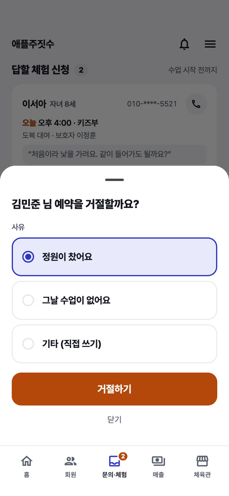

# 문의·체험 신청 답하기

**문의·체험**은 주짓주짓 앱에서 우리 체육관을 찾은 사람이 남긴 체험 신청과 문의를 모아 보는 화면이에요. 체험 신청이 오면 수업 시작 전까지 확정하거나 거절하고, 수업이 끝나면 왔는지와 등록했는지를 표시해요. 매니저 앱은 가운데 **문의·체험** 탭, 웹은 왼쪽 메뉴 **문의·체험**이에요. 관리 시작 전에도 무료로 써요.

<figure><figcaption>
매니저 앱 「문의·체험」 탭. 탭에 붙은 숫자는 답할 체험 신청 수예요.
</figcaption></figure>

## 화면에 모이는 것

| 묶음 | 보이는 것 | 할 일 |
| --- | --- | --- |
| 답할 체험 신청 | 새로 들어온 신청 | **거절** 또는 **확정** |
| 오늘 오는 사람 | 오늘 확정한 체험 | 전화, 오면 맞이하기 |
| 체험 끝난 사람 | 수업이 끝난 체험 | 「왔나요?」 → **안 왔어요** / **왔어요**, 「등록했나요?」 → **다음에** / **등록했어요** |
| 이번 달 흐름 | 조회 → 문의 → 체험 신청 → 등록 수 | 등록까지 이어진 비율 보기 |

신청 카드에는 이름, 본인인지 자녀인지(자녀면 나이와 보호자 이름), 날짜·시간·수업, 도복 대여 여부, 남긴 말이 보여요. 전화 버튼을 누르면 바로 전화해요. 웹에서는 번호를 복사할 수 있어요.


예시 · 「김민수 · 본인 · 11월 18일 (수) 오전 11:00 · 일반 · 도복 대여 · “주짓수 처음이에요”」 신청이 오면 수업 시작 전까지 **확정**을 눌러요.


## 확정하기

1. **답할 체험 신청**에서 신청을 확인해요.
2. **확정**을 눌러요. 「○○ 님 예약을 확정했어요」가 나와요.
3. 확정한 체험은 그날 **오늘 오는 사람**에 보여요.


수업 시작 전까지 답하지 않으면 신청이 자동으로 닫혀요. 새 신청이 오면 알림으로 알려 드려요.


## 거절하기

1. **거절**을 눌러요.
2. 사유를 골라요: **정원이 찼어요**, **그날 수업이 없어요**, **기타 (직접 쓰기)**.
3. **거절하기**를 눌러요. 고른 사유가 신청한 사람에게 그대로 알림으로 가요.

<figure><figcaption>
거절 사유는 신청한 사람에게 그대로 가요.
</figcaption></figure>

이미 확정한 다른 날 예약은 **⋯ → 예약 취소하기**로 취소해요. 사유를 고르는 방법은 거절과 같아요.

## 체험 뒤 표시하기

수업이 끝나면 **체험 끝난 사람**에 「왔나요?」가 나와요.

1. 왔으면 **왔어요**, 오지 않았으면 **안 왔어요**를 눌러요. 수업 뒤 7일 안에 표시할 수 있어요.
2. 왔다면 「등록했나요?」가 이어서 나와요. 등록했으면 **등록했어요**, 아니면 **다음에**를 눌러요.
3. **회원으로 등록**을 누르면 이름과 번호가 채워진 채로 회원 등록 화면이 열려요. 이미 회원이면 **회원 보기**가 보여요.

등록까지 표시하면 **이번 달 흐름**의 「체험 온 ○명 중 ○명이 등록했어요」에 반영돼요.

<figure><figcaption>
웹 「문의·체험」. 오른쪽에 이번 달 흐름과 체험 수업 설정·문의 받는 연락처가 보여요.
</figcaption></figure>

## 모든 체험 예약

**모든 체험 예약**에서 지난 예약까지 모두 봐요. **확인 필요**, **다가오는**, **지난 예약**으로 나뉘어 있어요.

| 표시 | 뜻 |
| --- | --- |
| 확정 | 확정한 예약 |
| 왔어요 / 안 왔어요 | 체험 뒤 표시한 결과 |
| 회원이 됐어요 | 왔고, 등록까지 했어요 |
| 거절 · 사유 | 거절한 예약과 사유 |
| 회원 취소 | 신청한 사람이 취소했어요 |
| 응답 없이 지남 | 수업 시작 전까지 답하지 않아 닫혔어요 |

## 체험 신청이 오지 않을 때

화면 맨 위 문장이 이유를 알려 줘요.

* 「사업자 인증을 마치면 체험 예약을 받아요」 → [사업자 인증](business-verification.md)
* 「주소를 넣어야 근처 찾기에 보여요」 → [체육관 페이지와 근처 찾기](gym-page.md)
* 「체험 수업 시간을 넣어 주세요」 → [체험 수업 받기](trial-classes.md)
* 「체험 예약을 받지 않고 있어요」 → **체육관 설정**에서 체험 예약 받기를 켜요

## 관련 페이지

* [체험 수업 받기](trial-classes.md)
* [회원 등록과 회원 상세](../members/README.md)
* [체육관 페이지와 근처 찾기](gym-page.md)
