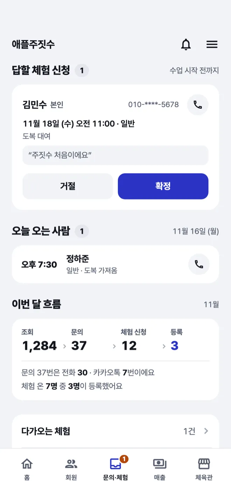

# 문의·체험 신청 답하기

체험 신청이 오면 수업 시작 전까지 확정하거나 거절해요. 매니저 앱 **문의·체험** 탭에 모이고, 관리 시작 전에도 무료예요.

<figure><figcaption></figcaption></figure>

## 이렇게 해요

1. **답할 체험 신청**에서 **확정**이나 **거절**을 눌러요.
2. 거절하면 사유를 골라요. 사유는 신청한 사람에게 그대로 가요.
3. 수업이 끝나면 **왔어요**나 **안 왔어요**를 눌러요. 7일 안에 표시해요.
4. 등록했다면 **등록했어요**를 누르고 **회원으로 등록**으로 이어서 넣어요.


수업 시작 전까지 답하지 않으면 신청이 자동으로 닫혀요.


확정한 예약을 취소하려면 예약의 더보기 메뉴에서 **예약 취소하기**를 눌러요.

**이번 달 흐름**에서 조회, 문의, 체험 신청, 등록 수를 한 줄로 봐요. 지난 예약은 **모든 체험 예약**에 있어요.

## 체험 신청이 오지 않을 때

화면 맨 위 문장이 이유를 알려 줘요. 사업자 인증, 주소, 체험 수업 시간, **체험 예약 받기** 중 빠진 것을 채워요. [체험 수업 받기](trial-classes.md)
