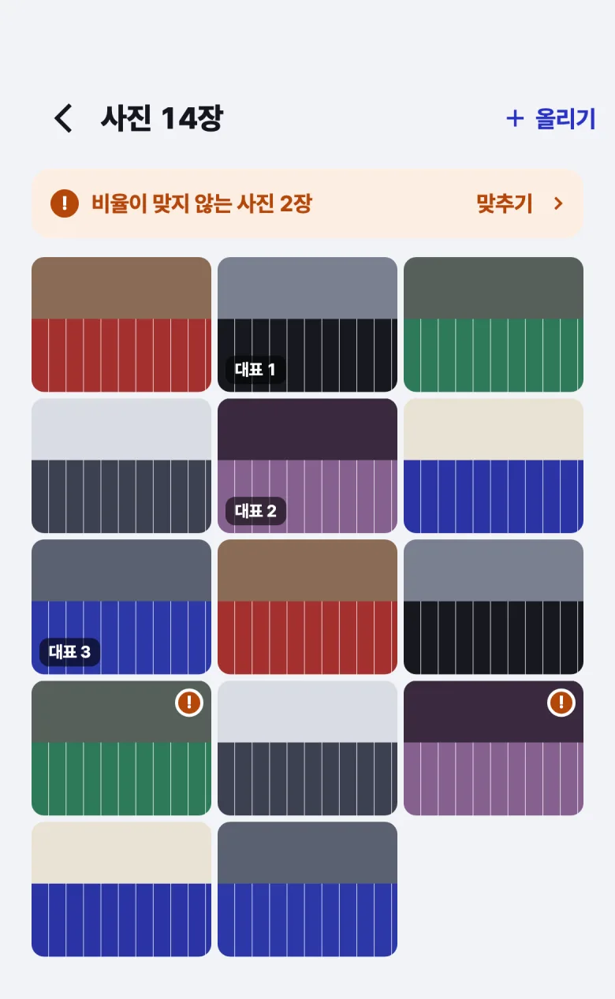

# 사진 올리기

모든 사진은 정해진 비율로 잘라 가로 1080px로 올라가요. 대표 1번 사진이 근처 찾기 목록 카드가 돼요.

## 이렇게 해요

1. 매니저 앱 **체육관** 탭의 **정보 수정**에서 **사진**을 열어요.
2. **올리기**를 눌러 사진을 고르고 자를 부분을 맞춰요.
3. 회원 공개 동의 확인에 체크하고 **올리기**를 눌러요.

<figure><figcaption></figcaption></figure>

사진을 누르면 **대표로 올리기**, **다시 자르기**, **지우기** 같은 메뉴가 나와요. 대표는 3장까지이고 끌어서 순서를 바꿔요.

## 사진 종류

| 종류 | 최대 | 보이는 곳 |
| --- | --- | --- |
| 사진 | 300장, 한 번에 30장 | 사진, 대표 3장은 맨 위 |
| 시설 사진 | 20장, 사진마다 이름표 | 시설 |
| 소개 이미지 | 10장, 세로 6000px까지 | 시설 |

로고는 **체육관 설정**의 **체육관 정보**에서 넣고, 1번 사진 위에 보여요.


회원 얼굴이 나온 사진은 꼭 동의를 받고 올려 주세요.

