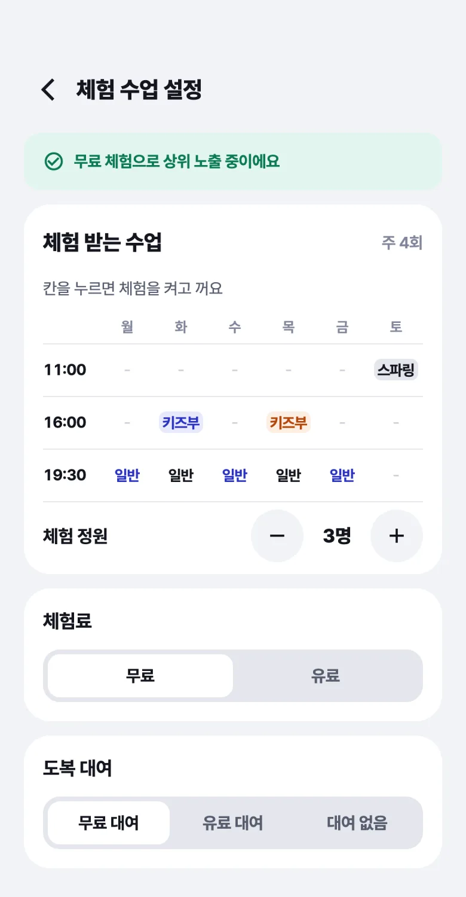

# 체험 수업 받기

체험 수업은 처음 오는 사람이 등록 전에 한 번 들어 보는 수업이에요. 주짓주짓 앱에서 우리 체육관을 찾은 사람이 체육관 페이지에서 바로 체험을 예약해요. 관장님은 **체험 수업 설정**에서 체험 받을 수업과 정원, 체험료, 도복 대여를 정해요. 체험을 받는 데 드는 돈은 없어요.

## 체험 예약을 받으려면

아래가 모두 갖춰져야 예약 버튼이 열려요.

| 조건 | 어디서 |
| --- | --- |
| 사업자 인증을 마쳤어요 | [사업자 인증](business-verification.md) |
| 근처 찾기에 보이기가 켜져 있어요 | [체육관 페이지와 근처 찾기](gym-page.md) |
| 체험 예약 받기가 켜져 있어요 | **체육관 설정 → 주짓주짓 앱 → 체험 예약 받기** |
| 체험 받는 수업이 하나 이상 있어요 | 아래 「체험 받을 수업 고르기」 |

조건이 빠져 있으면 체험 수업 설정 맨 위에 「체험 시간이 없어 예약을 받지 않아요」, 「인증하면 체험 예약을 받아요」처럼 무엇이 빠졌는지 나와요.

## 체험 받을 수업 고르기

체험은 시간표의 수업 칸에서 골라요. 시간표가 비어 있으면 먼저 **시간표 만들기**로 수업을 넣어요. → [시간표](../attendance/timetable.md)

1. 매니저 앱은 **체육관** 탭 → **체험 수업 설정**, 웹은 **체육관 → 체험 수업 설정**으로 가요.
2. **체험 받는 수업** 표에서 체험을 받을 칸을 눌러요. 다시 누르면 꺼져요.
3. **체험 정원**에서 한 수업에 받을 체험 인원을 정해요.


예시 · 월·수·금 19:30 일반 수업과 화요일 16:00 키즈부를 누르면 「주 4회」로 보여요. 정원을 3명으로 두면 한 수업에 체험 3명까지 예약을 받아요.


<figure><figcaption>
매니저 앱 「체험 수업 설정」. 파란 칸이 체험을 받는 수업이에요.
</figcaption></figure>


시간표에서 수업 시작 시간을 옮기면 그 수업에 잡힌 체험 예약도 함께 옮겨지고, 예약한 사람에게 알림이 가요. → [시간표](../attendance/timetable.md)


## 체험료

| 고르는 것 | 어떻게 보이나요 |
| --- | --- |
| **무료** | 근처 찾기에서 상위 노출되고 「무료 체험」 배지가 붙어요. 예약 버튼은 「무료 체험 예약하기」예요 |
| **유료** | 넣은 금액을 현장에서 받아요. 1,000원부터 100만 원까지 넣을 수 있어요. 예약 버튼은 「체험 예약하기」예요 |

체험료를 유료에서 무료로 바꾸면 「무료로 바꾸면 상위 노출돼요」가 보여요.

## 도복 대여

도복을 입는 수업에 체험을 받으면 **도복 대여**가 나와요.

| 고르는 것 | 체험하는 사람에게 보이는 말 |
| --- | --- |
| 무료 대여 | 무료로 빌려줘요 |
| 유료 대여 | ○원에 빌려줘요(현장 결제). 10만 원까지 넣을 수 있어요 |
| 대여 없음 | 직접 가져와 주세요 |

웹 체험 수업 설정 오른쪽 「주짓주짓 앱에서 이렇게 보여요」에서 체험료·도복 안내와 예약 버튼이 어떻게 보이는지 바로 확인해요.

## 체험 예약을 잠시 멈추기

**체육관 설정 → 주짓주짓 앱 → 체험 예약 받기**를 끄면 새 예약을 받지 않아요. 체험 수업 설정 맨 위에 「체험 예약 받기가 꺼져 있어요」와 **켜기**가 보여요.

## 관련 페이지

* [문의·체험 신청 답하기](inquiries.md)
* [시간표](../attendance/timetable.md)
* [사업자 인증](business-verification.md)
* [체육관 페이지와 근처 찾기](gym-page.md)
