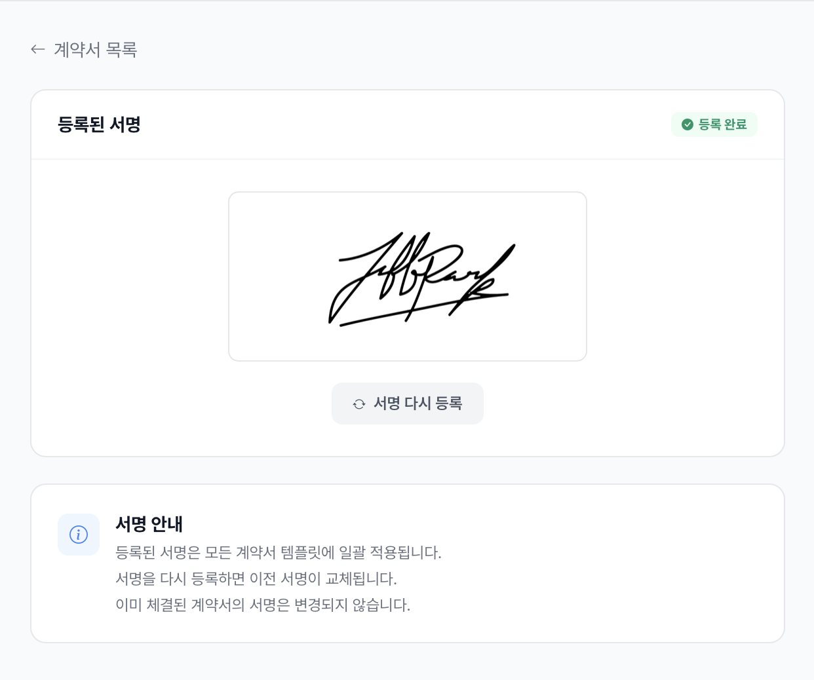

# 주요 기능 훑어보기

회원 등록부터 승급까지, 주짓주짓 매니저의 핵심 기능을 실제 운영 순서대로 소개합니다. 🥋\
어떤 종목의 체육관이든 같은 흐름으로 씁니다.

---

## 0. 3분이면 시작

1. **휴대폰 번호**로 로그인 → [로그인](getting-started/login.md)
2. **종목**을 고르고 체육관 등록 → [체육관 등록](getting-started/gym-registration.md)
3. 승인 대기 없이 바로 시작합니다. 체육관 페이지와 체험 신청은 무료이고, 관리 기능은 **"관리 시작하기"**를 누른 날부터 30일 무료입니다. → [구독 관리](subscription.md)

---

## 1. 계약서 준비

**체육관 설정 → 계약서 → 양식 추가**를 누르면 종목에 맞는 계약서 초안이 채워집니다.\
태권도 초안에는 보호자 동의·차량 이용 동의가 처음부터 들어 있습니다.

<div align="left"><figure><figcaption>기본 조항 — 이용약관, 수업 규정, 면책 규정, 개인정보 동의 등</figcaption></figure></div>

계약서 PDF에 들어갈 **관장 서명**도 미리 등록해 두세요.

<div align="left"><figure><figcaption>등록한 서명은 모든 계약서에 함께 들어갑니다</figcaption></figure></div>

→ 자세히 보기: [전자 계약서](contracts/README.md)

---

## 2. 회원 등록

### A. 오늘 처음 온 회원

회원권을 고르고 결제를 기록한 뒤, 계약서를 **카카오 알림톡**으로 보내거나 회원 휴대폰으로 **QR**을 찍어 그 자리에서 서명받습니다.\
회원은 앱 설치 없이 **휴대폰 브라우저에서 바로 서명**합니다.

<div align="center"><figure><figcaption>회원이 받는 카카오 알림톡</figcaption></figure></div>

→ 자세히 보기: [회원 관리](members/README.md) · [회원 서명 과정](contracts/signing-flow.md)

### B. 이미 다니던 회원

쓰던 회원권의 **시작한 날**(횟수권은 남은 횟수)만 넣으면 됩니다.\
회원이 많다면 쓰던 프로그램에서 내려받은 **엑셀·CSV 파일을 그대로 올리세요.** 운영팀이 확인해서 등록해 드립니다.

→ 자세히 보기: [엑셀로 회원 등록](data-migration.md)

---

## 3. 출석 키오스크

체육관 입구에 태블릿 하나만 두세요. 회원이 **휴대폰 뒷자리 4자리**를 누르면 출석이 끝납니다.

<div align="left"><figure><figcaption>뒷자리 4자리 → 본인 선택 → 출석 완료</figcaption></figure></div>

- **횟수권**은 출석할 때 1회 차감, **기간권**은 기록만 남습니다.
- **주짓수 체육관**은 벨트가 없는 회원이 출석할 때 한 번만 벨트를 직접 고르게 할 수 있습니다.

→ 자세히 보기: [출석 키오스크](attendance/kiosk.md)

---

## 4. 키즈 등·하원 알림

회원 정보에 **보호자 연락처**를 넣으면 키즈부 회원이 됩니다.\
아이가 출석하면 보호자에게 **등원 알림**이, 하원 버튼을 누르면 **하원 알림**이 알림톡으로 갑니다.

- 사범님은 휴대폰 **등·하원** 화면에서 픽업 주소를 보고 등원·하원을 처리합니다.
- 픽업 주소는 보호자가 링크로 직접 입력합니다.

→ 자세히 보기: [키즈 등·하원](kids/README.md)

---

## 5. 회원 관리 · 결제 기록

| 기능 | 설명 |
|---|---|
| 조건으로 좁히기 | 결제 전 · 곧 끝나는 회원 · 오래 안 온 회원 · 횟수 얼마 안 남음 등 |
| 재등록 안내 알림톡 | 회원권이 곧 끝나는 회원에게 한 번에 안내 |
| 재등록 · 환불 · 횟수 고치기 | 회원 상세에서 바로 처리 |
| 결제 기록 | 결제는 체육관에서 쓰던 방식대로 받고 기록만 남기기 |

→ 자세히 보기: [회원 관리](members/README.md) · [회원 상세](members/detail.md)

---

## 6. 승급식

출석 기준으로 승급 대상자를 **자동으로 뽑고**, 검토한 뒤 **한 번에 승급**합니다. 승급한 회원에게는 축하 알림톡이 갑니다.

```
만들기 → 최소 출석일 설정 → 대상자 검색 → 검토·조정 → 확정 → 승급 실행
```

| 주짓수 체육관 | 태권도 체육관 |
|---|---|
| IBJJF 벨트·그랄, IBJJF 나이 기준 | 급·품·단, 나이에 맞는 품·단 자동 제안 |
| [승급식](jiujitsu/ceremonies.md) | [승급식 (태권도)](taekwondo/promotion-test.md) · [띠 설정](taekwondo/ranks.md) |

<div align="left"><figure><figcaption>출석 기준으로 뽑힌 대상자 — 목표 벨트·띠를 개별 조정</figcaption></figure></div>

---

## 7. 매출

- **매출**: 이번 달 순매출, 월별 추이, 환불률, 이번 달 결제 전 회원
- **결제 내역**: 결제·환불 기록 조회, 결제 수단 고치기, 엑셀로 받기

→ 자세히 보기: [매출](settlement.md)

---

궁금한 점은 [카카오톡 채널](https://pf.kakao.com/_NnxmZX)로 문의해 주세요.
