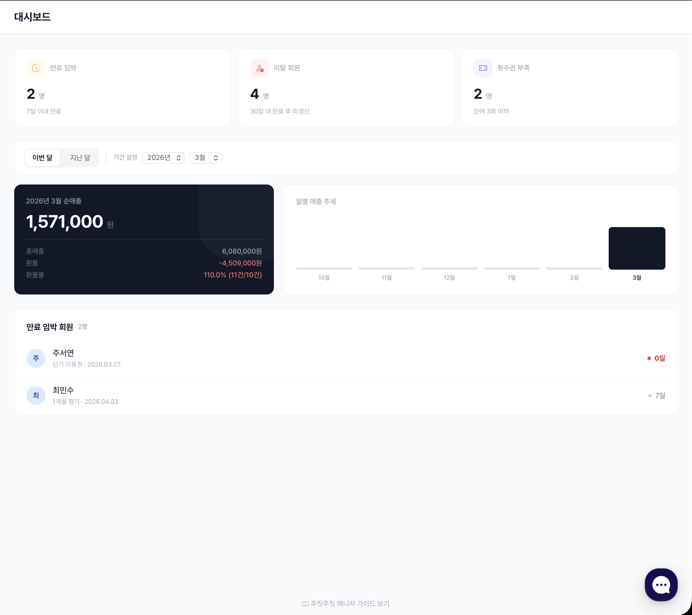

# 매출

도장의 매출과 결제 내역을 관리합니다.\
**매출 → 매출 현황 / 수납 관리** 메뉴에서 확인합니다.

---

## 매출 현황

<figure><figcaption>월별 매출 추세, 환불률, 만료 임박 회원</figcaption></figure>

| 지표 | 설명 |
|---|---|
| **이번 달 순매출** | 결제 금액에서 환불을 뺀 금액 |
| **총매출 · 환불 · 환불률** | 조회 기간의 결제·환불 금액과 비율 |
| **월별 매출 추세** | 최근 몇 달의 순매출·총매출 그래프 |
| **만료 임박 회원** | 7일 이내 만료 예정 회원 |
| **이탈 회원** | 30일 안에 만료됐는데 갱신하지 않은 회원 |
| **횟수권 부족** | 잔여 3회 이하 회원 |

**기간 설정**으로 조회 기간을 바꿀 수 있습니다.

---

## 수납 관리

<figure><figcaption>기간·상태별 결제 내역 조회와 Excel 내보내기</figcaption></figure>

모든 결제 건을 날짜순으로 봅니다. 상단에 **총 수납액 · 총 환불액 · 순매출**이 표시됩니다.

| 기능 | 설명 |
|---|---|
| 기간별 조회 | 날짜 범위를 정해 검색 |
| 상태 필터 | 납부 / 환불 / 취소 |
| 결제 수단 변경 | 카드 · 현금 · 계좌이체 · 카카오페이 · 네이버페이 · 기타 중 잘못 기록된 수단 고치기 |
| Excel 내보내기 | 환불 포함 결제 내역을 XLSX로 다운로드 (세무·회계 제출용) |

---

## 수납 상세

결제 건의 **"상세"**를 누르면 그 결제의 흐름과 정보를 한 화면에서 봅니다.

<figure><figcaption>수납 상세</figcaption></figure>

### 타임라인

| 이벤트 | 설명 |
|---|---|
| **계약 서명** | 회원이 계약서에 서명한 시점 |
| **결제 완료** | 결제가 확인된 시점, 결제 수단과 금액 |
| **이용 시작 · 이용 종료** | 회원권 이용 기간 |
| **환불 처리** | 환불 금액과 처리자 (환불한 경우만) |

### 상세 정보

| 구역 | 내용 |
|---|---|
| 결제 정보 | 회원명, 회원권, 유형(기간제/횟수제), 금액, 결제 수단, 결제일, 상태 |
| 이용 정보 | 시작일, 종료일, 총 기간, 남은 기간, 출석 횟수, 이용률 |
| 환불 정보 | 환불 금액, 환불일, 사유, 처리자 |
| 연결 정보 | **계약서 PDF 다운로드**, **회원 정보 보기** |
